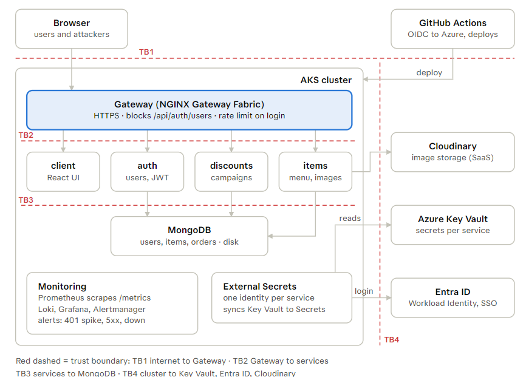
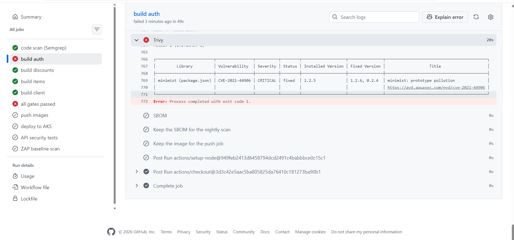
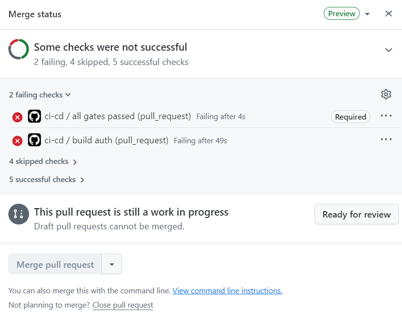
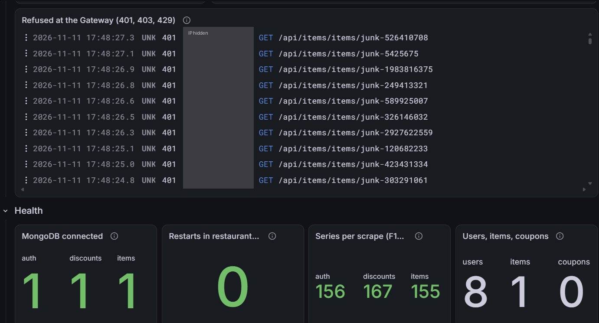
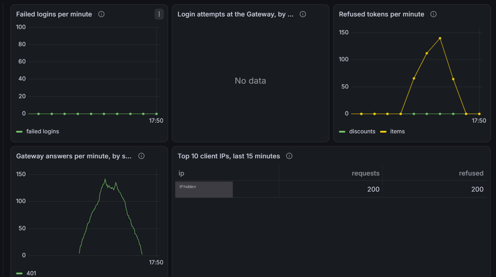
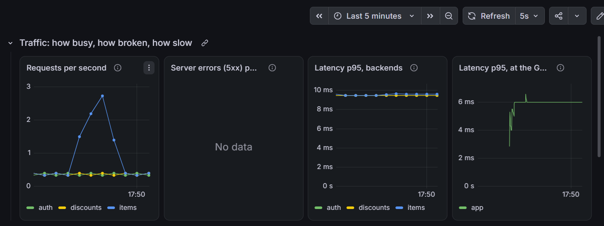
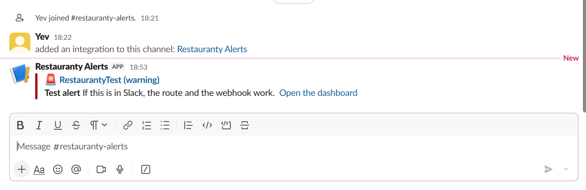
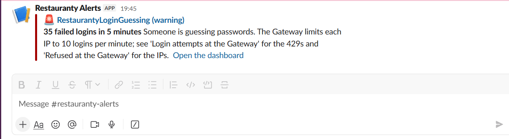

# Build log: Restauranty DevSecOps on AKS

**What this is.** A day-by-day record of what was built and why. Each entry has the goal, the commands, and the result, so the work can be followed or repeated later. It sits next to the [security assessment](security-assessment.md), which explains the problems; this log shows the fixes being built.

**How to read it.** Entries are in order. Each one starts with its result in one line. You can read any entry on its own.

**Three kinds of numbers.** They are unrelated to each other:

| Looks like | Means | Example |
| --- | --- | --- |
| `26.` at the start of a heading | An entry in this log. Entries count up through the whole log, from 1; they do not restart in each part. | 26. Before #10 |
| `#10` | An issue on GitHub: one piece of planned work | #10 = Gateway block and rate limit |
| `F6` | A finding in the [security assessment](security-assessment.md) | F6 = no limit on login attempts |

So "entry 11" (the Dockerfiles) and "issue #11" (the network rules) are different things. Headings without a number, such as "What is Trivy", explain an idea; numbered entries record work that was done.

**Parts 1 to 5 are from 9 November 2026, Parts 6 to 10 from 10 November, Parts 11 and 12 from 11 November.**

---

## Contents

- [Part 1 — assessment and code fixes](#part-1--assessment-and-code-fixes)
  - [1. Run the app locally](#1-run-the-app-locally)
  - [2. Security assessment](#2-security-assessment)
  - [3. Code fix: RS256 signing and the JWT key pair](#3-code-fix-rs256-signing-and-the-jwt-key-pair)
  - [4. Code fix: 401 instead of 500, and brief errors](#4-code-fix-401-instead-of-500-and-brief-errors)
  - [5. Code fix: one login answer](#5-code-fix-one-login-answer)
  - [6. Code fix: no password hashes, no personal data in logs](#6-code-fix-no-password-hashes-no-personal-data-in-logs)
  - [7. Code fix: a login token on every data route](#7-code-fix-a-login-token-on-every-data-route)
- [Part 2 — infrastructure](#part-2--infrastructure)
  - [8. Module: enforce NetworkPolicies with Cilium](#8-module-enforce-networkpolicies-with-cilium)
  - [9. Cluster: AKS up](#9-cluster-aks-up)
  - [10. Persistent layer: Key Vault, registry, IP, identity](#10-persistent-layer-key-vault-registry-ip-identity)
- [Findings and their fixes](#findings-and-their-fixes)
- [Part 3 — container images](#part-3--container-images)
  - [11. Hardened Dockerfiles for all four components](#11-hardened-dockerfiles-for-all-four-components)
  - [What is Trivy, and why we scan](#what-is-trivy-and-why-we-scan)
  - [The software supply chain](#the-software-supply-chain)
- [Part 4 — the app on AKS](#part-4--the-app-on-aks)
  - [12. Cluster access: image pulls and the static IP](#12-cluster-access-image-pulls-and-the-static-ip)
  - [13. DNS: the app's names point at the static IP](#13-dns-the-apps-names-point-at-the-static-ip)
  - [14. MongoDB password made URL-safe](#14-mongodb-password-made-url-safe)
  - [15. Kubernetes manifests, Gateway and HTTPS](#15-kubernetes-manifests-gateway-and-https)
  - [What was created in Part 4](#what-was-created-in-part-4)
- [Part 5 — secrets from Key Vault, one identity per service](#part-5--secrets-from-key-vault-one-identity-per-service)
  - [16. Before #8: one person copies every secret](#16-before-8-one-person-copies-every-secret)
  - [17. What #8 introduces](#17-what-8-introduces)
  - [18. Azure: one identity per workload](#18-azure-one-identity-per-workload)
  - [19. Kubernetes: External Secrets and Reloader](#19-kubernetes-external-secrets-and-reloader)
  - [What #8 creates](#what-8-creates)
- [Part 6 — network rules](#part-6--network-rules)
  - [20. Before #11: every pod can reach every pod](#20-before-11-every-pod-can-reach-every-pod)
  - [21. The rules: deny everything, then open what the app uses](#21-the-rules-deny-everything-then-open-what-the-app-uses)
  - [22. The test: assume a pod is already hacked](#22-the-test-assume-a-pod-is-already-hacked)
  - [23. Surprise: after a cluster restart, the backends lost MongoDB](#23-surprise-after-a-cluster-restart-the-backends-lost-mongodb)
  - [24. Before the rules: the attacker reaches MongoDB, the password holds](#24-before-the-rules-the-attacker-reaches-mongodb-the-password-holds)
  - [25. After the rules: every attack blocked, the app still works](#25-after-the-rules-every-attack-blocked-the-app-still-works)
  - [What #11 creates](#what-11-creates)
- [Part 7 — rules at the edge](#part-7--rules-at-the-edge)
  - [What "the edge" means](#what-the-edge-means)
  - [26. Before #10: what the code fixes left open](#26-before-10-what-the-code-fixes-left-open)
  - [27. The rules: close the user list, slow down guessing, stop floods](#27-the-rules-close-the-user-list-slow-down-guessing-stop-floods)
  - [Rate limiting: why, and how it works](#rate-limiting-why-and-how-it-works)
  - [28. Two surprises: a refused pattern and a test too slow to matter](#28-two-surprises-a-refused-pattern-and-a-test-too-slow-to-matter)
  - [29. After the rules: 11 of 11](#29-after-the-rules-11-of-11)
  - [What #10 creates](#what-10-creates)
- [Part 8 — the pipeline](#part-8--the-pipeline)
  - [What a pipeline is](#what-a-pipeline-is)
  - [How GitHub signs in to Azure: OIDC and federated identity](#how-github-signs-in-to-azure-oidc-and-federated-identity)
  - [What "azurerm" is](#what-azurerm-is)
  - [30. Azure: two identities, one to push, one to deploy](#30-azure-two-identities-one-to-push-one-to-deploy)
  - [How the pipeline reaches the cluster: the whole chain](#how-the-pipeline-reaches-the-cluster-the-whole-chain)
  - [31. GitHub: the approval gate and branch protection](#31-github-the-approval-gate-and-branch-protection)
  - [32. The workflow, part by part](#32-the-workflow-part-by-part)
  - [When the pipeline deploys, and how production teams do it](#when-the-pipeline-deploys-and-how-production-teams-do-it)
  - [33. First run: the pull request](#33-first-run-the-pull-request)
  - [34. First run on main: Entra ID refused the sign-in](#34-first-run-on-main-entra-id-refused-the-sign-in)
  - [35. First deploy by the pipeline](#35-first-deploy-by-the-pipeline)
  - [36. Proof: a run from a feature branch is refused](#36-proof-a-run-from-a-feature-branch-is-refused)
  - [What #12 creates](#what-12-creates)
- [Part 9 — security gates in the pipeline](#part-9--security-gates-in-the-pipeline)
  - [What a security gate is](#what-a-security-gate-is)
  - [The tools, one by one](#the-tools-one-by-one)
  - [Pinning: why a version tag is not enough](#pinning-why-a-version-tag-is-not-enough)
  - [37. The gates before the push](#37-the-gates-before-the-push)
  - [38. Secrets on every push: gitleaks](#38-secrets-on-every-push-gitleaks)
  - [39. First runs: three gates failed on their own setup](#39-first-runs-three-gates-failed-on-their-own-setup)
  - [40. Required checks: the gates block the merge](#40-required-checks-the-gates-block-the-merge)
  - [41. Deploy by digest, and a guard against old approvals](#41-deploy-by-digest-and-a-guard-against-old-approvals)
  - [42. After the deploy: the API tests and ZAP](#42-after-the-deploy-the-api-tests-and-zap)
  - [43. The nightly scan: are the running images still safe?](#43-the-nightly-scan-are-the-running-images-still-safe)
  - [44. Dependabot: 16 pull requests on the first day](#44-dependabot-16-pull-requests-on-the-first-day)
  - [45. Proof: the Trivy gate stops a CRITICAL, and the merge is blocked](#45-proof-the-trivy-gate-stops-a-critical-and-the-merge-is-blocked)
  - [What #13 creates](#what-13-creates)
- [Part 10 — backends recover by themselves after a cluster restart](#part-10--backends-recover-by-themselves-after-a-cluster-restart)
  - [46. Fix: a backend that cannot reach MongoDB at start exits, and Kubernetes restarts it](#46-fix-a-backend-that-cannot-reach-mongodb-at-start-exits-and-kubernetes-restarts-it)
  - [What #28 changes](#what-28-changes)
- [Part 11 — monitoring](#part-11--monitoring)
  - [How monitoring works: four questions, five tools](#how-monitoring-works-four-questions-five-tools)
  - [47. Before monitoring: what runs in the cluster](#47-before-monitoring-what-runs-in-the-cluster)
  - [48. Metrics code in the backends: count requests by route, not by URL (F18)](#48-metrics-code-in-the-backends-count-requests-by-route-not-by-url-f18)
  - [49. Metrics code in the backends: measure how long each request takes](#49-metrics-code-in-the-backends-measure-how-long-each-request-takes)
  - [50. Design: where each monitoring part runs, and what it may do](#50-design-where-each-monitoring-part-runs-and-what-it-may-do)
  - [51. Finding: five monitoring tools could read every Secret in the cluster](#51-finding-five-monitoring-tools-could-read-every-secret-in-the-cluster)
  - [52. Grafana's login from Key Vault](#52-grafanas-login-from-key-vault)
  - [53. Install, step by step: Prometheus, Grafana, Loki, Alloy](#53-install-step-by-step-prometheus-grafana-loki-alloy)
    - [Step 1: the namespace](#step-1-the-namespace)
    - [Step 2: Grafana's password](#step-2-grafanas-password)
    - [Step 3: kube-prometheus-stack (Prometheus, Alertmanager, Grafana)](#step-3-kube-prometheus-stack-prometheus-alertmanager-grafana)
    - [Step 4: Loki](#step-4-loki)
    - [Step 5: Alloy](#step-5-alloy)
    - [Hardening Alloy and Loki after the install](#hardening-alloy-and-loki-after-the-install)
    - [Step 6: scrape targets, Grafana's address, the dashboard](#step-6-scrape-targets-grafanas-address-the-dashboard)
    - [Step 7: network rule 6, Prometheus may scrape the backends](#step-7-network-rule-6-prometheus-may-scrape-the-backends)
    - [The same steps in the setup script](#the-same-steps-in-the-setup-script)
  - [54. Check: does the data arrive?](#54-check-does-the-data-arrive)
  - [55. Retest on AKS: F18 is fixed, and a latency number that was made up](#55-retest-on-aks-f18-is-fixed-and-a-latency-number-that-was-made-up)
- [Part 12 — alerts](#part-12--alerts)
  - [56. Slack: a channel for the alerts, and its webhook in Key Vault](#56-slack-a-channel-for-the-alerts-and-its-webhook-in-key-vault)
  - [57. Alertmanager: where the alerts go](#57-alertmanager-where-the-alerts-go)
  - [58. The alert rules](#58-the-alert-rules)
  - [59. Applying the alerts, and a test message to Slack](#59-applying-the-alerts-and-a-test-message-to-slack)
  - [60. Installing k6: a supply-chain check, on my own laptop](#60-installing-k6-a-supply-chain-check-on-my-own-laptop)
  - [61. The attack: password guessing with k6, and the alert in Slack](#61-the-attack-password-guessing-with-k6-and-the-alert-in-slack)
- [What is next](#what-is-next)

---

## Part 1 — assessment and code fixes

Goal for the day: test the app as received, then fix the code findings before putting anything on the internet.

### 1. Run the app locally

**Result:** the whole app runs on the laptop. MongoDB and HAProxy in Docker, the three backends with `node`, the React client with `npm start`.

```bash
# MongoDB
docker run -d --name restauranty-mongo -p 27017:27017 -v restauranty-mongo-data:/data/db mongo:8

# One .env per backend, from the example
for s in auth discounts items; do cp backend/$s/.env.example backend/$s/.env; done

# Each backend in its own terminal
cd backend/auth && node server.js
cd backend/discounts && node server.js
cd backend/items && node server.js

# Client
cd client && npm install && BROWSER=none PORT=3000 npm start

# HAProxy in Docker on port 80 (its config reaches the host backends)
docker run -d --name restauranty-haproxy -p 80:80 \
  --add-host host.docker.internal:host-gateway \
  -v <local haproxy.cfg>:/usr/local/etc/haproxy/haproxy.cfg:ro haproxy:3.0-alpine
```

The app is then at http://localhost. One fix was needed first: `client/package-lock.json` was out of sync, so `npm install` resynced it.

### 2. Security assessment

**Result:** 20 findings (8 high, 9 medium, 3 low), each proved with a real request. Full write-up in [security-assessment.md](security-assessment.md).

The testing followed the OWASP Web Security Testing Guide, step by step: list every route, then try each one the way an attacker would (no token, a changed token, a forged token, bad input). The three worst findings:

1. Anyone could read every user's password hash and personal data without logging in (F11).
2. Anyone could make an admin token, because the signing secret was published in the repo (F9).
3. Anyone could change or delete any data without a token (F13, F14).

### 3. Code fix: RS256 signing and the JWT key pair

**Result:** tokens are signed with a key pair instead of one shared secret. Only `auth` can create tokens; `discounts` and `items` can only check them. (Fixes F9.)

**The problem.** The app used HS256: one secret both signs and checks tokens. That secret was `MySecret1!`, published in `.env.example`. Anyone could sign an admin token.

**Create the key pair** (local development only; the files are git-ignored):

```bash
# Private key: signs tokens. Public key: checks tokens.
openssl genpkey -algorithm RSA -pkeyopt rsa_keygen_bits:2048 -out jwt-private.pem
openssl pkey -in jwt-private.pem -pubout -out jwt-public.pem
```

**Put the keys in the .env files** (auth gets the private key; discounts and items get the public key):

```bash
# set_key <.env file> <variable> <pem file>: writes the key on one line
set_key() {
  grep -v "^$2=" "$1" > "$1.tmp"
  printf '%s="%s"\n' "$2" "$(awk '{printf "%s\\n", $0}' "$3")" >> "$1.tmp"
  mv "$1.tmp" "$1"
}
set_key backend/auth/.env      JWT_PRIVATE_KEY jwt-private.pem
set_key backend/discounts/.env JWT_PUBLIC_KEY  jwt-public.pem
set_key backend/items/.env     JWT_PUBLIC_KEY  jwt-public.pem
```

**In the code:** each service loads its key at startup (`backend/*/config/jwt.js`) and refuses to start without a valid one. `auth` signs with `RS256`, an issuer and an audience; every service checks all three.

**How keys are handled later:** on AKS the keys come from Azure Key Vault, not from `.env` files (see entry 10). In real production you would not manage the key at all: an identity provider (Entra External ID, Keycloak) would hold it and publish the public key at a JWKS URL, and rotate it automatically.

**Files changed** (`backend/*` = in all three backends): `backend/*/config/jwt.js` (new: loads the key), `backend/*/middleware/jwt.middleware.js` (checks tokens with the public key), `backend/*/app.js`, `backend/*/.env.example`, `backend/auth/routes/auth.routes.js` (signs with the private key). Commit `d4ccc8f`.

**Proof:** a token forged with the old secret was accepted before, refused (401) after. Retest 1 in the assessment.

### 4. Code fix: 401 instead of 500, and brief errors

**Result:** a bad token gets "401 not allowed", not "500 server error". Bad input gets a short message, not the raw database error. (Fixes F8, F17.)

- Token errors: the shared error handler (`backend/*/error-handling/index.js`) answers 401 and writes one short log line, so attacks no longer look like server outages.
- Input errors: 32 route handlers used to send the whole database error (model and field names). They now pass the error on, and the handler answers `Invalid id` or `Invalid or missing fields`. The details go only to the log.

**Files changed:** `backend/*/error-handling/index.js` (the shared error handler), and the route files that sent raw errors: `backend/auth/routes/users.routes.js`, `backend/discounts/routes/campaigns.routes.js`, `coupons.routes.js`, `backend/items/routes/dietary.routes.js`, `items.routes.js`, `orders.routes.js`. Commits `1522185`, `6f93d8b`.

### 5. Code fix: one login answer

**Result:** login gives the same answer whether or not the email exists, so it no longer reveals which emails have an account. (Fixes F4.)

Before: an unknown email got "User not found." (fast), a wrong password got "Email or Password Incorrect" (slow). Now both get the same message, and an unknown email is still checked against a dummy hash so the response takes the same time.

**File changed:** `backend/auth/routes/auth.routes.js` (the login route). Commit `bbcb0be`.

### 6. Code fix: no password hashes, no personal data in logs

**Result:** no answer contains a password hash, and the logs no longer contain personal data. (Fixes F11, F14, F15, F3.)

- The User model hides the `password` field by default and strips it from every answer. Login is the only query that loads it.
- The `console.log` lines that wrote token content (email, address, phone) and whole records were removed.

**Files changed:** `backend/*/models/User.model.js` (the `password` field hidden), `backend/auth/routes/auth.routes.js` (login asks for the hash explicitly; log lines removed), `backend/items/routes/dietary.routes.js`, `orders.routes.js` (log lines removed). Commits `81efba4`, `6a17c02`.

PRs #22 covered entries 3 to 6. Each fix is one commit.

### 7. Code fix: a login token on every data route

**Result:** every data route in discounts and items now requires a valid token, and the frontend sends the token. (Fixes F12, F13; the brief's own task, #9.)

- The token check runs where the routes are mounted (`backend/*/app.js`), so a new route is protected automatically. Health checks, `/metrics`, signup and login stay public on purpose.
- The frontend adds the token to every call to our own API, through one axios interceptor (`client/src/services/apiToken.js`).

**Files changed:** `backend/*/app.js` (the token check where routes are mounted), `client/src/services/apiToken.js` (new: adds the token) and `client/src/index.jsx` (loads it). Commits `2773060`, `957ec48`.

**Proof:** every data route answered 401 without a token; the admin pages still work. Retest 2 in the assessment. PR #23.

---

## Part 2 — infrastructure

Goal for the day: the app on AKS. Build the cluster and the resources that outlive it.

### 8. Module: enforce NetworkPolicies with Cilium

**Result:** the shared AKS module can now enforce Kubernetes NetworkPolicies. Released as `terraform-azure-modules` v1.4.0.

**Why.** Without a policy engine, Kubernetes accepts NetworkPolicies but nothing enforces them. The attacker-pod test would then silently pass. The module gained two settings, `network_data_plane` and `network_policy`; setting both to `cilium` enforces policies. A safety check refuses a half-configuration. Four new tests, all passing.

### 9. Cluster: AKS up

**Result:** a 3-node AKS cluster is running in Germany West Central, with Cilium enforcing policies.

```bash
cd ~/ironhack/infra-aks/cluster
export ARM_SUBSCRIPTION_ID=$(az account show --query id -o tsv)
terraform init -upgrade
terraform plan -out restauranty.tfplan   # review: 8 to add
terraform apply restauranty.tfplan

# Connect and check
az aks get-credentials -g rg-evgenia-k8s-dev -n aks-evgenia-k8s-dev
kubectl get nodes -o wide                         # 3 nodes Ready, Standard_D2s_v3
kubectl -n kube-system get ds -l k8s-app=cilium   # cilium 3/3 ready
```

Settings: 3 × `Standard_D2s_v3` over zones 1-3, Kubernetes 1.36, Azure CNI Overlay with Cilium, OIDC issuer and Workload Identity on. The cluster lives in the separate `infra-aks` repo and is reused, not rebuilt from scratch.

### 10. Persistent layer: Key Vault, registry, IP, identity

**Result:** the Terraform for the resources that must survive a daily cluster rebuild is written and planned. Lives in `terraform/persistent/` in this repo.

**Why a separate layer.** A Key Vault, the images and the domain's IP must not be destroyed when the cluster is. They have their own Terraform root, so `terraform destroy` on the cluster never touches them.

```bash
cd terraform/persistent
export ARM_SUBSCRIPTION_ID=$(az account show --query id -o tsv)
terraform init
terraform plan -out persistent.tfplan   # review: 7 to add
terraform apply persistent.tfplan
```

It creates: Key Vault (RBAC, soft delete), a container registry (Basic), a static public IP, and the pipeline identity, plus two role assignments (operator may write secrets, pipeline may push images).

**Put the secret values in by hand** (so no secret is ever in Terraform state):

```bash
KV=$(terraform output -raw key_vault_name)
az keyvault secret set --vault-name "$KV" --name jwt-private-key --file jwt-private.pem
az keyvault secret set --vault-name "$KV" --name jwt-public-key  --file jwt-public.pem
az keyvault secret set --vault-name "$KV" --name mongo-password  --file <(openssl rand -hex 32 | tr -d '\n')
```

The MongoDB password is hex because it goes inside a URL (see entry 14).

Per-service identities and their Key Vault roles come next (#8), in a `cluster-access` layer that reads this one.

---

## Findings and their fixes

The 20 findings from the [security assessment](security-assessment.md), and whether each is fixed yet. "Fixed" means the code change is done and retested locally; the AKS parts (Gateway block, rate limit, Key Vault) are marked where they belong.

| ID | Finding | Severity | State |
| --- | --- | --- | --- |
| F1 | Every new account is admin | High | Accepted (demo shortcut, documented) |
| F2 | Personal data inside the token | Medium | Accepted (profile page reads it) |
| F3 | Personal data in the server log | Medium | **Fixed** (entry 6) |
| F4 | Login reveals which emails exist | Medium | **Fixed** (entry 5) |
| F5 | Weak passwords accepted | Medium | Accepted (other fixes reduce the risk) |
| F6 | No limit on login attempts | High | Planned on AKS: Gateway rate limit (#10) |
| F7 | Logout does not end the session | Medium | Accepted (6-hour token) |
| F8 | Token errors answered with 500 | Medium | **Fixed** (entry 4) |
| F9 | Public signing secret, one secret for all | High | **Fixed** (entry 3) |
| F10 | Old `.env` files in git history | Low | Planned: gitleaks in the pipeline (#13) |
| F11 | User list with hashes, no login | High | **Fixed** (entries 6, 7) |
| F12 | All data readable without login | Medium | **Fixed** (entry 7) |
| F13 | All data changeable without login | High | **Fixed** (entry 7) |
| F14 | Any user deleted without login | High | **Fixed** (entries 6, 7) |
| F15 | Logged-in users get every hash | High | **Fixed** (entry 6) |
| F16 | Any discount and any dates accepted | Medium | Accepted (closed to strangers by #9) |
| F17 | Raw database errors in answers | Low | **Fixed** (entry 4) |
| F18 | Metrics labelled with the full URL | Medium | Planned: label by route (#14) |
| F19 | Outdated packages | Low | **Images done** (entry 11): 0 high/critical; pipeline scan still to add (#13) |
| F20 | Cloudinary keys in git history | High | Not reported (course repo, keys not used) |

Fixed so far: 10 of 20, all the code findings. The rest are either planned for AKS or accepted on purpose.

---

## Part 3 — container images

### 11. Hardened Dockerfiles for all four components

**Result:** each component now has a container image that runs as a non-root user and has no known high or critical vulnerabilities. (Issue #5; part of F19.)

**Why.** The app will run as containers on AKS. A container built carelessly runs as root, ships development tools, and uses a base image full of outdated libraries. Each of those is a way in for an attacker. These images avoid all three.

**The backends** (`backend/*/Dockerfile`): two stages. The first installs only the production dependencies. The second copies them into a small image with the app. It runs `node server.js` (not `nodemon`, a development tool), as the built-in non-root user, and `npm` is removed from the final image so its own vulnerabilities are gone.

**The client** (`client/Dockerfile`): the React site is built with Node, then served by `nginx-unprivileged`, which runs as a non-root user on port 8080. The base image's operating-system packages are upgraded, which cleared outdated `libssl`, `libcrypto` and `brotli`.

```bash
# Build an image
docker build -t restauranty-auth ./backend/auth

# Check it runs as a non-root user
docker run --rm --entrypoint sh restauranty-auth -c id   # uid=1000(node)
```

A `.dockerignore` in each folder keeps `.env` files, the JWT keys, `node_modules` and git history out of the image.

### What is Trivy, and why we scan

**In one line:** Trivy is a free tool that checks a container image for known security problems before it ships.

**What it is.** Trivy is a real, widely used open-source scanner made by Aqua Security. It is one of the most common tools of its kind and runs in the pipelines of many companies. It scans container images, code folders and infrastructure files.

**What it looks for.** Mainly **known vulnerabilities** (called CVEs). Every image contains many pieces of software: operating-system packages (like `libssl`) and application packages (from `package-lock.json`). Each has a version. Security researchers keep public lists of which versions have known problems. Trivy compares every package in the image against those lists and reports any match, with how serious it is and which version fixes it.

**Why we use it.** An image can be built from perfectly fine code and still be dangerous, because a library inside it is old and has a known hole. A person cannot track thousands of packages by hand. Trivy does it in seconds, so a problem is caught before the image reaches the cluster.

**How it becomes a gate.** In the pipeline (planned, #13), Trivy runs on every build and **fails the build if it finds a CRITICAL problem**. So a dangerous image never gets deployed. We block on CRITICAL only, not on everything, so the gate stays useful and is not switched off from noise.

**What it found here.** The backend images had no critical problems. The client image first showed 3 critical and 62 high problems, all in the base image's operating-system packages. Upgrading those packages in the image cleared them.

```bash
# Scan an image for the serious problems, the way the pipeline will
docker run --rm -v /var/run/docker.sock:/var/run/docker.sock \
  aquasec/trivy:latest image --severity HIGH,CRITICAL restauranty-client
```

| Image | High / critical before | After |
| --- | --- | --- |
| auth, discounts, items | 0 critical, 10 high (in npm) | **0** (npm removed) |
| client | 3 critical, 62 high (in the base OS) | **0** (OS packages upgraded) |

Trivy is one of three tools in this project, each for a different job: Trivy for vulnerable packages in images, Semgrep for risky code patterns, gitleaks for secrets in git history (see the [security assessment](security-assessment.md), step 8).

### The software supply chain

**In one line:** the path a piece of software travels from source code to running in the cluster, and being able to trust every step of it.

**The official names.** This has real terms, used across the industry:

| Term | What it means |
| --- | --- |
| **Software supply chain** | The whole path from code to a running program: the source, the libraries it pulls in, the build, the image, the registry, the cluster. |
| **Software supply chain security** | Making every step of that path trustworthy and checked. |
| **Provenance** | A record of how an artifact was built and from which exact code, so its origin can be proven. |
| **SBOM** (Software Bill of Materials) | A list of everything inside an image: every library and its version. Like an ingredients list on food. |
| **SLSA** (said "salsa") | A public framework from the OpenSSF that grades how trustworthy a build is, in levels. |
| **A03 Software Supply Chain Failures** | The matching category in the OWASP Top 10 2025. Findings F10, F19 and F20 sit here. |

**Why it matters.** Most attacks no longer break in through the running app. They slip something bad in earlier: a poisoned library, a tampered image, a secret left in git. If each step is checked and traceable, a bad artifact is caught before it runs, and when something does go wrong, it can be traced back to where it came from.

**Our chain, link by link.** For the image tag `client:bfb0e27`:

| Step | What it is | What makes it trusted or traceable |
| --- | --- | --- |
| Source | Commit `bfb0e27` on `main` | Reached only through pull requests; gitleaks will scan every push for secrets (#13) |
| Dependencies | The libraries in `package-lock.json` | Exact versions pinned; `npm audit` checks them (#13) |
| Build | The hardened Dockerfile | Non-root, no dev tools, minimal base |
| Scan | Trivy on the built image | 0 high or critical; the pipeline blocks on critical (#13) |
| Name | The tag `bfb0e27` | The commit SHA, so the image points back to exact code |
| Store | The private registry | Reached only with short-lived identity tokens, no stored password |
| Run | The AKS cluster (next) | Only images from this registry; the kubelet identity needs AcrPull |

Every link names where the code came from, what went into it, and who may touch it. That end-to-end trust is what "software supply chain security" means.

**What a stricter setup would add** (next steps, not this week): **signing** each image so the cluster only runs images signed by the pipeline (for example with cosign), an **SBOM** stored next to each image, and **verified provenance** that proves the image was built by the pipeline from that commit. These raise the SLSA level.

---

## Part 4 — the app on AKS

Goal: the app running on the cluster at https://restauranty.aks.springlaughing.dev, with a real HTTPS certificate. Issue #7, branch `7-manifests-gateway-https`.

**Three Terraform layers, three lifetimes.** This part adds the third layer. Each layer has its own folder and state, so destroying one never touches another.

| Layer | Folder | Lifetime | Holds |
| --- | --- | --- | --- |
| Persistent | `terraform/persistent/` (this repo) | Never destroyed | Key Vault, registry, static IP, DNS records, pipeline identity |
| Cluster | `infra-aks/cluster` (separate repo) | Destroyed and rebuilt | The AKS cluster itself |
| Cluster access | `terraform/cluster-access/` (this repo, new) | Applied again after every rebuild | What the cluster may do in Azure |

### 12. Cluster access: image pulls and the static IP

**Result:** the cluster may pull images from our registry and may use our static IP. Two role assignments, applied. Lives in `terraform/cluster-access/`.

**Why two permissions.**

- **AcrPull for the kubelet.** The kubelet is the agent on each node that starts containers. Our registry has no password login (admin user off), so the kubelet signs in with its own Azure identity. Without AcrPull, every pod fails with `ImagePullBackOff`. The role is pull only: the cluster can never push or change an image.
- **Network Contributor for the cluster's identity, on the persistent resource group only.** The static IP lives in `rg-evgenia-restauranty`, not in the cluster's own resource group. Azure lets a load balancer use an IP only if its owner may "join" that IP. The scope is that one group, not the whole subscription.

**Why a separate layer.** A rebuilt cluster gets new identities, so these roles must be created again after every rebuild. Keeping them here, and not in the shared `infra-aks` repo, keeps Restauranty's permissions out of the voting app's cluster code. The layer only *reads* the cluster, registry and resource group (data sources), so `terraform destroy` here removes the two roles and nothing else.

```bash
cd terraform/cluster-access
export ARM_SUBSCRIPTION_ID=$(az account show --query id -o tsv)
terraform init
terraform plan -out access.tfplan   # review: 2 to add
terraform apply access.tfplan
```

Per-service identities for Key Vault come into this same layer next (#8).

### 13. DNS: the app's names point at the static IP

**Result:** `restauranty.aks.springlaughing.dev` and `grafana.aks.springlaughing.dev` both resolve to `4.182.101.186`. Two A records, applied. Lives in `terraform/persistent/dns.tf`.

**Why in the persistent layer.** The IP never changes, so the records never need to change either. They are set once and survive every cluster rebuild. This also matters for HTTPS: Let's Encrypt checks the name before it issues a certificate, and a stale record would make that check fail.

**The zone is reused from the vote app on AKS.** The zone `aks.springlaughing.dev` was made for the vote app's AKS run, which used the name `vote.aks.springlaughing.dev`. Its teardown deleted the `vote` record, but the zone and its delegation at Porkbun stayed. A zone can hold many names, so Restauranty just adds its own two names next to where `vote` was. Reusing it saved a step: a new zone gets four new name servers, which have to be entered at Porkbun by hand.

```
springlaughing.dev                 your domain, at Porkbun
└── aks.springlaughing.dev         zone in Azure (made for the vote app on AKS)
    ├── vote         (deleted)     the vote app on AKS
    ├── restauranty  → 4.182.101.186
    └── grafana      → 4.182.101.186
```

**The zone is only read.** The zone belongs to the `infra-aks/dns` project. Here it is a data source, so `terraform destroy` removes only our two records, never the zone or the voting app's records.

**Why `grafana` already.** Grafana comes later (#14, #17), but its name is in the same certificate (entry 15). One certificate for both names now means no second issue later.

```bash
cd terraform/persistent
terraform plan -out persistent.tfplan   # review: 2 to add
terraform apply persistent.tfplan
dig +short restauranty.aks.springlaughing.dev   # 4.182.101.186
```

### 14. MongoDB password made URL-safe

**Result:** `mongo-password` in Key Vault is now 64 hex characters. A new secret, `mongo-root-password`, is created by the setup script on its first run.

**Why two MongoDB passwords.** They belong to two different users. `mongo-password` is for `restauranty`, the user the three backends log in as; it may only read and write the app's own database. `mongo-root-password` is for `root`, the administrator, used only for admin work like rotating the app password (#16). No app gets the root password, so a hacked backend cannot create users or touch other databases. The script generates the root password straight into Key Vault (only if it is missing), so it is never typed, printed or stored anywhere else.

**Why.** The apps connect with a URL that contains the password: `mongodb://restauranty:<password>@mongodb:27017/restauranty`. The old value had characters such as `/` or `+`, which have a meaning inside a URL and break it. Hex uses only `0-9` and `a-f`, so it never needs escaping. Nothing used the old value yet, and Key Vault keeps it as an older version.

```bash
az keyvault secret set --vault-name kv-evgenia-restauranty -n mongo-password \
  --file <(openssl rand -hex 32 | tr -d '\n') --output none
```

`--file <(...)` hands the value over as a temporary file, not as a command argument, so it never shows up in the process list or the shell history.

### 15. Kubernetes manifests, Gateway and HTTPS

**Result:** the app runs on AKS at https://restauranty.aks.springlaughing.dev, behind the static IP, with a trusted Let's Encrypt certificate (staging first, production the same evening). Sign-up, login, token checks and creating an item with an image all work end to end.

**What runs where.**

| Namespace | What runs there | Why separate |
| --- | --- | --- |
| `nginx-gateway` | The NGINX Gateway Fabric controller | Installed by Helm; turns Gateway objects into NGINX config |
| `cert-manager` | cert-manager | Installed by Helm; gets and renews certificates |
| `gateway` | The Gateway's NGINX pods, the certificate and its private key | No app pod runs here, so no app has a reason to read the TLS key (threat model, TB1) |
| `restauranty` | auth, discounts, items, client, MongoDB | The app |

**The Gateway** (`k8s/platform/gateway.yaml`) is the only way in from the internet. It has three listeners:

- **port 80**: serves only the Let's Encrypt check and a permanent redirect to HTTPS. Plain HTTP is never served.
- **port 443 for `restauranty`**: routes by path, the same split as `haproxy.cfg` locally: `/api/auth`, `/api/discounts`, `/api/items` to the three backends, everything else to the client.
- **port 443 for `grafana`**: ready for Grafana later.

The HTTPS listeners accept routes only from namespaces labelled `gateway-access: "true"`, so a stray route in any other namespace cannot publish a service. Two annotations on the Gateway tell Azure to put the static IP from entry 12 on its load balancer.

**The routes** (`k8s/app/httproute.yaml`) say which path goes to which service. The Gateway is the door; the routes are the signs behind it. One object of the kind **HTTPRoute** holds four rules:

| Path starts with | Goes to |
| --- | --- |
| `/api/auth` | auth |
| `/api/discounts` | discounts |
| `/api/items` | items |
| `/` (everything else) | client |

The longest matching path wins, so `/api/items/...` goes to items and not to the client. The backends' `/metrics` pages are not routed: a request for `/metrics` lands on the client, so the internet cannot read them.

**Why an HTTPRoute and not an Ingress.** The brief asks for an Ingress, the older Kubernetes object for the same job. **Gateway API** (Gateway + HTTPRoute) is its successor, with three advantages here:

- **Two owners, two files.** The Gateway (the door, HTTPS, the certificate) belongs to the platform; the routes belong to the app. With an Ingress, both are in one object.
- **Rules without vendor tricks.** Path rules, redirects and policies such as rate limits are part of the standard or attach to it cleanly. An Ingress needs controller-specific annotations for most of this.
- **The controller the brief names is retired.** The brief suggests the NGINX Ingress controller. The Kubernetes project retired it: maintenance ended in March 2026, so it gets no more security fixes. The project recommends moving to Gateway API ([Kubernetes blog, 11 Nov 2025](https://kubernetes.io/blog/2025/11/11/ingress-nginx-retirement/)). For a project about security, starting on software with no security fixes would be the wrong choice.

**Why NGINX Gateway Fabric.** It is the same controller as the voting app, so the setup is known. Version 2.4 added `RateLimitPolicy`, which the login rate limit needs (#10). Raw NGINX config snippets stay switched off: a snippet can do anything NGINX can, so it could get around every other rule.

**Why `externalTrafficPolicy: Local`.** Azure then sends traffic only to nodes that run an NGINX pod, so NGINX sees the visitor's real IP. Without it, NGINX sees a node's IP, and a per-IP login limit (#10) would count all visitors as a few addresses.

**HTTPS** (`k8s/platform/cluster-issuers.yaml`, `certificate.yaml`). cert-manager gets a free certificate from Let's Encrypt. To prove we own the name, Let's Encrypt fetches a file from `http://<name>/.well-known/acme-challenge/...`, and cert-manager answers through the Gateway's port 80 (HTTP-01). This needs no write rights in the DNS zone. **Staging first**: the staging certificate is not trusted by browsers, but its limits are generous. Production allows only 5 certificates for the same names per week, so it is used only once staging works. A new private key is made at every renewal.

**MongoDB** (`k8s/app/mongodb.yaml`). One pod, data on a zone-redundant Azure disk (`k8s/platform/storageclass.yaml`). The disk keeps three copies in three zones, so MongoDB can move to another zone if a node dies. Two users, created on the first start:

| User | Rights | Who has the password |
| --- | --- | --- |
| `root` | Everything | Only Key Vault and the MongoDB pod; used for admin work like password rotation (#16) |
| `restauranty` | Read and write on the `restauranty` database only | The three backends |

So a hacked backend cannot create users, change rights or read other databases (threat model, TB3).

**Why MongoDB in the cluster, not Atlas.** The planned tests need it here. A NetworkPolicy can only keep an attacker pod away from a database that runs inside the cluster (#11), and the rotation demo needs admin access (#16). The limit: the disk is deleted with the cluster, so the data does not survive a rebuild (accepted for the demo).

**The four app components** (`k8s/app/auth.yaml`, `discounts.yaml`, `items.yaml`, `client.yaml`). Every pod is hardened the same way:

| Setting | What it stops |
| --- | --- |
| Runs as a non-root user | A break-out starts without root rights |
| No privilege escalation, all Linux capabilities dropped | The process cannot gain rights later |
| Read-only root filesystem (only `/tmp` writable where needed) | An attacker cannot drop tools or change files in the image |
| seccomp `RuntimeDefault` | Blocks rarely used, risky kernel calls |
| Own ServiceAccount, no Kubernetes API token mounted | A hacked pod has no key to the Kubernetes API |
| Memory limit | One pod cannot starve the node |
| 2 replicas, spread over nodes | One pod can restart while the other serves |

The `restauranty` namespace **enforces** these rules: Kubernetes' Pod Security "restricted" profile refuses any pod that breaks them, even one added by mistake later.

Images are pinned to the commit tag `bfb0e27`, not `latest`, so the cluster runs exactly the scanned image (entry 11).

**Secrets: one per workload, only what it needs.**

| Secret | Contents |
| --- | --- |
| `mongodb-secrets` | root password, app password |
| `auth-secrets` | app password, JWT **private** key (the only service that can sign tokens) |
| `discounts-secrets` | app password, JWT public key |
| `items-secrets` | app password, JWT public key, Cloudinary keys (needed to create items) |

For now the setup script copies the values from Key Vault into these Secrets. In #8, External Secrets takes over with one Azure identity per service, and keeps the same Secret names, so the Deployments do not change.

**The setup script** (`scripts/setup-aks.sh`) does everything in order and is safe to run again:

1. Checks that `kubectl` points at our cluster.
2. Installs the Gateway API CRDs, NGINX Gateway Fabric 2.8.1 and cert-manager v1.21.3 (exact versions).
3. Applies the namespaces, storage class, Gateway, issuers and certificate.
4. Creates the Secrets from Key Vault (values passed as files, never as command arguments).
5. Deploys MongoDB, waits for it, then deploys the app and the routes.
6. Prints the status.

```bash
./scripts/setup-aks.sh
kubectl get certificate -n gateway        # READY=True after a few minutes
curl -kI https://restauranty.aks.springlaughing.dev   # -k while the certificate is from staging
```

**Proof: the smoke test** (9 November, after `./scripts/setup-aks.sh`):

| Check | Command (short) | Result |
| --- | --- | --- |
| Static IP on the Gateway | `kubectl get gateway -n gateway` | `ADDRESS 4.182.101.186`, `PROGRAMMED True` |
| HTTP goes to HTTPS | `curl -I http://restauranty.aks.springlaughing.dev/menu` | `301`, `Location: https://.../menu` |
| Certificate | `openssl s_client ... \| openssl x509 -noout -issuer -ext subjectAltName` | Let's Encrypt (STAGING), both names; `READY True` after 90 seconds |
| Routing | `curl -k https://.../api/auth` (and the others) | Each backend answers "... Server UP!"; `/` gives the React page |
| `/metrics` not public | `curl -k https://.../metrics` | The React page: the backends' metrics are not reachable from outside |
| No token, no data | `curl -k https://.../api/items/items` | `401` |
| Sign up and log in | `POST /api/auth/signup`, `POST /api/auth/login` | `201`, then a token signed with `RS256` |
| Token accepted | items, coupons, `/api/auth/verify` with the token | `200` each |
| MongoDB users | MongoDB log on first start | `Created user 'restauranty' with readWrite on 'restauranty'` |
| Create an item with an image | `POST /api/items/items` as a form with a PNG, with the token | `200`; the item's image URL is on `res.cloudinary.com` and loads (`200 image/png`); without a token `401` |

**One stop on the way.** The first run stopped with `line 119: f: command not found`. The script file had been edited while it was running. Bash reads a script from disk bit by bit, so it resumed in the middle of a changed line. Everything before that point was already applied. The second run finished, and showed that the script is safe to repeat: unchanged things stay `unchanged`. Lesson: never edit a script while it runs.

**Switched to the production certificate the same evening.** The staging certificate cannot be used in a browser here: `.dev` is on the browsers' **HSTS preload list**, so every browser forces HTTPS for it and refuses an untrusted certificate with no "accept the risk" button. The browser said "Verbindung nicht sicher" and offered no way through. So `certificate.yaml` now uses `letsencrypt-prod`. The new certificate was ready in under a minute: issuer `Let's Encrypt YE1`, valid until 7 February 2027, and `curl` works without `-k`.

This is the same path as the vote app on AKS (staging first, then production). The difference is the plan to rebuild the cluster daily until the demo.

**Backup of the certificate, so rebuilds do not use up the limit.** Let's Encrypt allows 5 production certificates per week for the same names. A rebuilt cluster has no certificate, so cert-manager would request a new one every time. The setup script now:

1. saves the certificate Secret in Key Vault as `restauranty-tls-backup`, after it is ready, and again only when it changes (step 6);
2. after a rebuild, puts it back **before** the Certificate is applied (step 3). cert-manager finds a valid certificate with the right names and issuer, and requests nothing.

The backup keeps only what cert-manager checks: the certificate, the private key, and cert-manager's labels and annotations. An expired copy does no harm: cert-manager just renews it.

**Trade-off:** the private key now has a second home, in Key Vault. Only the operator can read it there (Secrets Officer role), it is encrypted, and every read is logged. If it ever leaks, the answer is the same as before: revoke the certificate and issue a new one.

**This backup is a workaround.** It solves a problem that exists only because the cluster is destroyed and rebuilt every day to save money. In a normal setup the cluster stays up, the certificate stays in it, and cert-manager renews it in place about every 60 days. Nothing needs a backup. Better options, and why they are not used this week:

| Option | How it works | Why not now |
| --- | --- | --- |
| Stop the cluster instead of destroying it (`az aks stop`, `az aks start`) | The nodes are switched off, so no compute cost, but everything stays: the certificate, MongoDB's data, the Secrets | A good fit, and it would also keep MongoDB's data. It is a change of habit from the vote app's destroy and rebuild, so it is left as a next step. |
| Key Vault as the home of the certificate | The certificate lives in Key Vault, and the cluster only gets a copy (Key Vault CSI driver or External Secrets, see #8) | The proper version of this backup. More setup than one script step. |
| HTTPS ends outside the cluster | Azure Application Gateway or Front Door holds the certificate; the cluster gets the traffic after it | Costs more, and replaces the Gateway built here |

**If the limit is hit anyway**, the site is down but the app keeps running: cert-manager's request is refused, the Certificate stays `READY False`, and the Gateway has no certificate to serve. Staging is no fallback, since browsers refuse it for `.dev`. The fastest way out is to change the set of names: the limit counts per exact set, so removing `grafana` from `certificate.yaml` (or adding a new name with its own DNS record) gives 5 fresh certificates within minutes. Otherwise, one slot comes back every 34 hours, or another free certificate authority (ZeroSSL, Google Trust Services) can be added as a second ClusterIssuer.

**Cloudinary is needed to create items.** Item images are uploaded to Cloudinary, and the create route always expects an image (`backend/items/routes/items.routes.js` reads `req.file.path` with no check). Without Cloudinary keys, `items` starts and can list items, but creating one fails. Cloudinary is a separate company, so it is its own trust boundary: only `items` gets its keys. They go into Key Vault without passing through the shell history:

```bash
for n in cloud-name cloud-api-key cloud-api-secret; do
  read -rsp "$n: " V; echo        # -s: what you type is not shown
  az keyvault secret set --vault-name kv-evgenia-restauranty -n "$n" --file <(printf %s "$V") --output none
done; unset V
./scripts/setup-aks.sh             # picks them up and restarts the pods
```

Done the same evening: a free Cloudinary account with its own API key named `restauranty`, so it can be deleted after the course without touching anything else. The cloud name is not a secret (it is part of every image URL); the API secret is.

### What was created in Part 4

| Thing | Where | State |
| --- | --- | --- |
| Role: AcrPull for the kubelet on the registry | Azure, `terraform/cluster-access/` | Applied |
| Role: Network Contributor for the cluster on `rg-evgenia-restauranty` | Azure, `terraform/cluster-access/` | Applied |
| A records `restauranty`, `grafana` → `4.182.101.186` | Azure DNS, `terraform/persistent/dns.tf` | Applied |
| `mongo-password` replaced with hex | Key Vault | Done |
| `mongo-root-password` | Key Vault | Created by the script (first run) |
| Namespaces `gateway`, `restauranty` (Pod Security enforced) | `k8s/platform/namespaces.yaml` | Deployed |
| Storage class `managed-csi-zrs` | `k8s/platform/storageclass.yaml` | Deployed |
| Gateway + HTTP→HTTPS redirect | `k8s/platform/gateway.yaml` | Deployed |
| Let's Encrypt issuers (staging, production) + certificate (production since 9 Nov) | `k8s/platform/cluster-issuers.yaml`, `certificate.yaml` | Deployed |
| `cloud-name`, `cloud-api-key`, `cloud-api-secret` (own Cloudinary account and key) | Key Vault, set by hand with `read -s` | Done |
| `restauranty-tls-backup` (copy of the certificate Secret) | Key Vault, written by `scripts/setup-aks.sh` | Done |
| Helm settings for NGINX Gateway Fabric: no usage data sent to the vendor, raw NGINX snippets off, the Gateway's Service keeps the caller's real IP (`externalTrafficPolicy: Local`, needed for the rate limits in #10) | `k8s/platform/nginx-gateway-fabric-values.yaml` | Deployed |
| Helm settings for cert-manager: installs its object types, and may use Gateway API for the Let's Encrypt check (off by default) | `k8s/platform/cert-manager-values.yaml` | Deployed |
| MongoDB StatefulSet with two users | `k8s/app/mongodb.yaml` | Deployed |
| auth, discounts, items, client + their ServiceAccounts and Services | `k8s/app/*.yaml` | Deployed |
| Path routing | `k8s/app/httproute.yaml` | Deployed |
| Setup script | `scripts/setup-aks.sh` | Used (safe to run again) |

---

## Part 5 — secrets from Key Vault, one identity per service

Goal: every secret reaches the cluster through External Secrets, and each service signs in to Key Vault as its **own** Azure identity that can read only its own secrets. Issue #8, branch `8-external-secrets`.

### 16. Before #8: one person copies every secret

**In one line:** after #7, the secrets were copied into the cluster by the setup script, running as me.

**How it worked.** `scripts/setup-aks.sh` ran on my laptop, signed in to Azure as me. I have "Key Vault Secrets Officer" on the whole vault, so the script could read **every** secret. It read them all and wrote four Kubernetes Secrets, one per workload (`auth-secrets`, `discounts-secrets`, `items-secrets`, `mongodb-secrets`). Then it restarted all app pods, so they picked up the values.

```
Me (laptop, az login) ──reads ALL secrets──> Key Vault
        │
        └──kubectl create secret──> auth-secrets, discounts-secrets, items-secrets, mongodb-secrets
```

The split per workload was already right: `auth` was the only one with the private key, `items` the only one with the Cloudinary keys. But the split was only as good as the script.

**What was wrong with that:**

| Problem | Why it matters |
| --- | --- |
| One identity reads everything | The cluster had no Azure identity of its own. The separation between services existed only in my script, not in Azure. Nothing in Azure would stop a mistake in the script from giving `items` the private key. |
| Everything depends on my login | Every deployment needs a person with full read rights on the vault. A pipeline (#12) would need the same broad rights. |
| Changes do not arrive by themselves | A new value in Key Vault (for example a rotated password, #16) reaches the cluster only when someone runs the script again. |
| Restarts every time | The script restarted all app pods on every run, even when no value had changed. |

### 17. What #8 introduces

**In one line:** each workload gets its own Azure identity, and a controller in the cluster (External Secrets) fetches each workload's secrets **as that workload**.

```
                                   Entra ID
 ServiceAccount "items" ──token──>  "trust the cluster's token        ──Azure token──> Key Vault
   (in the cluster)                  for restauranty:items only"                       "items may read these
                                     (federated credential)                             5 secrets, nothing else"
        ▲                                                                                     │
        │ External Secrets does the sign-in on items' behalf                                 │
        └──────────────── writes Secret items-secrets <───────────────────────────────────────┘
                                   │
                                   └── Reloader restarts items, only if a value changed
```

| | Before #8 | After #8 |
| --- | --- | --- |
| Who reads Key Vault | Me, with rights on the whole vault | Each workload, as its own identity |
| What each one can read | Everything (only the script held back) | Only its own secrets: a role per single secret, enforced by Azure |
| Passwords to get in | My `az login` | None: the cluster's own signed token is exchanged for an Azure token (Workload Identity) |
| A changed value in Key Vault | Arrives when I run the script again | Arrives by itself within the hour (`refreshInterval: 1h`), or at once on request |
| Pod restarts | Every script run | Only when a value really changed (Reloader) |
| If Key Vault is down | Nothing changes until the next run | The last synced Secret stays; the app keeps running |

**The proof the issue asks for:** `items` asks Key Vault for `auth`'s private key and is refused. Before #8 that test was impossible, because there was only one identity (mine).

### 18. Azure: one identity per workload

**Result:** applied (`Apply complete! Resources: 19 added, 0 changed, 0 destroyed`). Lives in `terraform/cluster-access/workload-identity.tf`. The role assignments took up to 30 seconds each: Azure checks every new role before it confirms it.

Three kinds of Azure resources, per workload (`auth`, `discounts`, `items`, `mongodb`):

| Resource | What it is | Count |
| --- | --- | --- |
| Managed identity `id-evgenia-restauranty-<name>` | The workload's Azure account. No password exists for it. | 4 |
| Federated credential | The rule "accept the cluster's token for `system:serviceaccount:restauranty:<name>`". Any other ServiceAccount, namespace or cluster is refused. | 4 |
| Role "Key Vault Secrets User" on **one secret** | Read that one secret's value. Not list, not change, not delete, and not any other secret. | 11 |

**Who may read what** (`variable "workload_secrets"`):

| Workload | Secrets |
| --- | --- |
| `auth` | `jwt-private-key`, `mongo-password` |
| `discounts` | `jwt-public-key`, `mongo-password` |
| `items` | `jwt-public-key`, `mongo-password`, `cloud-name`, `cloud-api-key`, `cloud-api-secret` |
| `mongodb` | `mongo-root-password`, `mongo-password` |

**Why the identities live in the persistent resource group.** Their client ids are written into the ServiceAccounts, so they should not change. A rebuilt cluster gets a new OIDC issuer (the address that signs its tokens), so on the next `terraform apply` only the 4 federated credentials are replaced. The identities and their roles stay.

**Why no secret ever lands in Terraform state.** The role scope is written as a plain string, `<vault id>/secrets/<name>`. Terraform's `azurerm_key_vault_secret` data source would have been easier, but it copies the secret's **value** into the state file.

```bash
cd terraform/cluster-access
terraform plan -out access.tfplan   # review: 19 to add
terraform apply access.tfplan
terraform output workload_client_ids   # 4 client ids, for the ServiceAccounts
```

### 19. Kubernetes: External Secrets and Reloader

**Result:** deployed. All four ExternalSecrets synced on the first try, each signed in as its own identity. The hand-over from the old Secrets restarted no pod.

**Two new tools**, installed by the setup script with Helm:

| Tool | Job | Locked down how |
| --- | --- | --- |
| External Secrets Operator 2.14.0 | Fetches secrets from Key Vault and writes them as Kubernetes Secrets | Cluster-wide stores switched off: a `ClusterSecretStore` would let any namespace read through one shared identity. Writing back to Key Vault (`PushSecret`) switched off. |
| Reloader 2.2.18 | Restarts a Deployment when its Secret changes | Only Deployments that ask for it; only the `restauranty` namespace (a Role there, no cluster-wide rights) |

**Per workload, three objects** (in each workload's own file, e.g. `k8s/app/auth.yaml`):

1. **ServiceAccount** with the annotation `azure.workload.identity/client-id`: "I stand for this Azure identity". The client id is not a secret: without the federated credential it opens nothing.
2. **SecretStore**: "Key Vault, signed in as this ServiceAccount". One per workload, so no workload can use another one's sign-in.
3. **ExternalSecret**: "fill the Secret `auth-secrets` with these keys". Same Secret names as before, so the Deployments' environment variables do not change.

The three backends get the annotation `secret.reloader.stakater.com/reload: "<name>-secrets"`. MongoDB does not: it reads its passwords only on its very first start, so a restart would only cause downtime. Changing a MongoDB password is done inside MongoDB (#16).

**What changes in `scripts/setup-aks.sh`:**

| Before | After |
| --- | --- |
| Reads every secret and creates the four Secrets | Installs External Secrets and Reloader, then only checks that the secrets exist in Key Vault |
| `kubectl rollout restart` on every run | No restart: Reloader handles it |
| — | Waits until every ExternalSecret reports `Ready` |
| — | One-time hand-over: deletes the four Secrets made by the old script, so External Secrets can create its own. Running pods keep their values; nothing restarts. |

**Two things to know:**

- **External Secrets is now a very trusted component.** Its controller may read and write every Secret in the cluster, including the HTTPS key in `gateway`. That is how it works, and cert-manager is the same. Both go into the threat model (#3).
- **Not everything moves to External Secrets.** The HTTPS certificate backup (entry 15) still goes through the script, because it writes **to** Key Vault, and no workload identity is allowed to write.

**Proof 1: the hand-over.** After `./scripts/setup-aks.sh`:

| Check | Result |
| --- | --- |
| `kubectl get externalsecret -n restauranty` | `auth-secrets`, `discounts-secrets`, `items-secrets`, `mongodb-secrets`: all `SecretSynced`, `READY True` |
| Who owns each Secret | `ExternalSecret/<name>`; each holds exactly its own keys (e.g. `auth-secrets`: `jwt-private-key`, `mongo-password`) |
| Did a pod restart? | No: the ReplicaSets were still the ones from before #8 (54-64 minutes old) |
| App | Sign-up `201`; items and coupons with a token `200` |

**Proof 2: `items` cannot read `auth`'s secret.** The test is a file, so it can be replayed in the demo: `k8s/proof/items-asks-for-auth-secret.yaml`. It is an ExternalSecret that uses **items'** SecretStore and asks for `jwt-private-key`.

```bash
kubectl apply -f k8s/proof/items-asks-for-auth-secret.yaml
kubectl get externalsecret proof-items-asks-for-private-key -n restauranty   # SecretSyncedError, READY False
kubectl logs -n external-secrets deploy/external-secrets | grep proof-items   # Key Vault's answer
kubectl delete -f k8s/proof/items-asks-for-auth-secret.yaml
```

Key Vault's answer, shortened:

```
Status=403 Code="Forbidden"  InnerError={"code":"ForbiddenByRbac"}
Caller: appid=c4cca0e5-8a35-4900-b62a-c0f6ff45bcbe        <- items' identity
Action: 'Microsoft.KeyVault/vaults/secrets/getSecret/action'
Resource: .../vaults/kv-evgenia-restauranty/secrets/jwt-private-key
Assignment: (not found)
```

Azure itself refuses, not a script: the caller is `items`' identity, and it has no role on that secret. No Secret was created in the cluster. Before #8 this test was not possible, because only one identity (mine) read Key Vault.

### What #8 creates

| Thing | Where | State |
| --- | --- | --- |
| 4 managed identities, 4 federated credentials, 11 single-secret roles | Azure, `terraform/cluster-access/workload-identity.tf` | Applied |
| External Secrets and Reloader settings | `k8s/platform/external-secrets-values.yaml`, `reloader-values.yaml` | Deployed |
| ServiceAccount annotation, SecretStore, ExternalSecret per workload | `k8s/app/auth.yaml`, `discounts.yaml`, `items.yaml`, `mongodb.yaml` | Deployed |
| Reloader annotation on auth, discounts, items | the same files | Deployed |
| Setup script: install both tools, no more copying or restarting | `scripts/setup-aks.sh` | Used |
| Proof: `items` refused when it asks for `auth`'s secret | `k8s/proof/items-asks-for-auth-secret.yaml` | Done: `403 ForbiddenByRbac` |

---

## Part 6 — network rules

Goal: a pod that is taken over can reach only what its job needs. Nothing else in the cluster can reach the database or the services except through the Gateway. Issue #11, branch `11-network-policies`.

The cluster was stopped overnight with `az aks stop` and started again with `az aks start`. Everything came back as it was: pods, MongoDB's disk, the certificate, the secrets.

### 20. Before #11: every pod can reach every pod

**In one line:** by default, Kubernetes lets any pod open a connection to any other pod, in any namespace.

That is a Kubernetes design choice, not a mistake in this cluster. It means "inside the cluster" protects nothing on its own:

| From | To | Allowed before #11? |
| --- | --- | --- |
| Any pod in any namespace | MongoDB, port 27017 | Yes |
| Any pod | `auth`, `discounts`, `items` directly, around the Gateway | Yes |
| `discounts` | `auth` (they never talk to each other) | Yes |
| `auth` | Any address on the internet | Yes |
| Any pod | The Azure metadata service, 169.254.169.254 | Yes |

The rules to change this are called **NetworkPolicies**. Kubernetes only stores them: a separate component, the policy engine, must enforce them. Without one, the rules are accepted and silently ignored. This cluster has one: Cilium, switched on in entry 8.

### 21. The rules: deny everything, then open what the app uses

**In one line:** five rules in `k8s/network/policies.yaml`. The first blocks everything; the other four open only the paths the app really uses.

**The paths the app really uses**, found by reading the code: the backends never call each other, and only `items` calls the internet (Cloudinary).

```
internet ──> Gateway ──> client, auth, discounts, items   (each on its port "http")
                         auth, discounts, items ──> MongoDB :27017
                         auth, discounts, items ──> cluster DNS :53
                         items ──> Cloudinary, HTTPS :443
```

| Rule | What it allows |
| --- | --- |
| `default-deny` | Nothing, in or out, for every pod in `restauranty` |
| `from-gateway` | The Gateway's NGINX pods reach the four app components on their `http` port |
| `mongodb-from-backends` | Only `auth`, `discounts` and `items` reach MongoDB, on 27017 |
| `backends-to-mongodb-and-dns` | The three backends may call MongoDB and the cluster DNS |
| `items-to-internet-https` | `items` may call HTTPS on public addresses, for Cloudinary |

**How the Gateway is recognised.** By its namespace (`gateway`) **and** a label on its pods. Checked on the cluster before applying the rules:

```
$ kubectl get pods -n gateway --show-labels
NAME                                 READY   STATUS    RESTARTS   AGE   LABELS
restauranty-nginx-85c5954cc8-6x6bh   1/1     Running   0          14h   app.kubernetes.io/instance=nginx-gateway,...,gateway.networking.k8s.io/gateway-name=restauranty,...
```

**What the rules cannot do:**

- **Name a website.** A NetworkPolicy knows IP addresses, not names. So `items` may reach **any** public HTTPS address, not just `api.cloudinary.com`. Allowing a single domain needs Cilium's FQDN rules, which on AKS come with the paid Advanced Container Networking Services. Known gap.
- **Stop an admin.** Someone with rights to create pods can usually delete the rules too. NetworkPolicies protect against a **taken-over app**, not a taken-over admin; that is the job of Kubernetes RBAC.

**Not in this step:** the monitoring paths (Prometheus reads `/metrics`, logs go to Loki). The monitoring namespace does not exist yet; its rules come with #14.

The setup script applies the rules after the app is up (`kubectl apply -f k8s/network/`), so a rebuilt cluster gets them too.

### 22. The test: assume a pod is already hacked

**In one line:** the test does not show how an attacker gets in. It assumes they already did, and checks what they can reach. Security people call this **assume breach**.

Real attackers get into a pod through a bug in a library (Log4Shell, 2021), a poisoned npm package (event-stream, 2018), or stolen deploy rights (Tesla's open Kubernetes dashboard, 2018). The network rules do not stop the break-in. They limit what happens after it.

**Two kinds of attacker** (`k8s/proof/attacker-pods.yaml` and the app pods themselves):

| Attacker | Stands for |
| --- | --- |
| Pod `attacker` in `restauranty`: just `curl`, no `app` label | A new container the attacker controls, right next to the app |
| Pod `attacker` in `default` | The same, somewhere else in the cluster |
| The real `auth`, `discounts`, `items` pods (`kubectl exec`) | A bug in the app's code: the attacker runs code inside a real app pod |

**The test script** `scripts/test-network.sh` runs 15 checks and prints PASS or FAIL for each:

- **The app still works:** the website loads, a wrong login gets `401` (auth must ask MongoDB to say so), and `items` reaches Cloudinary.
- **The attackers are blocked:** both attacker pods try MongoDB and `auth`.
- **A hacked app pod is boxed in:** `discounts` tries `auth`, `auth` tries the internet, and `items` tries the Azure metadata service. That last address is how the Capital One breach (2019) got its cloud credentials.
- **No app ServiceAccount may read Secrets:** `kubectl auth can-i` for all five.

The targets are **pod IP addresses, not names**. A pod without a DNS rule cannot look up a name, so the test would then show a DNS failure instead of a blocked connection. "Blocked" means the connection attempt timed out: the packet was dropped on the way and never arrived.

**Prediction, written before the first run:**

| Group | Checks | Without rules | With rules |
| --- | --- | --- | --- |
| The app still works | 3 | PASS | PASS |
| Attacker in `restauranty` | 2 | FAIL: gets through | PASS: blocked |
| Attacker in `default` | 2 | FAIL: gets through | PASS: blocked |
| Hacked app pod | 3 | FAIL: gets through | PASS: blocked |
| ServiceAccounts and Secrets | 5 | PASS (no rights since #8) | PASS |
| **Total** | 15 | **8 passed, 7 failed** | **15 passed** |

### 23. Surprise: after a cluster restart, the backends lost MongoDB

**In one line:** the first run gave one result that was not predicted. Its cause was not the network: after `az aks start`, the three backends had lost MongoDB for good, while Kubernetes showed every pod as healthy.

**The first run**, with the attacker pods in place and no rules yet:

```
$ kubectl apply -f k8s/proof/attacker-pods.yaml
pod/attacker created
pod/attacker created

$ ./scripts/test-network.sh
Policies in restauranty: 0

The app still works
  PASS  internet -> Gateway -> client                           200
  FAIL  internet -> Gateway -> auth -> MongoDB (wrong login)    expected 401, got 500
  PASS  items -> Cloudinary (api.cloudinary.com:443)            open

A hacked pod in the app namespace
  FAIL  attacker -> MongoDB :27017                              expected blocked, got open
  FAIL  attacker -> auth :3001                                  expected blocked, got open

A hacked pod in another namespace
  FAIL  attacker (default) -> MongoDB :27017                    expected blocked, got open
  FAIL  attacker (default) -> auth :3001                        expected blocked, got open

A hacked app pod
  FAIL  discounts -> auth :3001 (backends do not call each other) expected blocked, got open
  FAIL  auth -> internet (1.1.1.1:443, no way to send data out) expected blocked, got open
  FAIL  items -> Azure metadata service (169.254.169.254:80)    expected blocked, got open

No app ServiceAccount may read Secrets
  PASS  ServiceAccount auth: get secrets                        no
  PASS  ServiceAccount discounts: get secrets                   no
  PASS  ServiceAccount items: get secrets                       no
  PASS  ServiceAccount client: get secrets                      no
  PASS  ServiceAccount mongodb: get secrets                     no

7 passed, 8 failed
```

Every attack got through, as predicted. But the wrong login answered `500` instead of `401`, and with no rules in place, nothing could be blocking it.

**Step 1: the same request by hand.**

```
$ curl -s -w '\nHTTP %{http_code}\n' -X POST https://restauranty.aks.springlaughing.dev/api/auth/login \
    -H 'Content-Type: application/json' -d '{"email":"nobody@example.com","password":"wrong"}'
{"message":"Internal server error"}
HTTP 500
```

**Step 2: auth's log.** Auth waits 10 seconds for the database, then gives up:

```
$ kubectl logs -n restauranty -l app=auth --since=10m
Error updating user count: MongooseError: Operation `users.countDocuments()` buffering timed out after 10000ms
```

**Step 3: every backend's log, from its start.** All six backend pods failed to find MongoDB by name:

```
$ kubectl logs -n restauranty <each auth, discounts, items pod> | grep -i mongo
Error connecting to mongo:  MongoNetworkError: getaddrinfo ENOTFOUND mongodb
```

**Step 4: when each pod started.** All at the same moment, MongoDB included:

```
$ kubectl get pods -n restauranty -o custom-columns=NAME:.metadata.name,STARTED:.status.containerStatuses[0].state.running.startedAt
auth-5b7d75d54-kkj72         2026-11-10T12:35:29Z
items-5ddb9fb88d-thn9f       2026-11-10T12:35:28Z
discounts-6bcf5f64d4-5mmbj   2026-11-10T12:35:47Z
mongodb-0                    2026-11-10T12:35:53Z
...
```

**Step 5: the name works now.**

```
$ kubectl exec -n restauranty deploy/auth -- node -e 'require("dns").lookup("mongodb",(e,a)=>console.log(e?e.code:a))'
192.168.0.114
```

**What happened.**

1. `az aks start` started all pods at once. Some backends were up **before** MongoDB.
2. The name `mongodb` belongs to a headless Service. Kubernetes publishes such a name only once its pod is ready. So for those first seconds the name did not exist: `ENOTFOUND`.
3. The backends try to connect **once**, at start. On failure, `backend/*/db/index.js` only logs the error and never tries again.
4. A few seconds later MongoDB was ready and the name worked, but no backend asked again.
5. The health checks only ask "does the web server answer?", not "can you reach the database?". So every pod stayed `Running` and `Ready`, while every login failed.

**Why it matters.** This is an outage that nothing reported: Kubernetes saw healthy pods, and the only sign was users getting errors. The app already measures it: `mongo_connection_status` was 0 in all three backends. An alert on that metric (#14, #15) would have caught it.

**Fixed for now** by restarting the backends, so they connect again:

```bash
kubectl rollout restart deployment auth discounts items -n restauranty
```

**The real fix** is in the code, so a restart is never needed: when the first connection fails, the app exits, and Kubernetes starts it again until MongoDB is there. It has its own issue, [#28](https://github.com/springlaughing/restauranty-devsecops-aks/issues/28), so the network change stays separate. (Done the same day: entry 46.)

### 24. Before the rules: the attacker reaches MongoDB, the password holds

**In one line:** with no rules, the attacker pod reaches MongoDB over the network. It cannot log in: MongoDB's password is a second, separate wall.

**Attack 1: knock on the door.** The attacker pod has only `curl`, which speaks HTTP:

```
$ MONGO=$(kubectl get pod mongodb-0 -n restauranty -o jsonpath='{.status.podIP}')
$ kubectl exec -n restauranty attacker -- curl -s --max-time 5 http://$MONGO:27017
It looks like you are trying to access MongoDB over HTTP on the native driver port.
```

What happened, step by step:

1. `curl` opened a network connection to MongoDB's port 27017. Nothing stopped it.
2. It sent an HTTP request, but MongoDB does not speak HTTP; it has its own protocol.
3. MongoDB recognised the HTTP text and answered with that fixed sentence. This happens **before any login**: it is the database saying "wrong language", not "welcome".

Like knocking on a door and hearing "wrong door!" from inside: the attacker now knows the door exists and someone is behind it, but has not opened it. No password was used and no data was read. The MongoDB password never left the backends' Secrets, and the attacker pod cannot read Secrets (entry 22: all five `can-i` checks say `no`).

**Attack 2: try a real database command.** A second attacker, this time with MongoDB's own client, from the `default` namespace:

```
$ kubectl run mongo-attacker -n default --rm -it --restart=Never --image=mongo:8.0.34 -- \
    mongosh --host $MONGO --quiet --eval 'db.adminCommand({listDatabases: 1})'
MongoServerError: Command listDatabases requires authentication
pod "mongo-attacker" deleted from default namespace
```

The request **reached** MongoDB, and MongoDB refused it. The password is the only wall still standing.

**Why reaching it matters, even with a password:**

| What the attacker can do with the door in reach | Why |
| --- | --- |
| Guess passwords | From inside the cluster, no Gateway rate limit applies |
| Use a bug that works before login | **MongoBleed** (CVE-2025-14847, December 2025): anyone who could connect could read pieces of the server's memory, no password needed. Exploited in real attacks; fixed in 8.0.17. This cluster runs `mongo:8.0.34`, so it is safe from this one, but the next such bug will hit someone unpatched. |
| Learn about the server | A bare connection already reveals facts that help choose an exploit |

**Two walls, two jobs.** Network rules decide who may **knock**; authentication decides who may **enter**. Before #11 only the second wall existed. After #11 both must fail before anyone reaches the data. That is defence in depth.

### 25. After the rules: every attack blocked, the app still works

**In one line:** 15 of 15 checks pass. Every attack from entry 22 times out, and the app's own paths still work.

**One variable at a time.** First the backends were restarted (entry 23) and the login checked **without** rules: `401`. So if the login broke after the rules, the rules would be the only possible cause.

```
$ kubectl rollout restart deployment auth discounts items -n restauranty
$ curl -s -o /dev/null -w '%{http_code}\n' -X POST https://restauranty.aks.springlaughing.dev/api/auth/login \
    -H 'Content-Type: application/json' -d '{"email":"nobody@example.com","password":"wrong"}'
401

$ kubectl apply -f k8s/network/policies.yaml
networkpolicy.networking.k8s.io/default-deny created
networkpolicy.networking.k8s.io/from-gateway created
networkpolicy.networking.k8s.io/mongodb-from-backends created
networkpolicy.networking.k8s.io/backends-to-mongodb-and-dns created
networkpolicy.networking.k8s.io/items-to-internet-https created
```

**Before and after, side by side** (full outputs: `docs/evidence/11-network-before.txt`, `11-network-after.txt`):

| Check | Before (0 rules) | After (5 rules) |
| --- | --- | --- |
| internet → Gateway → client | 200 | 200 |
| internet → Gateway → auth → MongoDB (wrong login) | 500 (entry 23, not the network) | 401 |
| items → Cloudinary | open | open |
| attacker → MongoDB | **open** | blocked |
| attacker → auth | **open** | blocked |
| attacker (default) → MongoDB | **open** | blocked |
| attacker (default) → auth | **open** | blocked |
| discounts → auth | **open** | blocked |
| auth → internet | **open** | blocked |
| items → Azure metadata service | **open** | blocked |
| 5 ServiceAccounts: get secrets | no | no |
| **Result** | 7 passed, 8 failed | **15 passed, 0 failed** |

```
$ ./scripts/test-network.sh
Policies in restauranty: 5

The app still works
  PASS  internet -> Gateway -> client                           200
  PASS  internet -> Gateway -> auth -> MongoDB (wrong login)    401
  PASS  items -> Cloudinary (api.cloudinary.com:443)            open

A hacked pod in the app namespace
  PASS  attacker -> MongoDB :27017                              blocked
  PASS  attacker -> auth :3001                                  blocked

A hacked pod in another namespace
  PASS  attacker (default) -> MongoDB :27017                    blocked
  PASS  attacker (default) -> auth :3001                        blocked

A hacked app pod
  PASS  discounts -> auth :3001 (backends do not call each other) blocked
  PASS  auth -> internet (1.1.1.1:443, no way to send data out) blocked
  PASS  items -> Azure metadata service (169.254.169.254:80)    blocked

No app ServiceAccount may read Secrets
  PASS  ServiceAccount auth: get secrets                        no
  PASS  ServiceAccount discounts: get secrets                   no
  PASS  ServiceAccount items: get secrets                       no
  PASS  ServiceAccount client: get secrets                      no
  PASS  ServiceAccount mongodb: get secrets                     no

15 passed, 0 failed
```

**The two MongoDB attacks from entry 24, again:**

```
$ kubectl exec -n restauranty attacker -- curl -s --max-time 5 http://$MONGO:27017; echo " (exit $?)"
command terminated with exit code 28
 (exit 28)

$ kubectl run mongo-attacker -n default --rm -it --restart=Never --image=mongo:8.0.34 -- \
    mongosh --host $MONGO --quiet --eval 'db.adminCommand({listDatabases: 1})'
MongoServerSelectionError: Socket 'connect' timed out after 30004ms (connectTimeoutMS: 30000)
```

| | Before | After |
| --- | --- | --- |
| `curl` | MongoDB answers: "It looks like you are trying to access MongoDB over HTTP..." | Exit 28: timed out, no answer |
| `mongosh` | `requires authentication`: MongoDB got the command and refused it | `Socket 'connect' timed out`: MongoDB never saw anything |

The error changes **kind**, not just text. "requires authentication" comes from MongoDB: the server received the request. A timeout comes from nowhere: the packet was dropped on the way. The attacker can no longer even knock.

**The one path to the internet still works.** The test above only proves `items` can open a connection to Cloudinary. The real proof is an upload: an item created with an image in the browser, with the rules on.

```
$ kubectl logs -n restauranty -l app=items -f --since=1m | grep -v 'GET /api/items '
POST /api/items/dietary 200 77.803 ms - 169
GET /api/items/items 200 7.110 ms - 350
POST /api/items/items 200 1135.593 ms - 250
```

The item was saved with `200`. It took about one second, while the other requests took milliseconds: that second is `items` uploading the file to Cloudinary before it answers. The image address is `https://res.cloudinary.com/.../restaurant/...jpg`.

Showing the image is a different path: the browser loads it straight from Cloudinary, never through the cluster. So the `200` on the POST is the proof, not the picture on screen.

**A false alarm on the first "after" run.** The first run gave 14 of 15: `attacker (default) -> auth :3001` reported "open". The same check against both running auth pods, by hand, timed out (exit 28). The cause was the test script, not the rules:

1. The restart had just replaced the auth pods; the old one was still shutting down.
2. The script took the first auth pod in the list, which could be the old one. A pod that is shutting down is no longer protected by the rules, so it most likely answered "connection refused".
3. The script counted everything except a timeout as "open".

From the other attacker the same address still showed "blocked": that attacker's own outbound rule (default deny) drops the packet before it leaves. The `default` attacker has no outbound rules, so its packet reached the dying pod.

**Fixed in the script:** it now picks only running pods that are not shutting down, and reports anything other than "connected" or "timed out" as `error (exit N)`, never as "open" or "blocked". The second run: 15 of 15.

### What #11 creates

| Thing | Where | State |
| --- | --- | --- |
| 5 NetworkPolicies: default deny, then Gateway in, backends to MongoDB and DNS, `items` to HTTPS | `k8s/network/policies.yaml` | Applied |
| Two attacker pods (`restauranty`, `default`) | `k8s/proof/attacker-pods.yaml` | Used for the test |
| Test with 15 checks, PASS/FAIL | `scripts/test-network.sh` | 15 of 15 |
| Item with image, rules on | Browser + `items` log | `POST /api/items/items 200`, image on Cloudinary |
| Setup script applies the rules after the app | `scripts/setup-aks.sh` | Ready for the next rebuild |
| Before/after outputs | `docs/evidence/11-network-before.txt`, `11-network-after.txt` | Saved |
| New issue: backends never reconnect to MongoDB | [#28](https://github.com/springlaughing/restauranty-devsecops-aks/issues/28) | Fixed later, entry 46 |

---

## Part 7 — rules at the edge

**Goal:** stop three kinds of harmful requests at the Gateway, before they reach any service. The Gateway is the app's front door: every request from the internet passes through it first.

| Harmful request | What the Gateway answers |
| --- | --- |
| Anyone asks for the list of all users (`/api/auth/users`) | `403 Forbidden`, always, for everyone |
| One address tries many logins in a row (password guessing) | After 6 tries: `429 Too Many Requests` |
| One address sends a huge number of requests (a flood) | Above 50 a second: `429 Too Many Requests` |

**Why at the Gateway, when the code is already fixed?** The code now checks the login token and never sends password hashes. But code changes. If a later change breaks the token check by mistake, the Gateway still refuses these requests. Two separate checks are harder to get past than one.

**Its place in the project.** The [approach](approach.md) follows a real incident in four steps: contain, close, guard, detect. This part is **contain**: block the attack at the front door first, fast, without touching the code. The code fixes (Part 1) were **close**: the real repair inside the app.

Issue #10, branch `10-gateway-block-rate-limit`.

### What "the edge" means

**In one line:** the edge is the border between the internet and my system: the first thing of mine that a request from outside touches. Here, that is the Gateway.



**How to read the picture.** Each red dashed line is a **trust boundary**: a place where a request moves from a side I trust less to a side I trust more, so it must be checked there.

| Line | Between | Checked there by |
| --- | --- | --- |
| TB1 | The internet and the Gateway | The Gateway: HTTPS, routing, the rules in this part |
| TB2 | The Gateway and the four services | The services: the login token check (#9); the network rules (#11) |
| TB3 | The services and MongoDB | The network rules (#11) and MongoDB's password |
| TB4 | The cluster and Azure (Key Vault, Entra ID) or Cloudinary | One Azure identity per service (#8) |

**The edge is TB1**, the top red line: the first place where a request from the internet meets something of mine. Everything in this part happens there, in the blue Gateway box. Some boxes are still to come: GitHub Actions (#12) and Monitoring (#14, #15).

The word comes from networking: an "edge router" sits at the edge of a company network, and content networks (CDNs) have "edge locations" close to users. It always means the outer border, where outside traffic first arrives.

**Why put rules at the edge:**

| Reason | What it means here |
| --- | --- |
| Earliest point | A refused request costs one line of NGINX work. It never starts Node.js, never runs bcrypt, never touches MongoDB. |
| One place for all services | One flood limit covers client, auth, discounts, items and, later, Grafana. No service needs its own copy. |
| No code change | The rules work even for code I cannot or do not want to change, for example a third-party app. |
| Fast to deploy | A Gateway rule is live seconds after `kubectl apply`. A code fix needs a build, a scan and a rollout. That is why "contain" comes before "close" in an incident. |

**What the edge cannot do.** The Gateway sees the request: address, path, headers, how often. It does not know the user, the account or the business rules. So it cannot say "this user may see only their own orders". That stays in the code. So the edge is only the **first** check a request meets, never the only one. Several independent checks, one behind the other, are called **defence in depth**: if one fails, the next still holds.

**Why the test is called the edge test.** `scripts/test-edge.sh` runs from my laptop, **outside** the cluster, exactly like a stranger on the internet. Every request crosses the edge. Compare with the network test of #11:

| Test | Runs from | Tests |
| --- | --- | --- |
| `scripts/test-edge.sh` (#10) | Outside: my laptop, over the internet | What a stranger can do through the front door |
| `scripts/test-network.sh` (#11) | Inside: pods in the cluster | What a hacked pod can do once it is already in |

Together they cover both directions: the front door, and the rooms behind it.

### 26. Before #10: what the code fixes left open

**In one line:** the code fixes made the worst leak smaller, but did not close it. And nothing slowed down password guessing.

**F-numbers** (F1 to F20) are the findings in the [security assessment](security-assessment.md), the test of the app as I received it.

**The user list (findings F11, F14, F15).** On day one, `/api/auth/users` gave every user's password hash to anyone, without login. The code fixes changed that: a token is needed (#9), and no answer contains a hash (#21). What is left:

- Any logged-in user still gets every user's email, address and phone number.
- Anyone can sign up, and every new user is admin (finding F1).
- The frontend never calls this route. Nobody needs it from the internet.
- Capital letters reach it too: Express, the web framework inside auth, ignores case, so `/api/auth/USERS` runs the same code as `/api/auth/users`. So a Gateway rule that closes this path must cover every spelling (entry 27).

**Password guessing (finding F6).** About 10 guesses per second, with no limit and no slowdown.

**Floods.** No limit at all: one machine could send as many requests as it likes.

**The test** `scripts/test-edge.sh` runs from my laptop, like a stranger on the internet, in four groups:

- **The app still works:** the website, auth, the items API and a wrong login.
- **The user list is closed:** five ways of writing its path.
- **Password guessing is limited:** 20 wrong logins in a row.
- **A flood is refused:** 300 requests at once.

**403 or 401 shows who answered.** 401 comes from the app's token check; 403 comes from the Gateway. So the test proves which layer stopped the request.

```
$ ./scripts/test-edge.sh
Edge rules: 0 policies

The app still works
  PASS  GET /  (the website)                             200
  PASS  GET /api/auth  (auth is up)                      200
  PASS  GET /api/items/items, no token  (reaches the app) 401
  PASS  POST /api/auth/login, wrong password             401

The user list is closed at the Gateway (403 = Gateway, 401 = the app)
  FAIL  GET /api/auth/users                              expected 403, got 401
  FAIL  GET /api/auth/USERS                              expected 403, got 401
  FAIL  GET /api/auth/Users                              expected 403, got 401
  FAIL  GET /api/auth/users/                             expected 403, got 401
  FAIL  GET /api/auth/users/000000000000000000000000     expected 403, got 401

Password guessing: 20 wrong logins in a row
        answers: 20 x 401, 0 x 429
  FAIL  some guesses refused with 429                    expected yes, got no

Flood: 300 requests at once from one address
        answers: 300 x 200, 0 x 429
  FAIL  some requests refused with 429                   expected yes, got no

4 passed, 7 failed
```

As predicted: every request reaches the app, every guess gets an answer, every flood request is served.

### 27. The rules: close the user list, slow down guessing, stop floods

**In one line:** three rules at the Gateway, in two **new** files. No existing file was changed: the normal routes in `k8s/app/httproute.yaml` stay as they were.

| File | New or changed | What it holds |
| --- | --- | --- |
| `k8s/app/edge-rules.yaml` | New | The user list block, and the login route with its limit |
| `k8s/platform/rate-limit.yaml` | New | The flood limit for the whole Gateway |
| `scripts/setup-aks.sh` | One line added | Applies `rate-limit.yaml` after a rebuild. `edge-rules.yaml` needs no line: the script already applies every file in `k8s/app/`. |

**How new routes win over old ones without editing them.** The Gateway collects all routes for the same address and, for each request, picks the most specific match. `/api/auth/users` and `/api/auth/login` (new file) are more specific than `/api/auth` (old file), so they win. Every other request still follows the old routes.

| Rule | What it does | Kind |
| --- | --- | --- |
| `block-user-list` | Every path starting with `/api/auth/users`, in any mix of upper and lower case, answers **403**. The request never reaches auth. | HTTPRoute + AccessPolicy "deny everyone" |
| `login` | 10 logins per minute per IP address, with room for 5 quick tries first. More answer **429** (Too Many Requests). | HTTPRoute + RateLimitPolicy |
| `flood` | 50 requests per second per IP address on everything, with room for a burst of 100. More answer **429**. | RateLimitPolicy on the Gateway |

**Blocking the user list: every spelling, not only lowercase.**

The user list is closed by a rule at the Gateway, a **block**: the Gateway answers `403 Forbidden` itself, and the request never reaches auth. The block does not match only the exact path `/api/auth/users`. It also matches every mix of upper and lower case: `USERS`, `Users`, and so on. The reason is how the two programs read letters:

- The **Gateway** compares letters exactly: `u` is not `U`.
- **Express**, the web framework inside auth, ignores case: `USERS` runs the same user list code as `users`.

So a block for lowercase `users` only would let `/api/auth/USERS` through to the user list.

The block is in `k8s/app/edge-rules.yaml`. Two parts:

```yaml
# Part 1: a route that matches the user list path, in any case.
# [Uu] means "u or U", and so on for each letter.
apiVersion: gateway.networking.k8s.io/v1
kind: HTTPRoute
metadata:
  name: block-user-list
  namespace: restauranty
spec:
  parentRefs:
    - name: restauranty
      namespace: gateway
      sectionName: https-app
  hostnames:
    - restauranty.aks.springlaughing.dev
  rules:
    - matches:
        - path: { type: RegularExpression, value: "/api/auth/[Uu][Ss][Ee][Rr][Ss]" }
      backendRefs:
        - { name: auth, port: 80 }   # required by the format; no request gets here
---
# Part 2: refuse every caller on that route. The Gateway answers 403 itself.
apiVersion: gateway.nginx.org/v1alpha1
kind: AccessPolicy
metadata:
  name: block-user-list
  namespace: restauranty
spec:
  targetRefs:
    - group: gateway.networking.k8s.io
      kind: HTTPRoute
      name: block-user-list
  action: Deny
  rules:
    - name: everyone-ipv4
      source:
        type: IPAddress
        ipAddress: { address: 0.0.0.0/0 }   # every IPv4 address
    - name: everyone-ipv6
      source:
        type: IPAddress
        ipAddress: { address: "::/0" }      # every IPv6 address
```

**The user routes: closed at the Gateway, kept in the code.** auth has four user routes: list all users, get one, change one, delete one. The block is only a Gateway rule; the code in `backend/auth/routes/users.routes.js` is unchanged. Why not delete the routes?

| Question | Answer |
| --- | --- |
| Are the routes needed? | Yes, in a real restaurant: an admin must be able to manage users. The frontend does not use them yet. |
| What would the proper fix be? | A role check in auth: only real admins may call these routes (authorization by role, often called RBAC). |
| Why not this week? | Every new user is admin (finding F1). A role check that everyone passes protects nothing. Fixing it means changing sign-up, creating the first admin, and adding the check: real app work. |
| So what now? | **Contain:** the Gateway closes the routes for everyone. The proper fix goes into SECURITY.md as "production would add" (#19). |
| Can an admin still reach them? | Only someone with rights on the cluster, with `kubectl port-forward` straight to auth, around the Gateway. An emergency door for the few people who are trusted anyway. |

**Why each rule is its own route.** A policy applies to a whole HTTPRoute. So the user list and login get their own small routes, and more specific paths win over the general `/api/auth` route.

**Why 403 and not 500.** The simplest way to block a path is a route with nowhere to send it. But then the Gateway answers `500 Internal Server Error`, which means "something broke". In the assessment, the app made the same mistake (finding F8): attacks were answered with 500, so in the logs they looked like server faults, not attacks. Instead, the rule says "deny everyone": every IPv4 address (`0.0.0.0/0`) and every IPv6 address (`::/0`). Then NGINX answers `403 Forbidden`, which means "refused on purpose".

**How much slower guessing gets.** Before: about 10 guesses per second, so 36,000 an hour. After: 10 a minute, so 600 an hour, 60 times fewer. A person who mistypes a password twice never notices the limit.

**How much traffic is normal.** Loading the app is about 10 requests; a person clicking around sends a few per second. The flood limit is far above both. It stops one machine from overloading the app, but not a flood from many machines at once (a DDoS). That needs Azure DDoS Protection or a firewall in front: out of scope.

**Why the limits can count per person.** The key is the caller's IP address. The Gateway's Service keeps the real client IP (`externalTrafficPolicy: Local`, entry 15). Without it, NGINX would see the node's address, and every visitor would share one count.

```
$ kubectl apply -f k8s/app/edge-rules.yaml -f k8s/platform/rate-limit.yaml
httproute.gateway.networking.k8s.io/block-user-list created
accesspolicy.gateway.nginx.org/block-user-list created
httproute.gateway.networking.k8s.io/login created
ratelimitpolicy.gateway.nginx.org/login created
ratelimitpolicy.gateway.nginx.org/flood created
```

The setup script applies both files, so a rebuilt cluster gets the rules too.

### Rate limiting: why, and how it works

**In one line:** a rate limit caps how many requests one caller may send in a given time. Above the cap, the Gateway answers `429 Too Many Requests` instead of passing the request on.

#### Why: three attacks that need speed

Many attacks only work because a computer can try very fast. A rate limit does not make them impossible; it makes them too slow to pay off.

| Attack | How it works | Why speed matters |
| --- | --- | --- |
| **Brute force** | Many passwords against one account | Needs thousands of tries for one weak password |
| **Password spraying** | One common password (`Password1`) against many accounts | Needs one try per account, across all accounts |
| **Credential stuffing** | Email and password pairs leaked from **other** sites, tried here | People reuse passwords. Leaked lists have millions of pairs; each pair is one try |
| **Flooding** | As many requests as possible, to slow down or stop the app | Without a cap, one machine can keep every service busy |

**A real case: 23andMe, 2023.** Attackers used credential stuffing: logins leaked from other sites, tried on 23andMe. About 14,000 accounts opened, roughly 0.1% of users. Through a feature that shows relatives' profiles, those accounts gave access to data of about 6.9 million people. The company said its own systems were not broken into: the attackers simply logged in, many times, with passwords that worked.

**In this app (finding F6):** about 10 guesses per second, no limit, no slowdown. And the weak passwords from F5 (`Password1`, `Qwerty123`) were accepted. Together that is the brute-force and spraying case exactly.

**A second reason: logins are expensive.**

- Every login checks the password with **bcrypt**. bcrypt is slow on purpose, so that stolen password hashes take very long to crack.
- auth runs on Node.js, which handles all requests on **one thread**: one line of work at a time.
- The login code uses `bcrypt.compareSync`. "Sync" means auth does nothing else until the check is done. While it checks one password, every other user waits.
- A login with an unknown email does the same work, on purpose: then the answer time does not reveal which emails exist (finding F4).

So a stream of logins does more than guess passwords: it keeps auth busy, and real users wait. The limit protects auth's CPU too.


#### How: the code, and what it does

The login limit is in `k8s/app/edge-rules.yaml`:

```yaml
apiVersion: gateway.nginx.org/v1alpha1
kind: RateLimitPolicy
metadata:
  name: login
  namespace: restauranty
spec:
  targetRefs:                   # which route the limit is for
    - group: gateway.networking.k8s.io
      kind: HTTPRoute
      name: login               # the route for /api/auth/login only
  rateLimit:
    rejectCode: 429             # the answer when a caller is over the limit
    logLevel: warn
    local:
      rules:
        - key: $binary_remote_addr   # count per caller IP address
          rate: 10r/m                # 10 requests per minute
          burst: 5                   # plus 5 extra, right away
          noDelay: true              # serve the 5 extra at once, do not hold them back
```

What each line means:

| Line | In plain words |
| --- | --- |
| `key: $binary_remote_addr` | Each IP address is counted on its own. Two callers never share a count. |
| `rate: 10r/m` | 10 logins per minute. NGINX spreads this evenly: **one login every 6 seconds**, not 10 at once and then nothing. |
| `burst: 5` | On top of that, up to **5 extra** logins are allowed right away. A person who mistypes a password twice never notices the limit. |
| `noDelay: true` | The 5 extra are answered at once. Without it, NGINX would hold them and answer one every 6 seconds, so the login would feel slow. |
| `rejectCode: 429` | When a caller has used all of that up, the Gateway answers `429 Too Many Requests` itself. auth never sees the request. |

The flood limit in `k8s/platform/rate-limit.yaml` has the same lines, with `rate: 50r/s` (50 per second, so one every 20 milliseconds) and `burst: 100`. It applies to every path, not only login.

**Why 429 and not 403.** 403 means "never allowed". 429 means "allowed, but not this fast: wait". A normal program that gets 429 knows to slow down and try again later. The user list gets 403 because it is closed for good.

#### The test, and why the numbers come out as they do

The test sends logins as fast as it can, from one address. This is the code in `scripts/test-edge.sh`:

```bash
# Before this group, "the app still works" already sent 1 wrong login.
codes=$(for i in $(seq 20); do wrong_login; echo; done)    # 20 wrong logins in a row
```

The result, from the "after" run:

```
Password guessing: 20 wrong logins in a row
        answers: 5 x 401, 15 x 429
```

Counting all wrong logins in this run, one after the other, within a fraction of a second:

| Login number | Allowed by | Answer |
| --- | --- | --- |
| 1 (in "the app still works") | the normal rate | `401`: auth checked the password |
| 2 to 6 (first 5 in the loop) | the 5 extra (`burst: 5`) | `401` |
| 7 to 21 (the other 15) | nothing left | `429`: the Gateway refused |

So 6 logins reached auth, then everything was refused. After 6 seconds, one more login would be allowed, then one every 6 seconds.

**The flood test** sends 300 requests for the home page, 50 at a time:

```bash
codes=$(curl -s -Z --parallel-max 50 --max-time 15 -w '%{stderr}%{http_code}\n' "$URL/?n=[1-300]" 2>&1 >/dev/null)
```

```
Flood: 300 requests at once from one address
        answers: 119 x 200, 181 x 429
```

The 300 requests took about 0.45 seconds. In that time the limit allows: 1 at the normal rate, plus 100 extra (`burst: 100`), plus about 22 more (50 per second for 0.45 seconds). That is about 123; the test got 119. The small difference comes from timing. The rest, 181, got `429`.

#### Proof: the Gateway counts each caller by their real address

The limits only work if NGINX sees the caller's real public address. If it saw an address from inside Azure instead, every visitor would share one count. The Gateway's own log, after the test:

```
$ kubectl logs -n gateway <gateway pod> | grep -a 'api/auth/login' | tail -1
<my IP> - - [10/Nov/2026:17:47:14 +0000] "POST /api/auth/login HTTP/2.0" 429 162 "-" "curl/7.81.0"

$ kubectl logs -n gateway <gateway pod> | grep -a 'limiting requests' | tail -2
[warn] limiting requests, excess: 5.020 by zone "restauranty_rl_login_rule0", client: <my IP>, ...
[warn] limiting requests, excess: 100.200 by zone "gateway_rl_flood_rule0", client: <my IP>, request: "GET /?n=300 ...
```

(`grep -a` reads the log as text: it contains a few non-text bytes, and without `-a` grep prints nothing.)

| Part of the line | Meaning |
| --- | --- |
| `<my IP>`, `client: <my IP>` | My laptop's real public address. NGINX counts per real caller. |
| `zone "restauranty_rl_login_rule0"` | The login limit's own count. The flood limit has a separate one, `gateway_rl_flood_rule0`. |
| `excess: 5.020` | Just over the 5 extra logins allowed (`burst: 5`): refused |
| `excess: 100.200` | Just over the 100 extra requests allowed (`burst: 100`): refused |

The same log shows other addresses from the internet. Each has its own count, so my test never slowed them down. **Many users at once are fine: the limits stop only one address that sends too much.** The exception is many people behind one shared address, in the table below.

#### Where to limit: at the edge or in the code

| | At the edge (this project) | In the code (for example `express-rate-limit`) |
| --- | --- | --- |
| Covers | Every service at once | One service |
| Cost of a refused request | Almost none: NGINX answers | Node.js already started on it |
| Knows the user or account | No, only the IP address | Yes: it could lock **one account** after 5 wrong passwords, from any address |
| Needs a code change | No | Yes |

The edge limit is the first check: cheap, and the same for every service. A per-account lock (5 wrong passwords, then the account waits) would be the next one, in the code. Not this week: it can also be abused to lock real users out, so it needs care.

#### What a rate limit per IP address does not stop

| Gap | Why | The answer |
| --- | --- | --- |
| **Many addresses** | A botnet has thousands of IP addresses, each with its own fresh bucket | Alert on many failed logins in total, from any address (#15) |
| **IPv6** | One home connection often gets billions of IPv6 addresses (a range written as `/64`); each address could get its own bucket | Count per `/64` range instead of per address. This Gateway is IPv4 only today |
| **Shared addresses** | An office or a mobile network puts many people behind one IP; they share one bucket | Fine for login (10 a minute); real traffic would need tuning, ideally from measurements |
| **More Gateway pods** | `local` limits count per NGINX pod. With 3 pods, a caller gets about 3 times the limit | One pod today. With more, lower the rate, or use a shared counter |
| **Floods from many machines** | A DDoS sends from thousands of machines at once | Azure DDoS Protection or a firewall in front of the Gateway: out of scope |

**How limits are set in real life.** Start with `dryRun: true`: NGINX counts and logs what it **would** refuse, but refuses nothing. Watch the logs for a week, see what normal users really send, then set the limit above that and switch dry run off. Here the limits come from estimates, not measurements: a known shortcut for a one-week project.

### 28. Two surprises: a refused pattern and a test too slow to matter

**In one line:** two things went wrong on the way. One rule was accepted by Kubernetes but did nothing. And one test sent its requests too slowly, so it never reached the limit and showed no effect.

**Surprise 1: the Gateway software refused the pattern, and only the route's status said so.**

The Gateway runs on **NGINX Gateway Fabric (NGF)**: software that reads the route files and turns them into NGINX settings. There are two checks when a route file is applied:

1. **Kubernetes** checks the file's format: are the fields there, is the path text? It said "created".
2. **NGF** checks whether it can turn the route into NGINX settings. It writes its answer into the route's **status**, a section Kubernetes adds to every object. `kubectl apply` does not show it.

The first version matched the path with the pattern `(?i)^/api/auth/users`. `(?i)` means "ignore upper and lower case". Kubernetes accepted it: it is valid text. NGF refused it, and said so only in the status:

```
$ kubectl get httproute block-user-list -n restauranty \
    -o jsonpath='{range .status.parents[0].conditions[*]}{.type}={.status} {.reason}: {.message}{"\n"}{end}'
ResolvedRefs=True ResolvedRefs: All references are resolved
Accepted=False UnsupportedValue: All rules are invalid: spec.rules[0].matches[0].path.value:
  Invalid value: "(?i)^/api/auth/users": must start with / ...

$ curl -s -o /dev/null -w '%{http_code}\n' https://restauranty.aks.springlaughing.dev/api/auth/users
401        <- still reaches the app: the block does nothing
```

The fix: write both cases for each letter, `/api/auth/[Uu][Ss][Ee][Rr][Ss]`. That needs no flag and works in every pattern language. After that:

```
Accepted=True Accepted
Programmed=True Programmed: Policy is programmed in the data plane
/api/auth/users 403
/api/auth/USERS 403
```

**Lesson:** a Gateway rule can be "created" and still do nothing. Only its status (`status.conditions`) says whether NGF accepted it. Check it after every change.

**Surprise 2: the flood test was slower than the limit.** The first "after" run gave 10 of 11: the flood test got `300 x 200`, no 429. So I checked the NGINX config that NGF generated, inside the Gateway pod:

```
$ kubectl exec -n gateway <gateway pod> -- nginx -T | grep -nE 'limit_req|server_name|location'
594: limit_req_zone $binary_remote_addr zone=gateway_rl_flood_rule0:10m rate=50r/s;
279:     server_name restauranty.aks.springlaughing.dev;
280:     include .../RateLimitPolicy_gateway_flood_gateway_server.conf;   <- limit_req ... burst=100 nodelay
283:     location ~ ^/api/auth/[Uu][Ss][Ee][Rr][Ss] {
306:     location = /api/auth/login {
461:     location / {
```

The rule was there and in the right place. So the question was whether the test really sent more than 50 requests per second:

```
old way (300 curl processes, 50 at a time):
    300 200
  took 6.505140383 s                  <- about 46 requests/s: under the limit

one curl, 300 requests over shared connections, 50 at a time:
    112 200
    188 429
  took .445680269 s                   <- about 670 requests/s
```

Each separate `curl` starts a new process and does its own HTTPS handshake. Fifty of them in parallel from a laptop reached only about 46 requests per second, just under the limit. The rule was right; the test was too weak. The script now sends the flood from one `curl` that reuses its connections. The "before" result still stands: with no limit, a faster flood is also served in full.

Two more things the config showed:

- **NGF adds `^` to every pattern itself.** In a pattern, `^` means "the path must start here". The config shows `location ~ ^/api/auth/...` with a `^` my rule does not have. So `/other/api/auth/users` is not blocked by mistake, and that is why NGF wants patterns to start with `/`.
- **The login limit replaces the flood limit on `/api/auth/login`.** In NGINX, a location with its own `limit_req` does not inherit the server's. That is fine here, because the login limit is the stricter one.

### 29. After the rules: 11 of 11

**In one line:** the user list answers 403 in every spelling, password guessing gets 429 after 6 tries, and a flood gets 429 after about 120 requests. The app works as before.

```
$ ./scripts/test-edge.sh
Edge rules: 3 policies

The app still works
  PASS  GET /  (the website)                             200
  PASS  GET /api/auth  (auth is up)                      200
  PASS  GET /api/items/items, no token  (reaches the app) 401
  PASS  POST /api/auth/login, wrong password             401

The user list is closed at the Gateway (403 = Gateway, 401 = the app)
  PASS  GET /api/auth/users                              403
  PASS  GET /api/auth/USERS                              403
  PASS  GET /api/auth/Users                              403
  PASS  GET /api/auth/users/                             403
  PASS  GET /api/auth/users/000000000000000000000000     403

Password guessing: 20 wrong logins in a row
        answers: 5 x 401, 15 x 429
  PASS  some guesses refused with 429                    yes

Flood: 300 requests at once from one address
        answers: 119 x 200, 181 x 429
  PASS  some requests refused with 429                   yes

11 passed, 0 failed
```

| Check | Before | After |
| --- | --- | --- |
| The app (4 checks) | works | works |
| `/api/auth/users`, 5 spellings | 401: reaches the app | **403: refused at the Gateway** |
| 20 wrong logins | 20 answered | 6 answered (1 + burst of 5), then **429** |
| 300 requests at once | 300 served | about 120 served (burst of 100 + refill), then **429** |
| **Result** | 4 passed, 7 failed | **11 passed, 0 failed** |

Full outputs: `docs/evidence/10-edge-before.txt`, `10-edge-after.txt`.

**The day-one leak, now met three ways:** the Gateway refuses the route (#10), the code asks for a token (#9), and the code sends no hashes (#21). An alert on it comes with #15.

**What the rules do not stop:**

- **Guessing from many addresses.** The limits count per IP address; an attacker with many addresses (a botnet) gets a fresh count on each. The alert on many failed logins (#15) is the answer to that.
- **Users behind one shared address.** People in one office share an IP and one count. For the login limit that is acceptable (10 a minute); for real traffic it would need tuning.
- **A flood from many machines.** See entry 27: that needs protection in front of the Gateway.

### What #10 creates

| Thing | Where | State |
| --- | --- | --- |
| User list closed at the Gateway, any case, 403 | `k8s/app/edge-rules.yaml` (HTTPRoute + AccessPolicy) | Applied |
| Login limit: 10 a minute per IP, burst 5, 429 | `k8s/app/edge-rules.yaml` (HTTPRoute + RateLimitPolicy) | Applied |
| Flood limit: 50 a second per IP, burst 100, 429 | `k8s/platform/rate-limit.yaml` | Applied |
| Setup script applies the flood limit | `scripts/setup-aks.sh` | Ready for the next rebuild |
| Test with 11 checks, PASS/FAIL | `scripts/test-edge.sh` | 11 of 11 |
| Before/after outputs | `docs/evidence/10-edge-before.txt`, `10-edge-after.txt` | Saved |

---

## Part 8 — the pipeline

**Goal:** every change reaches the cluster the same way: built, tested and deployed by GitHub Actions, never from my laptop. GitHub gets into Azure without any password stored in GitHub. Issue #12, branch `12-pipeline`.

| When | What the pipeline does |
| --- | --- |
| Someone opens a pull request to `main` | Installs, tests and builds the four images. It does not sign in to Azure and pushes nothing. |
| A pull request is merged into `main` | The same, then pushes the four images to the registry, each tagged with the commit's ID |
| After the push | The deploy waits until I approve it in GitHub, then puts exactly those images on AKS and checks that the site answers |

### What a pipeline is

**In one line:** a pipeline is a list of steps that a service runs by itself on every change: build, test, deliver.

| Word | Meaning |
| --- | --- |
| **CI**, continuous integration | Every change is built and tested automatically, so a broken change shows up before it is merged |
| **CD**, continuous delivery | Tested changes are delivered to the servers automatically. "Delivery" when a person approves the last step; "deployment" when nobody does. This pipeline is delivery: I approve. |
| **GitHub Actions** | GitHub's own pipeline service |
| **Workflow** | One pipeline, written as a YAML file in `.github/workflows/`. Here: `.github/workflows/ci-cd.yaml`, the name the brief asks for |
| **Job** | A group of steps. Each job runs on its own fresh virtual machine from GitHub, called a **runner**, which is thrown away afterwards |
| **Step** | One command, or one ready-made **action** (a small published program, such as `actions/checkout`) |

**Before #12**, images were built and pushed from my laptop (entry 11), and the manifests were applied from my laptop (`scripts/setup-aks.sh`). That has three problems: it depends on my machine and on me remembering every step; nothing guarantees the tests ran; and my laptop needs the rights to change everything.

### How GitHub signs in to Azure: OIDC and federated identity

**In one line:** for each job, GitHub writes a short signed note that says who the job is. Azure checks the note against a rule I set up, and only then lets the job in. No password exists anywhere.

**The old way, and why it is risky.** Create a password for the pipeline in Azure (a "client secret") and store it in GitHub's secret settings. That password:

- lives for months or years;
- works from anywhere, for anyone who gets hold of it: a log that prints it by mistake, a poisoned package in the build, a break-in at the CI company;
- must be changed by hand.

**A real case: CircleCI, January 2023.** Malware on one CircleCI engineer's laptop stole a logged-in session. Through it, attackers reached CircleCI's systems, where customers' stored secrets were kept. CircleCI told every customer to rotate every secret stored with them: cloud keys, tokens, SSH keys. With OIDC there is nothing stored that could be stolen this way.

**The words of the new way:**

| Word | Meaning |
| --- | --- |
| **Entra ID** | Microsoft's identity service. It decides who may sign in to Azure. (Its old name is Azure Active Directory.) |
| **Managed identity** | An Azure account for a program, not a person. It has no password at all. "User-assigned" means I create it myself, as its own resource. |
| **OIDC**, OpenID Connect | A standard way for one service to prove an identity to another with a signed token |
| **OIDC token** | A short note GitHub writes and signs for one job, valid for minutes. It says, for example, "this job runs in repo springlaughing/restauranty-devsecops-aks, on branch main". Only GitHub can sign it, so nobody can fake it. |
| **Issuer** | Who signed the token: `https://token.actions.githubusercontent.com` |
| **Subject** | Who the token is about: the repo, plus the branch or the environment of the job |
| **Audience** | Who the token is meant for: `api://AzureADTokenExchange`, Entra ID's token exchange |
| **Federated credential** | A rule attached to a managed identity: "accept a token from this issuer, about exactly this subject, for this audience". "Federated" means Azure trusts another identity system (GitHub) for this one question. |

**What happens when a job signs in:**

```
 1. job ──"I need a token"──> GitHub                     (needs permission id-token: write)
 2. GitHub ──signed token──> job                         issuer   = token.actions.githubusercontent.com
                                                         subject  = repo:springlaughing@31309521/restauranty-devsecops-aks@1450795318:environment:production
                                                         audience = api://AzureADTokenExchange
 3. job ──token + "I want to be identity f4f5b9dd-…"──> Entra ID
 4. Entra ID checks: signed by GitHub? Issuer, subject and audience equal to a federated
    credential on that identity?
 5. yes ──> Azure access token for that identity, valid about one hour
    no  ──> refused
```

| | Client secret in GitHub | OIDC with a federated credential |
| --- | --- | --- |
| What is stored in GitHub | A password | Nothing secret. Only ids, which open nothing on their own |
| How long a stolen credential works | Until someone changes it, often months | The GitHub token: minutes. The Azure token: about an hour |
| Who can use it | Anyone, from anywhere | Only a job whose repo and branch or environment match the rule |
| Rotation | By hand | Nothing to rotate |

### What "azurerm" is

**Terraform** describes infrastructure in files, then creates it. Terraform itself knows no cloud. A **provider** is a plugin that turns Terraform files into one platform's API calls.

**azurerm** is the provider for Azure. The name comes from **Azure Resource Manager**, Azure's own layer that creates, changes and deletes every Azure resource. Every resource type that starts with `azurerm_`, such as `azurerm_user_assigned_identity`, comes from this provider. This project uses version 4.81.0, fixed in each layer's `.terraform.lock.hcl`, so every run uses the same version.

### 30. Azure: two identities, one to push, one to deploy

**In one line:** two managed identities with different rights, each trusted for a different kind of GitHub job. The powerful one is used only after I approve.

| Identity | May do in Azure | Trusted for jobs with subject | When it is used |
| --- | --- | --- | --- |
| `id-evgenia-restauranty-pipeline` (existed since entry 10) | Push images to the registry (role AcrPush) | `repo:springlaughing@31309521/restauranty-devsecops-aks@1450795318:ref:refs/heads/main`: the `main` branch | Every merge, automatically |
| `id-evgenia-restauranty-deploy` (new) | Fetch this one cluster's credentials (role "Azure Kubernetes Service Cluster User Role") | `repo:springlaughing@31309521/restauranty-devsecops-aks@1450795318:environment:production` | Only after I approve the deploy |

**Why two and not one.** The build job runs `npm ci`, which installs packages from the internet: 156 per backend, 1,516 for the client. Any of them could be poisoned (event-stream, 2018). If the build job had the deploy identity, a poisoned package could reach the cluster directly: read Secrets, delete things, change the network rules, without anyone approving. With two identities, the deploy identity exists only inside the approved deploy job.

**Where the two identities are defined.** Four places, three in Terraform and one in the workflow:

| What | File |
| --- | --- |
| Push identity `id-evgenia-restauranty-pipeline` and its role AcrPush | `terraform/persistent/main.tf` (made in entry 10; code below) |
| Deploy identity `id-evgenia-restauranty-deploy`, and the GitHub rules for both identities | `terraform/persistent/github.tf` (code further down in this entry) |
| Deploy identity's role on the cluster | `terraform/cluster-access/pipeline.tf` (code further down in this entry) |
| Which job signs in as which identity | `.github/workflows/ci-cd.yaml` (entry 32) |

The push identity, in `terraform/persistent/main.tf`:

```hcl
# The pipeline's Azure account. No password exists for it.
resource "azurerm_user_assigned_identity" "pipeline" {
  name                = "id-${local.name_suffix}-pipeline"
  resource_group_name = azurerm_resource_group.persistent.name
  location            = azurerm_resource_group.persistent.location
  tags                = local.common_tags
}

# Its only right: push and pull images in this one registry.
resource "azurerm_role_assignment" "pipeline_acr_push" {
  scope                = azurerm_container_registry.main.id
  role_definition_name = "AcrPush"
  principal_id         = azurerm_user_assigned_identity.pipeline.principal_id
}
```

| Part | Meaning |
| --- | --- |
| `azurerm_user_assigned_identity` | Creates the identity: an Azure account for a program |
| `azurerm_role_assignment` | Gives it a right. Three parts: **who** (`principal_id`, the identity), **what** (`role_definition_name`, AcrPush), **where** (`scope`, the registry only) |

The deploy identity is built the same way: `azurerm_user_assigned_identity.deploy` in `github.tf`, and its one role in `cluster-access/pipeline.tf`, with the cluster as the scope.

**Each identity has exactly one role**, read back from Azure:

```
$ az role assignment list --assignee <principal id> --all --query "[].{role:roleDefinitionName, scope:scope}" -o tsv
== id-evgenia-restauranty-pipeline
AcrPush                                       .../registries/acrevgeniarestauranty
== id-evgenia-restauranty-deploy
Azure Kubernetes Service Cluster User Role    .../managedClusters/aks-evgenia-k8s-dev
```

**Why one can reach the cluster's Secrets and the other cannot.** The Secrets here are the Kubernetes Secrets inside the cluster (`auth-secrets` holds the JWT private key and the MongoDB password, `items-secrets` the Cloudinary keys). The only way to read them is the cluster's API, which needs two doors:

| Door | Pipeline identity (build job) | Deploy identity (deploy job) |
| --- | --- | --- |
| 1. Azure hands out the cluster's connection file (`az aks get-credentials`) only to an identity with a role on the cluster | Refused: it has no role on the cluster, so it cannot even talk to Kubernetes | Allowed: Cluster User Role |
| 2. Kubernetes checks the certificate in that file | Never gets here | Allowed: on this cluster it is the admin certificate (the known gap), so it could read every Secret |

Neither identity can read **Key Vault**, where the secrets are kept. Only the four workload identities (entry 18), each for its own secrets, and my own account can. The deploy job's only path to secret values is the copies that External Secrets writes into the cluster.

**What the split does not stop: a poisoned image.** The build job can still push an image, and an image is exactly what goes to production after my approval. A poisoned package gets into it in two ways:

| Way | What happens |
| --- | --- |
| The poison is in a package version | The package is inside the image like any other. The backends' final images keep every package the app needs to run (about 128 of 156; only the 28 development tools are left out). The client's final image has no `node_modules`, but the code of the libraries it uses is compiled into the JavaScript that every visitor's browser runs. |
| The poison runs during `npm ci` | Packages may have **install scripts**, which run while installing, with the job's rights. On `main`, the build job may ask for an OIDC token, so a script could sign in as the push identity and push any image, even replace the image under this commit's tag. Today three packages have install scripts (`fsevents`, macOS only; `core-js` and `core-js-pure`, which print a message), all harmless, but a new version could add one. |

**What protects already:** every package in the four lock files has an integrity hash (156 of 156, 1,516 of 1,516). `npm ci` refuses a package whose content does not match its hash. So a package cannot change silently under the same version: poison can only come in through a change to `package-lock.json`, which shows up in a pull request.

**Planned in #13:** `npm ci --ignore-scripts`, so install scripts never run; the build job split in two, so the job that runs npm code holds no identity and a separate job only pushes; deploy by digest (`image@sha256:…`) instead of tag, so the cluster runs exactly the image that was built and scanned; Trivy and `npm audit` for known bad versions. Image signing with a check in the cluster would be the production answer.

**New file `terraform/persistent/github.tf`:**

```hcl
locals {
  github_issuer   = "https://token.actions.githubusercontent.com"
  github_audience = ["api://AzureADTokenExchange"]
}

# Build and push: every merge to main, no approval needed.
resource "azurerm_federated_identity_credential" "pipeline_main" {
  name                      = "github-main"
  user_assigned_identity_id = azurerm_user_assigned_identity.pipeline.id
  issuer                    = local.github_issuer
  audience                  = local.github_audience
  subject                   = "${var.github_subject_prefix}:ref:refs/heads/main"
}

# Deploy: a separate identity. Its only right is on the cluster.
resource "azurerm_user_assigned_identity" "deploy" {
  name                = "id-${local.name_suffix}-deploy"
  resource_group_name = azurerm_resource_group.persistent.name
  location            = azurerm_resource_group.persistent.location
  tags                = local.common_tags
}

# Trusted only for jobs in the GitHub environment "production".
resource "azurerm_federated_identity_credential" "deploy_production" {
  name                      = "github-production"
  user_assigned_identity_id = azurerm_user_assigned_identity.deploy.id
  issuer                    = local.github_issuer
  audience                  = local.github_audience
  subject                   = "${var.github_subject_prefix}:environment:production"
}
```

| Part | What it does |
| --- | --- |
| `locals` | Two values used twice below: GitHub's token signer, and Entra's token exchange as the audience |
| `pipeline_main` | The rule on the existing push identity: accept a GitHub token only for the `main` branch of this repo |
| `azurerm_user_assigned_identity.deploy` | The new deploy identity, in the persistent resource group, next to the push identity |
| `deploy_production` | The rule on the deploy identity: accept a GitHub token only for jobs in the environment `production` |
| `${var.github_subject_prefix}` | `repo:springlaughing@31309521/restauranty-devsecops-aks@1450795318`: the start of the subject GitHub sends for this repo, from a new variable. The numbers are the ids of my GitHub account and of the repo (entry 34 explains why they are there). |

**New file `terraform/cluster-access/pipeline.tf`:**

```hcl
data "azurerm_user_assigned_identity" "deploy" {
  name                = "id-evgenia-restauranty-deploy"
  resource_group_name = data.azurerm_resource_group.persistent.name
}

# Allows "az aks get-credentials" for this cluster only.
resource "azurerm_role_assignment" "deploy_cluster_user" {
  scope                            = data.azurerm_kubernetes_cluster.aks.id
  role_definition_name             = "Azure Kubernetes Service Cluster User Role"
  principal_id                     = data.azurerm_user_assigned_identity.deploy.principal_id
  skip_service_principal_aad_check = true
}
```

| Part | What it does |
| --- | --- |
| `data "azurerm_user_assigned_identity"` | Looks up the deploy identity made by the persistent layer. A `data` block only reads; it never creates or deletes. |
| `scope = …aks.id` | The role applies to this one cluster, nothing else in Azure |
| `Azure Kubernetes Service Cluster User Role` | May ask Azure for the cluster's connection details (`az aks get-credentials`) |
| `skip_service_principal_aad_check` | The identity is brand new; this skips a check that can fail while Entra ID is still spreading it to all its servers |

**Why the files are in two different layers.** The identities and the GitHub rules go in `persistent`, which is never destroyed: GitHub's address never changes. The role goes in `cluster-access`, because it points at the cluster, and a rebuilt cluster gets a new id.

**Changes to existing files:**

| File | Change |
| --- | --- |
| `terraform/persistent/variables.tf` | New variable `github_subject_prefix` = `repo:springlaughing@31309521/restauranty-devsecops-aks@1450795318` (first `github_repo` with names only; changed in entry 34) |
| `terraform/persistent/outputs.tf` | New output `deploy_client_id`, the id the workflow needs |
| `terraform/persistent/main.tf` | Comment only: the push identity's GitHub rule is now in `github.tf` |

**A renamed field.** The first plan warned that `resource_group_name` and then `parent_id` are "deprecated" (old, to be removed). The installed provider's own description shows the new name:

```
$ terraform providers schema -json | jq -r '.provider_schemas[].resource_schemas.azurerm_federated_identity_credential.block.attributes | to_entries[] | "\(.key) deprecated=\(.value.deprecated // false)"'
parent_id  deprecated=true
resource_group_name  deprecated=true
user_assigned_identity_id  deprecated=false
...
```

So the rules use `user_assigned_identity_id`. Asking the installed provider is safer than a web page, which may describe another version.

**Applied, in this order** (the second layer looks up the identity the first one creates):

```
$ cd terraform/persistent && terraform apply persistent.tfplan
Apply complete! Resources: 3 added, 0 changed, 0 destroyed.
deploy_client_id = "f4f5b9dd-3677-4e1f-addf-8ae2b060a6b0"

$ cd ../cluster-access && terraform apply access.tfplan
azurerm_role_assignment.deploy_cluster_user: Creation complete after 28s
Apply complete! Resources: 1 added, 0 changed, 0 destroyed.
```

### How the pipeline reaches the cluster: the whole chain

**In one line:** the deploy job proves itself twice: to Azure with the OIDC token, then to Kubernetes with a certificate that Azure hands out.

```
 deploy job (environment "production", after my approval)
    │ 1. OIDC token from GitHub (subject …:environment:production)
    v
 Entra ID ── matches the federated credential? ──> Azure token for id-…-deploy
    │ 2. az aks get-credentials
    v
 Azure ── does id-…-deploy have "Cluster User Role" on this cluster? ──> kubeconfig file
    │ 3. kubectl apply …  (the kubeconfig holds a client certificate)
    v
 Kubernetes API of aks-evgenia-k8s-dev
```

| Step | Who checks | Proof used |
| --- | --- | --- |
| GitHub to Azure | Entra ID | The OIDC token, against the federated credential |
| Azure to the cluster's details | Azure, by role | The Azure token, against the role assignment |
| Into Kubernetes | The cluster itself | A **client certificate**: a file signed by the cluster that says who the holder is |

**The known gap: the certificate means full admin.** This cluster has no Entra ID integration. Then Kubernetes knows nothing about Azure identities: it only checks certificates, and the certificate Azure hands out is the cluster's admin certificate. Azure has no way to give out "only the `restauranty` namespace".

What keeps the risk small:

- Only the deploy job can get the certificate, only on `main`, and only after I approve.
- The runner is a fresh machine that GitHub throws away after the job, together with the file.

What it does not fix: the certificate itself is valid for a long time. If someone copied it during a deploy, it would keep working until the cluster's certificates are replaced (`az aks rotate-certs`). That is an accepted risk for this week.

**What production would do:** turn on Entra ID integration with Azure RBAC on the cluster and switch off local accounts. Then Kubernetes checks Azure identities itself, and the deploy identity can get the role "Azure Kubernetes Service RBAC Writer" on the `restauranty` namespace only. Even better is **GitOps**: a tool inside the cluster (Argo CD) pulls the wanted state from git, so the pipeline needs no cluster rights at all.

### 31. GitHub: the approval gate and branch protection

**In one line:** two settings on GitHub. Deploys wait for my approval, and nobody changes `main` without a pull request.

**Environment `production`** (repo → Settings → Environments):

| Setting | Value | What it protects |
| --- | --- | --- |
| Required reviewers | `springlaughing` | The deploy job waits until I click "Approve". Before that, GitHub does not even issue the job's OIDC token. |
| Deployment branches | `main` only | A job from any other branch cannot use this environment, so it can never match the deploy identity's rule |

**Branch protection on `main`** (repo → Settings → Branches):

| Setting | Value | Why |
| --- | --- | --- |
| Require a pull request before merging | On | Every change to `main` goes through a pull request, so the pipeline's checks run first |
| Required approvals | 0 | I work alone: requiring an approval would stop me from merging my own work |
| Force pushes | Off | Nobody can rewrite `main`'s history |

**Read back with the GitHub API**, to check the settings really are what I think:

```
$ gh api repos/springlaughing/restauranty-devsecops-aks/environments \
    --jq '.environments[] | {name, reviewers: [.protection_rules[] | select(.reviewers) | .reviewers[].reviewer.login]}'
{"name":"production","reviewers":["springlaughing"]}

$ gh api repos/springlaughing/restauranty-devsecops-aks/environments/production/deployment-branch-policies --jq '.branch_policies[].name'
main

$ gh api repos/springlaughing/restauranty-devsecops-aks/branches/main/protection \
    --jq '{approvals: .required_pull_request_reviews.required_approving_review_count, enforce_admins: .enforce_admins.enabled, force_push: .allow_force_pushes.enabled}'
{"approvals":0,"enforce_admins":false,"force_push":false}
```

**Two doors left open for the admin (me), on purpose:**

- `enforce_admins: false`: as repo admin I could still push straight to `main`.
- The environment allows admins to skip the approval.

Normal for a one-person project. Production would close both, so the rules hold for everyone.

### 32. The workflow, part by part

**In one line:** one file, `.github/workflows/ci-cd.yaml`, with two jobs: `build` (four times, once per component) and `deploy`.

Two kinds of variables appear in it:

- `${{ … }}` is filled in by GitHub before the step runs. Example: `${{ matrix.component }}` becomes `auth`.
- `$NAME` is a normal shell variable, read when the command runs. Example: `$IMAGE`.

**When it runs:**

```yaml
name: ci-cd

on:
  pull_request:
    branches: [main]
  push:
    branches: [main]
  workflow_dispatch:
```

| Trigger | Meaning |
| --- | --- |
| `pull_request` to `main` | Every pull request: build and test only |
| `push` to `main` | A merge: build, push, then deploy after approval |
| `workflow_dispatch` | A "Run workflow" button in GitHub, to start it by hand. From a feature branch, Entra ID refuses the sign-in, which is a useful test. After a cluster rebuild, a run on `main` puts the newest images back. |

**Rights, and fixed values:**

```yaml
permissions:
  contents: read

env:
  AZURE_TENANT_ID: 84f58ce9-43c8-4932-b908-591a8a3007d3
  AZURE_SUBSCRIPTION_ID: daf9c53c-7096-4293-9bb1-f7ad8263db1a
  PIPELINE_CLIENT_ID: d708b138-ba0b-44a0-beae-5c0cb5bcf9ea   # id-evgenia-restauranty-pipeline
  DEPLOY_CLIENT_ID: f4f5b9dd-3677-4e1f-addf-8ae2b060a6b0     # id-evgenia-restauranty-deploy
  ACR_NAME: acrevgeniarestauranty
  REGISTRY: acrevgeniarestauranty.azurecr.io
  CLUSTER_NAME: aks-evgenia-k8s-dev
  CLUSTER_RESOURCE_GROUP: rg-evgenia-k8s-dev
  APP_URL: https://restauranty.aks.springlaughing.dev
```

| Part | Meaning |
| --- | --- |
| `permissions: contents: read` | Every job may only read the code by default. Each job asks for more only if it needs it. GitHub gives each job a token for the GitHub API; this keeps that token weak. |
| `env` | Values every job can read. The tenant (my Entra directory), the subscription, and the two client ids are **not secrets**: without a federated credential that matches the job, they open nothing. So no GitHub secrets are needed at all. |

**Job 1, `build`: who, where, how often:**

```yaml
  build:
    name: build ${{ matrix.component }}
    runs-on: ubuntu-latest
    permissions:
      contents: read
      id-token: write
    strategy:
      fail-fast: false
      matrix:
        include:
          - { component: auth, path: backend/auth }
          - { component: discounts, path: backend/discounts }
          - { component: items, path: backend/items }
          - { component: client, path: client }
    env:
      IMAGE: acrevgeniarestauranty.azurecr.io/${{ matrix.component }}:${{ github.sha }}
```

| Part | Meaning |
| --- | --- |
| `runs-on: ubuntu-latest` | A fresh Linux machine from GitHub for each run, with Docker, Node.js, the Azure CLI and kubectl already installed |
| `id-token: write` | May ask GitHub for an OIDC token. Without this, the Azure sign-in cannot work. |
| `matrix` | Run the same job four times, once per component, side by side. `component` and `path` change in each copy. |
| `fail-fast: false` | If one component fails, the other three still finish, so one run shows every problem |
| `IMAGE` | The image's full name, for example `acrevgeniarestauranty.azurecr.io/auth:2b75634…`. The tag is the commit's full id (`github.sha`). |

**Why the commit id as the tag.** Each image says exactly which code it was built from, and a tag never moves. The usual alternative, `latest`, points at a different image after every push, so nobody can tell what is really running.

**Job 1, `build`: the steps:**

```yaml
      - uses: actions/checkout@v7

      - uses: actions/setup-node@v7
        with:
          node-version: 22
          cache: npm
          cache-dependency-path: ${{ matrix.path }}/package-lock.json

      - name: Install dependencies
        working-directory: ${{ matrix.path }}
        run: npm ci

      - name: Test
        working-directory: ${{ matrix.path }}
        run: |
          if [ "${{ matrix.component }}" = client ]; then
            CI=true npm test -- --watchAll=false
          else
            node --check app.js
            node --check server.js
          fi

      - name: Build image
        run: docker build -t "$IMAGE" "${{ matrix.path }}"
```

| Step | What it does |
| --- | --- |
| `actions/checkout` | Copies the repo's code onto the runner |
| `actions/setup-node` | Installs Node.js 22, the same major version as the images (`node:22-alpine`). `cache: npm` keeps downloaded packages between runs, keyed by the lock file, so the next run is faster. |
| `npm ci` | Installs exactly the versions in `package-lock.json`, nothing newer. `npm install` could pick newer versions and change the lock file. |
| Test, client | Runs the client's component test (`src/App.test.jsx`: the start page shows the logo and the welcome text). `CI=true` and `--watchAll=false` make it run once and stop, instead of waiting for file changes. |
| Test, backends | They have no tests. `node --check` at least proves every file parses: a typo fails the build. The real checks for them are the security tests after the deploy (#13). |
| `docker build` | Builds the image from the component's own `Dockerfile` (entry 11) |

**Job 1, `build`: push, on `main` only:**

```yaml
      - name: Sign in to Azure as the pipeline identity
        if: github.event_name != 'pull_request'
        uses: azure/login@v3
        with:
          client-id: ${{ env.PIPELINE_CLIENT_ID }}
          tenant-id: ${{ env.AZURE_TENANT_ID }}
          subscription-id: ${{ env.AZURE_SUBSCRIPTION_ID }}

      - name: Push image
        if: github.event_name != 'pull_request'
        run: |
          az acr login --name "$ACR_NAME"
          docker push "$IMAGE"
```

| Part | Meaning |
| --- | --- |
| `if: github.event_name != 'pull_request'` | Skipped on pull requests. A pull request never signs in to Azure and never pushes. |
| `azure/login` | Microsoft's action. With only a client id and no secret, it uses OIDC: it asks GitHub for the token and trades it at Entra ID (the steps in "How GitHub signs in to Azure") |
| `az acr login` | Uses the Azure sign-in to get a short-lived password for the registry, and gives it to Docker |
| `docker push` | Uploads the image. The identity has AcrPush, so this works, and nothing else does. |

**Job 2, `deploy`: conditions and the approval gate:**

```yaml
  deploy:
    name: deploy to AKS
    needs: build
    if: github.event_name != 'pull_request' && github.ref == 'refs/heads/main'
    runs-on: ubuntu-latest
    environment:
      name: production
      url: ${{ env.APP_URL }}
    concurrency:
      group: deploy-production
      cancel-in-progress: false
    permissions:
      contents: read
      id-token: write
```

| Part | Meaning |
| --- | --- |
| `needs: build` | Starts only after all four builds succeeded. One failed build means no deploy. |
| `if: … refs/heads/main` | Only for `main`, never for a pull request |
| `environment: production` | The approval gate (entry 31). The job waits until I approve. The OIDC token then carries the subject `…:environment:production`, which is the only subject the deploy identity accepts. `url` puts a link to the site on the run's page. |
| `concurrency` | At most one deploy at a time. A second one waits; `cancel-in-progress: false` means a running deploy is never stopped halfway. |

**Job 2, `deploy`: the steps:**

```yaml
      - uses: actions/checkout@v7

      - name: Sign in to Azure as the deploy identity
        uses: azure/login@v3
        with:
          client-id: ${{ env.DEPLOY_CLIENT_ID }}
          tenant-id: ${{ env.AZURE_TENANT_ID }}
          subscription-id: ${{ env.AZURE_SUBSCRIPTION_ID }}

      - name: Get the cluster's credentials
        run: az aks get-credentials --resource-group "$CLUSTER_RESOURCE_GROUP" --name "$CLUSTER_NAME" --overwrite-existing

      - name: Point the manifests at this commit's images
        run: |
          sed -i -E "s#(${REGISTRY}/(auth|discounts|items|client)):[0-9a-f]+#\1:${GITHUB_SHA}#" k8s/app/*.yaml
          grep -n "image:" k8s/app/*.yaml

      - name: Deploy
        run: |
          kubectl apply -f k8s/app/ -f k8s/network/
          for d in auth discounts items client; do
            kubectl rollout status "deployment/$d" -n restauranty --timeout=5m
          done

      - name: Smoke test
        run: |
          curl -fsS -o /dev/null -w "website %{http_code}\n" "$APP_URL/"
          curl -fsS -w "\n" "$APP_URL/api/auth"
```

| Step | What it does |
| --- | --- |
| Sign in as the deploy identity | Same as above, with the other client id. Works only in the approved `production` job. |
| `az aks get-credentials` | Writes the kubeconfig file, so `kubectl` can reach the cluster (the chain above) |
| `sed …` | The manifests in git name a fixed tag (`:bfb0e27`). This replaces it with this run's commit id, in the runner's copy only; git is not changed. The pattern matches only the four app images: MongoDB's `mongo:8.0.34` stays as it is. `grep` prints the result into the log, as a record. |
| `kubectl apply` | Sends the app's manifests and the network rules (Part 6) to the cluster. Kubernetes changes only what differs. |
| `kubectl rollout status` | Waits until each Deployment runs its new pods and they are ready, up to 5 minutes each. If a new version does not start, the job fails. |
| Smoke test | Two quick checks that the site answers: the home page and auth. `-f` makes `curl` fail on an error answer, so the job fails too. |

**What the pipeline does not deploy.** The platform parts (the Gateway, cert-manager, External Secrets, Reloader, the flood limit) are still installed by `scripts/setup-aks.sh`. They change rarely and need Helm. The pipeline handles what changes often: the app.

**A known gap: the tag in git.** The manifests in git keep the tag `bfb0e27`. After a cluster rebuild, `scripts/setup-aks.sh` deploys that old tag. Fix for now: after a rebuild, start the workflow by hand on `main` ("Run workflow"), which deploys the newest images.

### When the pipeline deploys, and how production teams do it

**In one line:** the pipeline deploys after a **merge**, never after a pull request, and only when I approve. Several merges can go out in one deploy, which is one of the normal ways production teams work, with one risk to watch.

#### Which jobs run, by event

What starts the run decides what the run does:

| What I do | Event | Build (4 jobs) | Push to the registry | Deploy |
| --- | --- | --- | --- | --- |
| Open a pull request, or add commits to it | `pull_request` | Runs | Skipped | Skipped |
| Merge the pull request into `main` | `push` to `main` | Runs | Runs | **Waits for my approval**, then runs |
| "Run workflow" on `main` | `workflow_dispatch` | Runs | Runs | Waits for my approval, then runs |
| "Run workflow" on another branch | `workflow_dispatch` | Runs | Refused by Entra ID (entry 36) | Skipped |

Two lines in the workflow decide this:

```yaml
# build job, the two push steps:
if: github.event_name != 'pull_request'

# deploy job:
if: github.event_name != 'pull_request' && github.ref == 'refs/heads/main'
environment: production          # makes the job wait for my approval
```

**Where to see it:** the **Actions** tab in GitHub lists every run with its event. A run that waits for me shows a yellow clock and a **"Review deployments"** button, and GitHub sends me an email, because I am the required reviewer. In the terminal:

```
$ gh run list --limit 5          # the event column: pull_request, push, workflow_dispatch
$ gh run view <run id>           # which jobs ran, were skipped, or wait
```

So every pull request shows the pipeline twice: while it is open (build only), and after the merge (build, push, then deploy after my click). If I do not click, nothing is deployed. **"Reject"** ends the run without a deploy.

#### Several merges, one deploy

`main` grows with every merge: each merge adds to everything before it. Each run builds and deploys exactly its own commit. Suppose I merge three times without approving:

| Merge | Run | Deploys, if I approve it |
| --- | --- | --- |
| A | Run 1 builds A, the deploy waits | The code up to A |
| B | Run 2 builds A+B, the deploy waits | The code up to A+B |
| C | Run 3 builds A+B+C, the deploy waits | The code up to **A+B+C** |

Approving run 3 puts all three merges live at once. Nothing is lost, because its images contain everything.

**The risk: an old waiting run.** If run 1 still waits and I approve it later by mistake, it deploys the **older** code. That is an accidental rollback: B and C disappear from production. So: reject old waiting deploys. Planned for #13: a check in the deploy job that stops if `main` has already moved past the run's commit.

**Docs-only merges.** Every merge asks to deploy, even one that changes only documentation. That builds four new images from the same code and restarts every pod for nothing. The image tag is the commit id, so every merge gives every image a new name, and Kubernetes rolls out new pods. Planned for #13: the workflow ignores changes that touch only `docs/`, `notes/` and `*.md` files.

#### How production teams do it

There are three common styles:

| Style | How it works | Who uses it |
| --- | --- | --- |
| **Continuous deployment** | Every merge goes live automatically, with no click. Safety comes from good tests, gradual rollouts (a few users first), feature flags (new code switched off until ready) and fast rollback. | Many web companies. They deploy many times a day. |
| **Continuous delivery with approval** (this project) | Every merge produces a version that could go live; a person decides when it does. Several merges often go out together, like A+B+C above. | Banks, healthcare and other regulated fields, and teams with fixed release times |
| **GitOps** | Merging a change into a deployment repo **is** the deploy. A tool inside the cluster (Argo CD) sees the change and applies it, so the pipeline needs no rights in the cluster. | Many Kubernetes teams |

Two principles almost all of them share:

1. **Small batches are safer.** If one deploy carries one change and something breaks, it is clear which change caused it. If it carries ten, someone has to search. The DORA research on software delivery keeps finding that teams who deploy small changes often have fewer failed deployments, not more. Batching A+B+C is fine now and then, but not as a habit.
2. **Build once, then promote the same image.** In a typical setup a merge deploys to a **staging** environment first, tests run there, and the approval promotes the **same** image to production. Nothing is rebuilt for production, so production runs exactly what was tested.

**Where this project stands.** Continuous delivery with approval. It matches the brief's "on merges to main (or manual approval)", and it shows a person in control. There is no staging before the approval, so my click means "I trust the build and the scans". The pipeline already builds once per commit, tagged with the commit id. So adding staging later would be one more deploy job that uses the same images, not a new build.

**An approval is only as good as what the approver checks.** In a regulated team, the reviewer looks at the test results, the scan results and the list of changes before clicking. Once #13 adds Trivy and `npm audit` to the same run, my click has real information behind it.

### 33. First run: the pull request

**In one line:** the first run, on the pull request itself, built and tested all four components and correctly skipped the deploy.

```
$ gh run view 42882192526 --json jobs --jq '.jobs[] | "\(.conclusion)\t\(.name)"'
success   build discounts    20s
success   build items        17s
success   build client       68s
success   build auth         20s
skipped   deploy to AKS
```

| Result | What it shows |
| --- | --- |
| Four builds `success` | All four install, pass their test or syntax check, and build their image on a clean machine, not just on my laptop |
| client takes longest (68 s) | It is the only one with a real test, and the React build is the heaviest |
| `deploy` `skipped` | A pull request never deploys. It never signed in to Azure either: those steps were skipped too |

### 34. First run on main: Entra ID refused the sign-in

**In one line:** after the merge, all three build jobs that reached the sign-in were refused by Entra ID. GitHub sends a different subject than the rule expected. The protection worked; the rule was wrong.

**What the run showed** (from the run's page in GitHub):

```
build auth
AADSTS700213: No matching federated identity record found for presented assertion subject
'repo:springlaughing@31309521/restauranty-devsecops-aks@1450795318:ref:refs/heads/main'.
Check your federated identity credential Subject, Audience and Issuer against the presented assertion.
```

`AADSTS700213` is Entra ID's code for "no federated credential matches this token". The images were built but not pushed, and the deploy did not start.

**The difference:**

| | Subject |
| --- | --- |
| The rule in Terraform | `repo:springlaughing/restauranty-devsecops-aks:ref:refs/heads/main` |
| What GitHub sent | `repo:springlaughing@31309521/restauranty-devsecops-aks@1450795318:ref:refs/heads/main` |

GitHub adds the numeric **id** of the account (`31309521`) and of the repo (`1450795318`). This is called the **immutable subject**: a name can change owner, an id cannot.

**Why that matters.** With names only, the rule trusts "whoever owns a repo called `springlaughing/restauranty-devsecops-aks`". If I renamed or deleted my account, someone else could register `springlaughing`, create a repo with the same name, and Azure would accept their jobs as mine. This is sometimes called **repo-jacking**. The ids belong to my account and this repo forever, so a look-alike gets different numbers and is refused.

**How I checked it.** GitHub's API shows the exact prefix it uses for this repo:

```
$ gh api repos/springlaughing/restauranty-devsecops-aks/actions/oidc/customization/sub
{"use_default":true,"use_immutable_subject":true,
 "sub_claim_prefix":"repo:springlaughing@31309521/restauranty-devsecops-aks@1450795318"}
```

**The fix** (branch `12-oidc-subject`): the variable `github_repo` became `github_subject_prefix`, which holds that exact prefix. Both rules use it:

```hcl
variable "github_subject_prefix" {
  description = "Start of the OIDC subject GitHub sends for this repo: repo:<owner>@<owner id>/<repo>@<repo id>."
  type        = string
  default     = "repo:springlaughing@31309521/restauranty-devsecops-aks@1450795318"
}

subject = "${var.github_subject_prefix}:ref:refs/heads/main"         # push identity
subject = "${var.github_subject_prefix}:environment:production"      # deploy identity
```

The plan changes only the two subjects, in place, and creates or deletes nothing:

```
$ terraform plan -out persistent.tfplan
  ~ subject = "repo:springlaughing/restauranty-devsecops-aks:environment:production"
           -> "repo:springlaughing@31309521/restauranty-devsecops-aks@1450795318:environment:production"
  ~ subject = "repo:springlaughing/restauranty-devsecops-aks:ref:refs/heads/main"
           -> "repo:springlaughing@31309521/restauranty-devsecops-aks@1450795318:ref:refs/heads/main"
Plan: 0 to add, 2 to change, 0 to destroy.
```

**Lesson:** a refusal is the security working. The first run on `main` proved that Entra ID accepts only an exact subject: a near miss is refused like a stranger.

**Also fixed: a warning about Node.js 20.** The same run warned that `actions/checkout@v4`, `actions/setup-node@v4` and `azure/login@v2` are built for Node.js 20, which GitHub is phasing out. The workflow now uses `actions/checkout@v7`, `actions/setup-node@v7` and `azure/login@v3`, which run on Node.js 24. Before changing, I checked in each new version's `action.yml` that it runs on Node 24 and still has every input the workflow uses (`node-version`, `cache`, `cache-dependency-path`, `client-id`, `tenant-id`, `subscription-id`).

### 35. First deploy by the pipeline

**In one line:** after the subject fix, "Re-run failed jobs" on the same run pushed the four images and, after my approval, deployed them. The app now runs images built by the pipeline, not on my laptop.

**Why re-run instead of a new commit.** The re-run uses the same commit and builds the same images. The only thing that changed between the two attempts is the rule in Azure. So if it works now, the rule was the only cause.

```
$ gh run view 42884263301 --json headSha,attempt,jobs --jq '...'
commit ff7a2e0, attempt 2
success   build items
success   build client
success   build auth
success   build discounts
success   deploy to AKS
```

**The deploy job's log, shortened:**

```
k8s/app/auth.yaml:122:      image: acrevgeniarestauranty.azurecr.io/auth:ff7a2e0019d48f0fe92329fffb4152681afd2f69
k8s/app/client.yaml:65:     image: acrevgeniarestauranty.azurecr.io/client:ff7a2e0019d48f0fe92329fffb4152681afd2f69
k8s/app/discounts.yaml:122: image: acrevgeniarestauranty.azurecr.io/discounts:ff7a2e0019d48f0fe92329fffb4152681afd2f69
k8s/app/items.yaml:131:     image: acrevgeniarestauranty.azurecr.io/items:ff7a2e0019d48f0fe92329fffb4152681afd2f69
k8s/app/mongodb.yaml:134:   image: mongo:8.0.34
deployment.apps/auth configured
...
deployment "auth" successfully rolled out
deployment "discounts" successfully rolled out
deployment "items" successfully rolled out
deployment "client" successfully rolled out
website 200
"Auth Server UP!"
```

| Line | What it shows |
| --- | --- |
| `image: …:ff7a2e0…` | The `sed` step pointed the four app images at this commit's images. MongoDB's image stayed as it was. |
| `configured` | `kubectl` found a difference and updated the object. For the Deployments that is the new image. For objects whose file did not change, it only updates `kubectl`'s own notes on the object. |
| `successfully rolled out` | Each Deployment's new pods started and are ready |
| `website 200`, `"Auth Server UP!"` | The smoke test: the site and auth answer through the Gateway |

**What runs in the cluster now:**

```
$ kubectl get pods -n restauranty -o custom-columns=NAME:.metadata.name,IMAGE:.spec.containers[0].image,STARTED:.status.startTime
auth-674d47786b-lrtpx        auth:ff7a2e0019d48f0fe92329fffb4152681afd2f69        2026-11-10T19:27:51Z
client-b9b54c75f-qvlk2       client:ff7a2e0019d48f0fe92329fffb4152681afd2f69      2026-11-10T19:27:37Z
discounts-568d5fd7d4-pbmsz   discounts:ff7a2e0019d48f0fe92329fffb4152681afd2f69   2026-11-10T19:27:45Z
items-8646b745b6-kgx4c       items:ff7a2e0019d48f0fe92329fffb4152681afd2f69       2026-11-10T19:27:40Z
mongodb-0                    mongo:8.0.34                                         2026-11-10T12:34:24Z
...
```

MongoDB was not restarted: its pod is from the morning, and its history still has one revision. Only the four app components changed.

**Nothing broke.** The network test from #11 on the new images:

```
$ ./scripts/test-network.sh
...
15 passed, 0 failed
```

The login still reaches MongoDB, every attack is still blocked, and no app ServiceAccount can read Secrets.

**What this proves for #12:**

| Goal from the issue | Proof |
| --- | --- |
| An identity with a federated credential for `main` only | Entra refused the first attempt (entry 34) and accepted only the exact subject |
| AcrPush, images tagged with the commit | Four images `…:ff7a2e0…` in the registry, pushed by the pipeline |
| Build, test, push, deploy | All five jobs `success` |
| No secrets stored in GitHub | The workflow holds only ids; the repo has no Actions secrets (`gh api …/actions/secrets` → `total_count: 0`) |
| A run from a feature branch is refused by Entra | Entry 36 |
| Role scoped to my resource group and AKS | Push identity: the registry only. Deploy identity: this cluster only |
| Branch protection on `main` | Read back in entry 31 |

### 36. Proof: a run from a feature branch is refused

**In one line:** the same workflow, started by hand on the branch `12-oidc-subject`, built and tested everything, then Entra ID refused its sign-in. A branch other than `main` cannot push an image or reach the cluster.

**Why this test.** A pull request never tries to sign in (entry 32), so it proves nothing about Azure. "Run workflow" on a feature branch does try. This is what an attacker who can push a branch, but not merge to `main`, would get.

```
$ gh workflow run ci-cd.yaml --ref 12-oidc-subject
$ gh run view 42886007123 --json jobs --jq '.jobs[] | "\(.conclusion)\t\(.name)"'
failure   build items
failure   build client
failure   build discounts
failure   build auth
skipped   deploy to AKS

$ gh run view 42886007123 --log-failed | grep AADSTS
AADSTS700213: No matching federated identity record found for presented assertion subject
'repo:springlaughing@31309521/restauranty-devsecops-aks@1450795318:ref:refs/heads/12-oidc-subject'
```

The steps of one build job:

```
success   Run actions/checkout@v7
success   Run actions/setup-node@v7
success   Install dependencies
success   Test
success   Build image
failure   Sign in to Azure as the pipeline identity
skipped   Push image
```

| Result | What it shows |
| --- | --- |
| Install, test, build: `success` | Anyone may build and test on any branch, with the new action versions too |
| Sign-in: `failure`, subject `…:ref:refs/heads/12-oidc-subject` | Entra ID trusts the push identity only for `refs/heads/main`. Any other branch is refused. |
| Push: `skipped` | No image from a feature branch reaches the registry |
| Deploy: `skipped` | The deploy job runs only for `main` and only in the environment `production` |

The red "failure" on this run is the expected result: here, failing is the proof.

### What #12 creates

| Thing | Where | State |
| --- | --- | --- |
| Deploy identity `id-evgenia-restauranty-deploy` | `terraform/persistent/github.tf` | Applied |
| GitHub rules: `main` for the push identity, `environment:production` for the deploy identity | `terraform/persistent/github.tf` | Applied |
| Deploy identity's role on the cluster | `terraform/cluster-access/pipeline.tf` | Applied |
| Environment `production` with me as required reviewer, `main` only | GitHub settings | Set |
| Branch protection: pull request required for `main` | GitHub settings | Set |
| Workflow: build, test, push, deploy after approval, smoke test | `.github/workflows/ci-cd.yaml` | First deploy done (commit `ff7a2e0`) |

---

## Part 9 — security gates in the pipeline

**Goal:** the pipeline from Part 8 builds and deploys whatever is merged. Now it also checks every change for known security problems, and stops the change if it finds a serious one. After each deploy it attacks the live app with the tests from the security assessment. Issue #13, branch `13-security-gates`, pull request #33.

| When | What is checked | If it finds a problem |
| --- | --- | --- |
| Every push, every branch | gitleaks: secrets (keys, passwords) in the git history | The check is red; the pull request cannot be merged |
| Every pull request, every merge | Semgrep (our code), npm audit (packages), Trivy (the finished image) | Nothing is pushed or deployed; the pull request cannot be merged |
| After every deploy | 30 attacks from the security assessment, and a ZAP scan of the website | The run is red (attacks); a report to read (ZAP) |
| Every night | The images in production, against that day's list of known vulnerabilities | An alert in GitHub's Security tab; the run is red only for a CRITICAL that has a fix |
| Every week | Dependabot: newer versions of packages, base images and actions | A pull request, which goes through all the gates above |

### What a security gate is

**In one line:** a gate is a check in the pipeline that can stop a change. A check that only reports is not a gate.

| Word | Meaning |
| --- | --- |
| **Gate** | A step that fails the run when it finds a problem. Everything after it is skipped: nothing is pushed or deployed. |
| **CVE** | A known, published vulnerability with an ID, such as `CVE-2026-9947`. Scanners compare package versions with lists of CVEs. |
| **Severity** | How bad a CVE is: LOW, MEDIUM, HIGH, CRITICAL. Our gates stop on CRITICAL only. |
| **False positive** | The tool reports a problem that is not real in this app. It must be turned off with a written reason, or the gate fails every run and people stop trusting it. |
| **Required check** | A GitHub setting: a pull request cannot be merged until this check is green |

**Why only CRITICAL.** A gate that fails too often gets switched off. HIGH and lower are not ignored: they are listed in the log, in the nightly scan and in the Security tab, and are fixed through normal updates.

| Tool | Looks at | Finds | Cannot find |
| --- | --- | --- | --- |
| **gitleaks** | Every commit, including old ones | Keys, passwords and tokens written into files | A weak password, an open route |
| **Semgrep** | Our own source code | Risky patterns, such as building a database query from user input | Whether a route should need a login (it does not know the app's rules) |
| **npm audit** | `package-lock.json`: every npm package and its version | Packages with known CVEs | Problems in our own code |
| **Trivy** | The finished image: Alpine packages and npm packages | Known CVEs in everything the image ships, and secrets left in its files | Problems in our own code |
| **API tests** (`scripts/test-api-security.sh`) | The live app, from outside | Our own findings coming back: open routes, forged tokens, password fields | Anything not on its list |
| **ZAP** | The live website, from outside, like a browser | Missing security headers, cookie flags, information in answers | Logic problems behind a login |

No tool found any of the 18 manual findings in the security assessment (Step 8). That is why the API tests exist: they turn the manual findings into a check that runs after every deploy.

### The tools, one by one

**In one line:** each tool looks at a different thing: the git history, our code, the package lists, the finished image, or the running website. Together they cover the path from a commit to the live app.

#### Four kinds of security testing

The industry has short names for these kinds. They are useful in conversations and job ads:

| Kind | Long name | Looks at | Tool here |
| --- | --- | --- | --- |
| **Secret scanning** | — | Files and git history, for keys and passwords | gitleaks (and GitHub's own) |
| **SAST** | Static Application Security Testing | The source code, without running it ("static") | Semgrep |
| **SCA** | Software Composition Analysis | The third-party packages the app is made of | npm audit, Trivy, Dependabot |
| **DAST** | Dynamic Application Security Testing | The running app, from outside, like an attacker ("dynamic") | ZAP, the API tests |

Container scanning (Trivy) is SCA applied to a whole image: the operating system's packages as well as the app's.

#### Where everything runs: the map

All tools run on GitHub's runners (fresh virtual machines, thrown away after each job), never on my laptop or in the cluster.

| Tool | File | Job | When | On a problem |
| --- | --- | --- | --- | --- |
| gitleaks | `.github/workflows/secret-scan.yaml` | `secrets (gitleaks)` | Every push, every branch | Check red, merge blocked |
| Semgrep | `.github/workflows/ci-cd.yaml` | `code scan (Semgrep)` | Every pull request and merge | Check red, merge blocked, nothing deployed |
| npm audit | `.github/workflows/ci-cd.yaml` | `build <component>`, step `npm audit` | Every pull request and merge | Same |
| Trivy (gate) | `.github/workflows/ci-cd.yaml` | `build <component>`, step `Trivy` | Every pull request and merge | Same |
| Trivy (SBOM) | `.github/workflows/ci-cd.yaml` | `build <component>`, step `SBOM` | Every pull request and merge; kept on `main` | — |
| Trivy (nightly) | `.github/workflows/nightly-scan.yaml` | `scan <component>` | Every night, 04:17 UTC | Alert in the Security tab; run red on a fixable CRITICAL |
| API tests | `scripts/test-api-security.sh`, called from `ci-cd.yaml` | `API security tests` | After every deploy | Run red |
| ZAP | `.github/workflows/ci-cd.yaml` | `ZAP baseline scan` | After every deploy | A report to read; never blocks |
| Dependabot | `.github/dependabot.yml` | Runs inside GitHub, not in a workflow | Weekly; at once for security fixes | Opens a pull request |

**How a tool runs: a Docker image, not an installed program.** gitleaks, Semgrep, Trivy and ZAP each come as a Docker image. The job starts the image for one command and throws it away. The pattern, piece by piece:

```bash
docker run --rm -v "$PWD:/src" -w /src "$SEMGREP_IMAGE" semgrep scan ...
```

| Piece | Meaning |
| --- | --- |
| `docker run` | Start a container from an image |
| `--rm` | Delete the container when the command ends |
| `-v "$PWD:/src"` | Show the runner's current folder (the checked-out repository) inside the container as `/src` |
| `-w /src` | Start the command in that folder |
| `"$SEMGREP_IMAGE"` | The image, pinned by digest at the top of the workflow (`env:`): `semgrep/semgrep:1.183.0@sha256:2e45517a…` |
| `semgrep scan ...` | The command to run inside the container |

**Why Docker images and not the tools' own GitHub Actions.** A third-party action is code from someone else that runs inside my job, with my job's permissions. A pinned image runs only the tool, with only the folder I give it. After the Trivy Action was hijacked in March 2026 (see "Pinning" below), this is the safer habit.

#### gitleaks: secrets in the git history

**What it is.** A free, open-source scanner for secrets: API keys, passwords, tokens, private keys. It knows the exact shape of many providers' keys (AWS, Stripe, GitHub, …), and has generic rules for the rest.

**How it works.** It reads every change in every commit (`git log -p`), not only today's files: a key that was deleted is still in the history, and anyone who clones the repository has it. Each line is checked against a long list of patterns, one per kind of key. A generic rule also measures **entropy**, how random a string looks: `password: hello` is not a key, `api_secret: 8fK2pQx…` probably is.

**What it found here.** In the security assessment (test 8c): Cloudinary secrets in the original app's first commit (F20), which I had missed by hand. In the pipeline: a false positive, image tags that look like keys (entry 39).

**Where and how it is integrated:**

| | |
| --- | --- |
| File | `.github/workflows/secret-scan.yaml`, its own workflow, because it must also run on docs-only pushes |
| Trigger | `on: push` (every branch), and by hand |
| Checkout | `fetch-depth: 0`: the whole history. The default is only the last commit. |
| Command | `docker run --rm -u "$(id -u):$(id -g)" -v "$PWD:/repo" zricethezav/gitleaks:v8.30.1@sha256:c00b6bd0… git /repo --redact --no-banner -v --config /repo/.gitleaks.toml --gitleaks-ignore-path /repo/.gitleaksignore` |
| `-u "$(id -u):$(id -g)"` | Run as the runner's own user. Otherwise git refuses to read a folder owned by another user. |
| `--redact` | Print `REDACTED` instead of the secret: the log is public |
| Config | `.gitleaks.toml`: all standard rules, plus one exception for image tags. `.gitleaksignore`: the three accepted old findings, by fingerprint, with the reason. |
| On a finding | Exit code 1, the check `secrets (gitleaks)` is red, the pull request cannot be merged |

**Next to it:** GitHub's own secret scanning and push protection, on for this repository. Push protection refuses a push that contains a known provider's key before it ever reaches GitHub. gitleaks adds the generic rules and the full history.

#### Semgrep: risky patterns in our own code

**What it is.** A code scanner, free and open source. The name means "semantic grep": like `grep`, but it understands code structure. A rule is written like the code it looks for:

```yaml
# The idea of a Semgrep rule (simplified): a database query built from user input
pattern: $MODEL.find({ $FIELD: req.body.$X })
```

This matches every query that takes a value straight from the request body, whatever the variable names are. Plain `grep` cannot do that.

**How it works.** It reads every source file, builds a tree of the code, and matches it against rules. The rules come from Semgrep's public registry: `p/default` (general security rules for many languages) and `p/secrets` (keys in code). Here: 211 rules on 112 files, about 20 seconds. It never runs the code.

**What it found here.** 3 results, all the same false positive: "no CSRF protection" (test 8b, entry 37). It did not find the 18 manual findings: open routes or a public secret are not risky *patterns*; they are wrong for this app's *rules*, which Semgrep cannot know.

**Where and how it is integrated:**

| | |
| --- | --- |
| File | `.github/workflows/ci-cd.yaml`, job `code scan (Semgrep)` |
| Trigger | Every pull request to `main`, every merge (except docs-only), by hand |
| Command | `docker run --rm -v "$PWD:/src" -w /src "$SEMGREP_IMAGE" semgrep scan --config p/default --config p/secrets --metrics=off --error --exclude-rule "$CSRF_RULE" backend client/src` |
| `--metrics=off` | Send no usage data to Semgrep's company |
| `--error` | Exit code 1 if anything is found. Without it, Semgrep reports and still succeeds. |
| `--exclude-rule` | The one false positive, by its full name, with the reason in a comment above it |
| `backend client/src` | Our code only. `node_modules` is skipped by default (that is npm audit's and Trivy's job). |
| On a finding | The job is red, so "all gates passed" is red: no merge, no push, no deploy |

#### npm audit: packages with known vulnerabilities

**What it is.** A command built into npm, nothing to install. It sends the list of installed packages and versions (from `package-lock.json`) to the npm registry, which answers with the known vulnerabilities for those versions. The data comes from the GitHub Advisory Database.

**How it works.** Only versions are compared; no code is read. A backend has about 150 packages, most of them pulled in by other packages. npm audit checks all of them, not only the ones in `package.json`.

**What it found here.** Backends: 0 in the packages that ship (`--omit=dev`); 2 moderate in `nodemon`, a development tool that is not in the image. Client: 36 (13 high, 0 critical), almost all in the build tools of Create React App (F19).

**Where and how it is integrated:**

| | |
| --- | --- |
| File | `.github/workflows/ci-cd.yaml`, job `build <component>` (once per component), step `npm audit`, right after `npm ci` |
| Backends | `npm audit --omit=dev --audit-level=critical`: only the packages that ship, fail only on CRITICAL |
| Client | `npm audit --audit-level=critical`: all packages, because the build tools write the code that runs in the browser |
| On a finding | Exit code 1 for CRITICAL, the build job is red. Lower levels are printed in the log. |

#### Trivy: everything inside the finished image

**What it is.** A free, open-source scanner from the company Aqua Security. It can scan container images, folders, git repositories and Kubernetes clusters, for known vulnerabilities, secrets, wrong configuration and licences. Here it scans images.

**How it works.**

1. It opens the image file (`image.tar`) and lists everything installed: Alpine packages (from the package database in the image) and npm packages (from every `package.json` under `node_modules`).
2. It downloads its vulnerability database (a few dozen MB, rebuilt every few hours). The database combines the Linux distributions' own security notices (here Alpine's), the US National Vulnerability Database (NVD), and the GitHub Advisory Database.
3. It compares each package version with the database, and reports each CVE with its severity and the version that fixes it.

**Why Trivy and npm audit both.** npm audit sees only npm packages. Trivy also sees the operating system inside the image (openssl, musl, libxslt, …), which npm audit cannot. The client's 2 HIGH are in Alpine's `libxslt`: only Trivy found them.

**What it found here.** Backends: 0 HIGH, 0 CRITICAL. Client: 2 HIGH in `libxslt`, and its Alpine version (3.21) no longer gets security updates (entry 43).

**Where and how it is integrated:** in three places.

| Where | What | Command (shortened) |
| --- | --- | --- |
| `ci-cd.yaml`, job `build <component>`, step `Trivy` | Report of HIGH and CRITICAL, then the **gate** | `trivy image --input /work/image.tar --severity CRITICAL --ignore-unfixed --exit-code 1` |
| Same job, step `SBOM` | Writes the parts list (next section) | `trivy image --input /work/image.tar --format cyclonedx --output /work/sbom.cdx.json` |
| `nightly-scan.yaml`, job `scan <component>` | Scans the SBOM of what runs in production, every night | `trivy sbom /work/sbom/sbom.cdx.json --severity HIGH,CRITICAL --format sarif` |

| Option | Meaning |
| --- | --- |
| `--input /work/image.tar` | Scan the saved image file: the same file the push job pushes |
| `--severity CRITICAL` | Only CRITICAL counts for the gate |
| `--ignore-unfixed` | Only CVEs that have a fixed version: something I can act on |
| `--exit-code 1` | Fail the step when something is found. Without it, Trivy only reports. |
| `-v "$HOME/.cache/trivy:/root/.cache/trivy"` | Keep the database between the report and the gate, so it is downloaded once per job |

#### SBOM: the parts list of an image

**What it is.** A Software Bill of Materials: a file that lists every component of a piece of software, with its version and where it comes from, like the ingredients list on food. Two standard formats exist: **CycloneDX** (from OWASP, used here) and **SPDX** (from the Linux Foundation). A US government order in 2021 (Executive Order 14028) made them common: US agencies can ask their software suppliers for one, and many companies now do the same.

**Why it matters.** When a new CVE comes out ("all versions of package X before 2.3 are affected"), a company with SBOMs knows in minutes which of its images contain X before 2.3. Without them it has to pull and scan everything again.

**Here:** a JSON file per image, with about 155 entries for a backend (Alpine plus npm packages) and 70 for the client (Alpine only: the client ships no npm packages, only built files).

**Where and how it is integrated:** made in `ci-cd.yaml` (job `build <component>`, step `SBOM`), kept with the run as an artifact `sbom-<component>` for 90 days (step `Keep the SBOM for the nightly scan`, only on `main`). Read every night by `nightly-scan.yaml`, which finds the run behind the last deploy and downloads its SBOMs.

#### OWASP ZAP: the running website, from outside

**What it is.** ZAP (Zed Attack Proxy) is a free, open-source web security scanner. It started as an OWASP project and is one of the most used tools of its kind. Testers also use it by hand, as a proxy between the browser and the site.

**How it works.** The **baseline scan** used here is the gentle mode:

1. A spider follows every link it can find on the site, for 1 minute (18 URLs here).
2. Passive rules read every answer: headers, cookies, comments, error messages. 68 checks in this run, such as "is the `Strict-Transport-Security` header set?"
3. It does **not attack**: no injected input, no guessing. That is why it is safe to run against production after every deploy.

The full scan (attacks) exists too. It belongs on a test copy of the app, not on production.

**What it found here.** 0 FAIL, 11 WARN, 57 PASS: missing security headers, `X-Powered-By: Express`, and CORS for every website (entry 42). All three had been noted by hand in the assessment's Step 1.

**Where and how it is integrated:**

| | |
| --- | --- |
| File | `.github/workflows/ci-cd.yaml`, job `ZAP baseline scan` |
| Trigger | After every successful deploy (`needs: deploy`), next to the API tests |
| Command | `docker run --rm -v "$PWD/zap:/zap/wrk" "$ZAP_IMAGE" zap-baseline.py -t "$APP_URL" -m 1 -I -r zap-report.html -J zap-report.json -w zap-report.md` |
| `-t`, `-m 1` | The target, and 1 minute of spidering |
| `-I` | Do not fail on warnings |
| `-r -J -w` | The report as HTML (to read), JSON (for tools), Markdown (for the summary page) |
| `mkdir -m 777 zap` | The ZAP image runs as its own user, which must be able to write the reports into the folder |
| Results | The run's summary page (from the Markdown report), and the artifact `zap-report` (Summary > Artifacts) |
| On a finding | Nothing is blocked (`continue-on-error: true`). It is a report to read, not a gate. |

#### The API tests: our own findings, as a check

**What it is.** Not a product: a Bash script I wrote, `scripts/test-api-security.sh`, using `curl` and `openssl`. It replays the attacks from the security assessment against the live app, and expects each one to fail.

**Why my own script, when tools exist.** No tool found any of the 18 manual findings: open routes, forged tokens and leaked hashes are wrong only for *this* app's rules. A test that knows the rules is the only automatic way to make sure they never come back. In software testing this is called a **regression test**: a test that guards against an old bug returning.

**Where and how it is integrated:** `ci-cd.yaml`, job `API security tests`, after every deploy: `./scripts/test-api-security.sh "$APP_URL"`. No Azure sign-in, no secret: it tests from outside, like a stranger. It exits with code 1 if any of the 30 checks fails, so the run is red. It also runs by hand from a laptop: `./scripts/test-api-security.sh`.

#### Dependabot: updates as pull requests

**What it is.** GitHub's own update bot, free and built into GitHub. It runs on GitHub's side, not in a workflow.

**How it works.** It has two jobs:

| Job | Does what | Started by |
| --- | --- | --- |
| **Version updates** | A pull request when a newer version of a package, base image or action exists | The schedule in `.github/dependabot.yml` (here: weekly) |
| **Security updates** | A pull request when an installed version has a known vulnerability (a Dependabot alert) | At once, when the alert appears |

Each pull request is normal: it goes through every gate before it can be merged. In each pull request it lists the changes and release notes of the new version.

**Where and how it is integrated:** `.github/dependabot.yml` lists what to watch: npm in the four folders, Docker base images in the four Dockerfiles, GitHub Actions. With `cooldown: 7 days` (a new version must be a week old) and grouping for small updates. Alerts and security updates were turned on in the repository settings (entry 44). It also keeps the SHA pins of the actions current: it changes the SHA and the `# v7` comment together.

#### SARIF and the Security tab: one place for the results

**What it is.** SARIF (Static Analysis Results Interchange Format) is a standard JSON format for the results of any scanner. GitHub reads SARIF and shows the results in the repository under **Security > Code scanning**, as alerts.

**How it works.** Each alert has a rule (here a CVE), a severity, a location and a state: open or closed. When a later upload no longer contains it, GitHub closes it by itself. The **category** keeps different scans apart: here one per image (`nightly-auth`, `nightly-client`, …), so the client's alerts are not closed by the auth scan.

**Where and how it is integrated:** `nightly-scan.yaml`, job `scan <component>`. Trivy writes `trivy.sarif`, then the action `github/codeql-action/upload-sarif` (pinned by SHA) sends it with `category: nightly-<component>`. This is the only job with the permission `security-events: write`, and it runs no npm code. Free for public repositories.

### Pinning: why a version tag is not enough

**In one line:** every tool and action in the pipeline is fixed to its exact bytes (a SHA or digest), not to a version name, because in March 2026 the version names of a security scanner were moved to malware.

**The real case.** On 19 March 2026, attackers used stolen credentials of the Trivy project. They moved 76 of the 77 version tags of the Trivy GitHub Action (`aquasecurity/trivy-action`) to code that read the secrets of every pipeline that ran it, and published a poisoned Trivy release, v0.69.4, for about 3 hours. Poisoned Docker images followed on 22 and 23 March. It is tracked as CVE-2026-33634, rated critical, and is on CISA's list of vulnerabilities used in real attacks. Pipelines that named the action by commit SHA kept running the old, clean code. ([StepSecurity](https://www.stepsecurity.io/blog/trivy-compromised-a-second-time---malicious-v0-69-4-release), [Endor Labs](https://www.endorlabs.com/vulnerability/cve-2026-33634), [CVE record](https://cveawg.mitre.org/api/cve/CVE-2026-33634))

| How a tool is named | Example | Can someone change what I get? |
| --- | --- | --- |
| A tag on an action | `trivy-action@0.28.0` | Yes. A tag is a label; the owner, or a thief, can move it |
| A tag on an image | `aquasec/trivy:0.76.1` | Yes, tags can be overwritten |
| A commit SHA or image digest | `aquasec/trivy:0.76.1@sha256:790fd66d…` | **No.** It is a hash of the contents. Other contents give another hash, and Docker refuses them |

What the pipeline does:

- **Actions pinned by commit SHA**, with the version as a comment: `actions/checkout@3d3c42e5… # v7`
- **Tools run as Docker images pinned by digest:** gitleaks, Semgrep, Trivy, ZAP. No third-party action runs a scanner.
- **Versions at least a week old.** Poisoned releases are usually found within hours or days.
- **Dependabot moves the pins**, so pinning does not mean never updating (entry 44).

### 37. The gates before the push

**In one line:** Semgrep, npm audit and Trivy run on every pull request and every merge; one summary check, "all gates passed", decides whether anything may be pushed.

The jobs of `.github/workflows/ci-cd.yaml` now:

```
pull request:   code scan (Semgrep)  ─┐
                build auth            ├─►  all gates passed
                build discounts       │
                build items           │
                build client         ─┘

merge to main:  the same, then  push images  ─►  deploy to AKS (my approval)  ─►  API security tests
                                                                               └►  ZAP baseline scan
```

What each build job does, in order:

| Step | What it does | Gate? |
| --- | --- | --- |
| Install | `npm ci --ignore-scripts` | — |
| npm audit | Backends: `npm audit --omit=dev --audit-level=critical` (only what ships). Client: all packages, because the build tools make the code that runs in the browser | Fails on CRITICAL |
| Test | Client: its component test. Backends: syntax check | Fails on error |
| Build image | `docker build`, then `docker save -o image.tar` | — |
| Trivy | A report of HIGH and CRITICAL, then the gate | Fails on CRITICAL that has a fix |
| SBOM | The image's parts list, kept for the nightly scan (entry 43) | — |

**Four decisions in this job:**

| Decision | Why |
| --- | --- |
| `--ignore-scripts` (also in the four Dockerfiles) | An npm package may contain a script that runs the moment it is installed. That is how most npm attacks start. Here only `fsevents` (macOS only) and `core-js` (prints a message) have one; neither is needed. |
| The build job has no `id-token` permission | The build job runs code from hundreds of npm packages. Without `id-token` it cannot ask GitHub for a token, so that code can never sign in to Azure. A separate job, `push images`, signs in and pushes. It runs no npm code: it has no checkout at all. |
| Trivy scans `image.tar`, and the push job pushes that same file | What was scanned is exactly what ships. Before, nothing guaranteed it. |
| `--ignore-unfixed` on the Trivy gate | A CRITICAL with no fix anywhere would block every deploy, with nothing I can do. It still shows in the report. |

**Semgrep** runs on `backend/` and `client/src` with its standard rules and its rules for secrets. One rule is turned off, with the reason in the workflow: `express-check-csurf-middleware-usage` ("no CSRF protection"). CSRF needs a login kept in a cookie, which the browser sends by itself. This app keeps the token in Local Storage and puts it in the `Authorization` header with its own code, which another website cannot do (security assessment, test 8b). If the login ever moves to a cookie, the rule must come back.

**"all gates passed"** is one small job that is green only if Semgrep and all four builds are green. It is the check that branch protection requires (entry 40). If a job is renamed or added later, the required check keeps its name.

Results on the pull request:

| Gate | auth | discounts | items | client |
| --- | --- | --- | --- | --- |
| npm audit, CRITICAL | 0 | 0 | 0 | 0 (13 HIGH in build tools, F19) |
| Trivy, CRITICAL | 0 | 0 | 0 | 0 (**2 HIGH**, see entry 43) |
| Semgrep | 0 findings in all code, with the CSRF rule off |

### 38. Secrets on every push: gitleaks

**In one line:** gitleaks reads every commit on every push, to every branch; the three old Cloudinary secrets are accepted by name, everything else fails the check.

It is a separate workflow, `.github/workflows/secret-scan.yaml`, because it runs on more than the pipeline does: also on pushes that change only docs. A key pasted into a document is still a leaked key.

```bash
docker run --rm -u "$(id -u):$(id -g)" -v "$PWD:/repo" \
  zricethezav/gitleaks:v8.30.1@sha256:c00b6bd0… \
  git /repo --redact --no-banner -v \
    --config /repo/.gitleaks.toml --gitleaks-ignore-path /repo/.gitleaksignore
```

`--redact` hides the secret values in the log, which is public.

| File | What it holds |
| --- | --- |
| `.gitleaksignore` | Three accepted findings, by fingerprint (`commit:file:rule:line`): the Cloudinary secrets in the original app's first commit (F20). They belong to the original authors' account; not used, not tried. Rewriting my history would not remove them: the original repository and its forks keep them. |
| `.gitleaks.toml` | All standard rules, plus one narrow exception for image tags (entry 39) |

GitHub's own secret scanning and push protection are also on. They know the exact key formats of many providers; gitleaks also catches generic ones, like the Cloudinary secret.

### 39. First runs: three gates failed on their own setup

**In one line:** the first runs failed three times, never because of the app: each time the tool's setup was wrong. A gate is only proven once it has run for real.

| Run | What failed | Why | Fix |
| --- | --- | --- | --- |
| 1 | Semgrep: the same 3 CSRF findings as in the assessment | The rule was turned off by its short name. Rules from Semgrep's registry repeat their name at the end: `…express-check-csurf-middleware-usage.express-check-csurf-middleware-usage`. `--exclude-rule` needs the full name. | The full name, in a variable with a comment |
| 1 | gitleaks: 2 findings in `docs/build-log.md` | Image tags such as `…azurecr.io/auth:<40-character commit ID>`. The word `auth` followed by a long random-looking string looks like `auth: <API key>` to the rule `generic-api-key`. False positive. | An exception in `.gitleaks.toml`, only for this shape (next row) |
| 2 | gitleaks: 1 of the 2 still found | The second shape is a `kubectl get pods` line, and the exception said "line starts with `auth-`" (`^auth-`). But gitleaks reads the history as git diffs, where every added line starts with `+`. The line starts with `+auth-`. | No start-of-line anchor (`\bauth-…`) |
| 3 | — | All gates green | — |

**Why an exception, not just the two fingerprints.** A fingerprint accepts one line in one commit. The next build-log entry that shows an image tag would fail again. The exception accepts exactly two shapes, an image reference and a pods line, so a real secret after `auth:` elsewhere is still caught.

### 40. Required checks: the gates block the merge

**In one line:** before this, a red gate stopped the deploy but not the merge. Now a pull request cannot reach `main` unless both checks are green, and that applies to me as admin too.

GitHub, Settings > Branches > rule for `main`:

| Setting | State | Why |
| --- | --- | --- |
| Require a pull request before merging | On (since #12) | Nothing reaches `main` without a pull request |
| Require status checks to pass: `all gates passed`, `secrets (gitleaks)` | **On** | A red gate blocks the merge button |
| Require branches to be up to date before merging | **On** | The gates test the pull request on top of the current `main`, not an old one |
| Do not allow bypassing the above settings | **On** | Without it, I as admin get a "merge anyway" button. Changing this setting is recorded in the repository's audit log. |
| Require approvals | Off | I work alone, and GitHub does not let me approve my own pull request. My approval is the deploy approval. |

```
$ gh api repos/springlaughing/restauranty-devsecops-aks/branches/main/protection \
    --jq '{checks: .required_status_checks.contexts, strict: .required_status_checks.strict, enforce_admins: .enforce_admins.enabled}'
{"checks":["all gates passed","secrets (gitleaks)"],"enforce_admins":true,"strict":true}
```

**Why pull requests always run every gate.** A push to `main` that changes only `docs/`, `notes/` or `*.md` files builds and deploys nothing (`paths-ignore`). Pull requests have no such filter. If they had one, a docs-only pull request would wait forever for a required check that never starts.

### 41. Deploy by digest, and a guard against old approvals

**In one line:** the deploy now names each image by its digest, the hash of its exact contents, and refuses to deploy if newer code reached `main` while it waited for my approval.

**By digest.** The push job reads each image's digest back from the registry and hands it to the deploy job. In the run's copy of the manifests, each image becomes `name:tag@sha256:digest`. Kubernetes pulls by the digest; the tag is only there for people.

From the first run on `main` (commit `b60e19a`, run 42895218455):

```
k8s/app/auth.yaml:122:      image: acrevgeniarestauranty.azurecr.io/auth:b60e19a19a4c76e10507ef88719d67e7d0b8a539@sha256:b256329730d1a05013ae488f590f82e08adae0cbe8036f55a437b76305f45c3c
k8s/app/client.yaml:65:     image: acrevgeniarestauranty.azurecr.io/client:b60e19a19a4c76e10507ef88719d67e7d0b8a539@sha256:332b803b47315844f891799edba81989fcba5857e37e6ac98f31d6155e4cd134
k8s/app/discounts.yaml:122: image: acrevgeniarestauranty.azurecr.io/discounts:b60e19a19a4c76e10507ef88719d67e7d0b8a539@sha256:65864a1c492c0d3881ca5b197e7b22191332c318b35d339757024137cec9346a
k8s/app/items.yaml:131:     image: acrevgeniarestauranty.azurecr.io/items:b60e19a19a4c76e10507ef88719d67e7d0b8a539@sha256:efe9cc3453f686cf51dd6db8d82acbb3c5b7d7dfc9236d716bbe76daa920755e
```

| | By tag (#12) | By digest (#13) |
| --- | --- | --- |
| Someone with push rights overwrites `auth:b60e19a…` in the registry | The next pod start runs the new, unscanned image | The cluster still runs the scanned image. The new one has another digest. |
| Which image runs, exactly? | Whatever the tag points to today | The one Trivy scanned, provably |

**The guard.** An approval can wait for hours. If newer code reached `main` in the meantime and I approve the older run, the older code goes live: a rollback nobody asked for. The first step of the deploy job compares this run's commit with the current `main`, ignoring docs:

```bash
git fetch --depth=1 origin main
newer=$(git diff --name-only HEAD FETCH_HEAD -- . ':(exclude)docs' ':(exclude)notes' ':(exclude)*.md')
```

If `newer` is not empty, the job stops with an error and names the files. From the first run:

```
main has no newer code: OK to deploy b60e19a19a4c76e10507ef88719d67e7d0b8a539
```

Docs commits are ignored on purpose: they change nothing that is deployed, and they start no run of their own (entry 40), so blocking on them would block every deploy that waits over a docs commit.

### 42. After the deploy: the API tests and ZAP

**In one line:** after the deploy, 30 attacks from the security assessment all failed as they should (30 of 30 PASS), and ZAP found no serious problem but 11 warnings, mostly missing security headers.

**API tests.** `scripts/test-api-security.sh` runs in the job `API security tests`, with no Azure sign-in: it tests from outside, like a stranger. I ran it by hand first, then the pipeline ran it after the deploy. Both: `30 passed, 0 failed`. Full output: [evidence/13-api-security-tests.txt](evidence/13-api-security-tests.txt).

| Group | Checks | Finding it guards |
| --- | --- | --- |
| The user list is closed at the Gateway | 4 × 403, including `USERS` and `DELETE` | F11, F14, F15 (#10) |
| Reading data without a token | 5 × 401 | F12 (#9) |
| Changing data without a token, such as a 100% coupon | 6 × 401 | F13 (#9) |
| A forged admin token: signed with the old public secret (HS256), and with no signature at all (`alg: none`) | 4 × 401 | F8, F9 (#4) |
| No `password` field in signup, login, the token, and four answers with a token | 9 × no | F11, F14, F15 (#21) |

The forged tokens are built with `openssl` inside the script, so the test needs no Node. For the last group it signs up one test user with a random email and a random password that is never stored or printed. One test user per run stays in the database: there is no public route to delete users, on purpose.

**ZAP baseline.** OWASP ZAP crawls the website for one minute and reports what it sees in the answers, without attacking. It does not block the run: the report is for me to read. It is saved with the run (artifact `zap-report`) and shown on the run's summary page. Summary: [evidence/13-zap-baseline-summary.txt](evidence/13-zap-baseline-summary.txt).

```
FAIL-NEW: 0   WARN-NEW: 11   PASS: 57
```

| ZAP warning | What it means | Known before? |
| --- | --- | --- |
| Strict-Transport-Security, Content-Security-Policy, X-Content-Type-Options, anti-clickjacking (X-Frame-Options), Permissions-Policy, Cross-Origin-Embedder-Policy not set | The answers carry none of the headers that tell the browser to add protection | Yes: security assessment, Step 1, "Other things I noticed" |
| `X-Powered-By` | The API answers say `Express` | Yes, Step 1 |
| Cross-Domain Misconfiguration | CORS allows every website (`Access-Control-Allow-Origin: *`) | Yes, Step 1 |
| Cache-control, non-storable content, modern web application | Information only: how pages are cached, and that the site is a JavaScript app | — |

ZAP confirmed by itself what I had noted by hand in Step 1, and found nothing new. The headers are one fix in one place (the Gateway or the client's nginx). Not this week; listed in "What is next".

### 43. The nightly scan: are the running images still safe?

**In one line:** every night, the parts lists of the images in production are scanned again against that day's vulnerabilities; the first run found the 2 HIGH in the client, which now wait in GitHub's Security tab.

**Why.** The gates check an image once, when it is built. New CVEs are published every day. An image that passed last week can have a CRITICAL today, without any change on my side. A gate checks a change; this checks the state.

**SBOM.** A Software Bill of Materials is the parts list of an image: every Alpine and npm package, with its version (format: CycloneDX). The build job writes one per image and keeps it with the run for 90 days, the longest GitHub allows.

**How it works** (`.github/workflows/nightly-scan.yaml`, every day at 04:17 UTC, or by hand):

| Job | What it does |
| --- | --- |
| find what runs in production | Asks GitHub for the last successful deploy to `production`, and which ci-cd run built it |
| scan auth / discounts / items / client | Downloads that run's SBOM and scans it with Trivy. HIGH and CRITICAL go to the Security tab and the run's summary page. Fails only on a CRITICAL that has a fix. |

**No Azure access.** The job never pulls an image: it needs only the SBOMs, which are stored with GitHub. It is still the image that runs: the SBOM was made from the exact file that was pushed, and the cluster runs that exact digest (entry 41). Its limit: an SBOM lists packages only. A config mistake or a secret inside the image is checked once, at build time.

**Where the results go.** A message only when someone must act:

| Finding | Where |
| --- | --- |
| HIGH and CRITICAL | GitHub, Security > Code scanning: one alert per CVE, one category per image. An alert closes by itself when a newer deploy no longer has it. |
| CRITICAL with a fix | The run fails, and GitHub emails me. That should be rare, so the email gets read. |
| Everything | A table per image on the run's summary page |

**First run** (by hand, run 42896994107): green, and two alerts in the Security tab.

```
Production runs commit b60e19a19a4c76e10507ef88719d67e7d0b8a539, built by run 42895218455

### client (commit b60e19a): HIGH and CRITICAL today
│ /work/sbom/sbom.cdx.json (alpine 3.21.3) │ alpine │        2        │
Total: 2 (HIGH: 2, CRITICAL: 0)
│ libxslt │ CVE-2026-87636 │ HIGH │ fixed │ 1.1.42-r2 │ 1.1.42-r3 │ Type confusion in XML │
│         │ CVE-2026-9947  │      │       │           │           │ Use after free in XML │

$ gh api "repos/springlaughing/restauranty-devsecops-aks/code-scanning/alerts?state=open" \
    --jq '.[] | "\(.rule.security_severity_level)\t\(.rule.id)\t\(.most_recent_instance.category)"'
high    CVE-2026-9947    nightly-client
high    CVE-2026-87636   nightly-client
```

The three backends: 0 HIGH, 0 CRITICAL.

**What it means.** The client's base image, `nginxinc/nginx-unprivileged:1.27-alpine`, is built on **Alpine 3.21, which no longer gets security updates** (Trivy: "This OS version is no longer supported by the distribution"). The Dockerfile's `apk upgrade` cannot install a fix that Alpine 3.21 no longer publishes. The fix is a newer base image. Dependabot has already proposed it (pull request #39: 1.27 → 1.31-alpine). **Left open on purpose for the demo:** merge #39 → the gates pass → deploy → nightly scan → both alerts close by themselves.

**Not a dashboard in Grafana, yet.** The Security tab is the work list: which CVE, where, what fixes it, open or closed. A Grafana panel ("vulnerabilities in the running cluster") would come from a scanner inside the cluster (Trivy Operator), read by Prometheus. Sending GitHub's results into the cluster would be the wrong direction: it needs credentials into the cluster. Planned with monitoring (#14), if time allows.

### 44. Dependabot: 16 pull requests on the first day

**In one line:** turning Dependabot on opened 16 pull requests within minutes; 1 is merged, 2 are kept, and 13 major upgrades are postponed with a rule the bot remembers.

`.github/dependabot.yml` checks weekly: npm packages in the four folders, the base images in the four Dockerfiles, and the GitHub Actions. New versions must be 7 days old (`cooldown`); security fixes for known CVEs do not wait. Patch and minor updates come grouped; major updates one by one, because they can break things. Dependabot alerts and security updates were turned on in the repository settings:

```bash
gh api -X PUT repos/springlaughing/restauranty-devsecops-aks/vulnerability-alerts
gh api -X PUT repos/springlaughing/restauranty-devsecops-aks/automated-security-fixes
```

Adding the file starts a first full check right away. The three backends share the same packages, so each major upgrade came three times:

| Pull requests | Update | Decision |
| --- | --- | --- |
| #34 | `upload-sarif` action 4.39.1 → 4.39.2 | Merge: a patch |
| #39 | Client base image nginx-unprivileged 1.27 → 1.31-alpine | Keep for the demo (entry 43) |
| #40 | react-router 6 → 7 | Keep. Fixes F19's 2 moderate CVEs in the browser code, but a major upgrade. After Friday. |
| #35–38 | Node 22 → 25 (4 Dockerfiles) | Postpone. Odd Node versions are short-lived and never get long-term support (LTS); 22 is an LTS version. |
| #41, 44, 49 | mongoose 8 → 9 | Postpone: database API changes |
| #42, 45, 48 | express 4 → 5 | Postpone: express 5 changes how paths are matched. The Gateway's block on `/api/auth/users` in any letter case is built around how express 4 matches paths. |
| #43, 46, 47 | dotenv 16 → 18 | Postpone: not used in production (Kubernetes sets the environment) |

The 13 postponed ones got the comment `@dependabot ignore this major version`. The bot closes the pull request and remembers: that major version is not proposed again. Updates inside the current major versions, and security fixes, still come. A plain close would bring the same pull requests back the next week.

**A major update is a migration, not an update.** Patches are merged when the gates are green. Majors are planned as their own task, with the security tests run again afterwards.

### 45. Proof: the Trivy gate stops a CRITICAL, and the merge is blocked

**In one line:** a test pull request put a package with a known CRITICAL into the auth image; npm audit did not see it, Trivy did, and the pull request could not be merged.

**Why this test.** Until now the Trivy gate had only ever passed. A gate that has never stopped anything is not proven. Same idea as the attacker pod in Part 6: do not only say the control exists, try to get past it.

**The test.** A throwaway branch `demo-trivy-block` and a draft pull request (#51), never meant to be merged. A pull request never pushes or deploys, so the test is safe for production.

It took three tries. The first two were useful too:

| Try | Change in `backend/auth/Dockerfile` | Result | What it taught |
| --- | --- | --- | --- |
| 1 | Both stages on `node:14-alpine` | Red, but in **Build image**: Node 14's old npm cannot read today's `package-lock.json`. Trivy never ran. | Red is not enough: check *which* step is red. This was a broken build, not the security gate. |
| 2 | Only the shipped stage on `node:14-alpine` | **Green.** Alpine 3.17 (out of support), 10 HIGH in openssl and musl, 0 CRITICAL | The gate stops only fixable CRITICALs. An image two years out of support got through. And Trivy listed no entry for the Node.js 14 program itself (below). |
| 3 | Back on Node 22, plus `RUN npm install --no-save --ignore-scripts minimist@1.2.5` | **Red in Trivy.** Blocked. | The proof |

**Try 3, step by step** (run 42899558881, job `build auth`):

| Step | Result | Why |
| --- | --- | --- |
| npm audit | Green: `found 0 vulnerabilities` | It reads `package-lock.json`. `--no-save` installs minimist without writing it into the lock file. |
| Build image | Green | — |
| **Trivy** | **Red: `Total: 1 (CRITICAL: 1)`** | It reads what is really in the image, including `node_modules/minimist/package.json` |
| all gates passed | **Red**, marked `Required` | The required check from entry 40 |
| push, deploy, API tests, ZAP | Skipped | Nothing left the pull request |

```
Node.js (node-pkg)
Total: 1 (CRITICAL: 1)
│ minimist (package.json) │ CVE-2021-44906 │ CRITICAL │ fixed │ 1.2.5 │ 1.2.6, 0.2.4 │ minimist: prototype pollution │
##[error]Process completed with exit code 1.
```

The Trivy step in the run:



The pull request:



The pull request is also a draft, which on its own disables the merge button. The `Required` label on the red check is what blocks a pull request that is not a draft: GitHub's merge state was `BLOCKED`. Full output: [evidence/13-trivy-block.txt](evidence/13-trivy-block.txt). Pull request #51 was closed without merging, and the branch deleted.

**What CVE-2021-44906 is.** minimist reads command-line options. Version 1.2.5 lets crafted input change `Object.prototype`, the object every JavaScript object inherits from ("prototype pollution"). That can change how the whole program behaves. Fixed in 1.2.6.

**What the three tries show:**

| Lesson | Meaning for this project |
| --- | --- |
| **npm audit trusts the lock file; Trivy checks the image.** | Anything added in a Dockerfile, by a script, or copied in by hand is invisible to npm audit. That is why both run. |
| **"CRITICAL only" lets an out-of-support base image through.** | Many teams add a second rule: fail on an end-of-life operating system or runtime, whatever its CVE count. Trivy already prints the warning (`This OS version is no longer supported`). Listed in "What is next". |
| **A scanner sees only what it knows how to find.** | Trivy listed Alpine's packages and the npm packages, but no entry for the Node.js program in the Node 14 image: the official image installs Node from a download, not as an Alpine package. A clean scan means "nothing known in what it could see". |
| **Check which step is red.** | Try 1 was red for the wrong reason. A demo that "fails" must fail in the control it is meant to prove. |

### What #13 creates

| Thing | Where | State |
| --- | --- | --- |
| Gates: Semgrep, npm audit, Trivy, "all gates passed" | `.github/workflows/ci-cd.yaml` | Running |
| Build job without `id-token`; separate push job | `.github/workflows/ci-cd.yaml` | Running |
| `npm ci --ignore-scripts` | Workflow and the four Dockerfiles | Running |
| Deploy by digest; guard against old approvals | `.github/workflows/ci-cd.yaml` | First deploy done (commit `b60e19a`) |
| API security tests after each deploy | `scripts/test-api-security.sh` | 30 of 30 PASS |
| ZAP baseline after each deploy | `.github/workflows/ci-cd.yaml` | 0 FAIL, 11 WARN |
| Secret scan on every push | `.github/workflows/secret-scan.yaml`, `.gitleaks.toml`, `.gitleaksignore` | Running |
| SBOM per image; nightly scan; Security tab | `.github/workflows/ci-cd.yaml`, `.github/workflows/nightly-scan.yaml` | First run done: 2 HIGH (client) |
| Dependabot: version updates, alerts, security updates | `.github/dependabot.yml`, repository settings | On |
| Required checks, no bypass | Branch protection for `main` | Set |
| All actions pinned by SHA, all tools by digest | Workflows | Done |
| Proof that the Trivy gate blocks a CRITICAL and the merge | Pull request #51, closed without merging | Done (entry 45) |

---

## Part 10 — backends recover by themselves after a cluster restart

**Goal:** after `az aks start`, the app works again without anyone restarting pods by hand. Issue #28, branch `28-mongo-reconnect`, pull request #53.

### 46. Fix: a backend that cannot reach MongoDB at start exits, and Kubernetes restarts it

**In one line:** a backend whose first connection to MongoDB fails now exits instead of running on without a database; Kubernetes restarts it until MongoDB is there. Proved with the same test before and after.

**The problem** (found in entry 23). After `az aks start`, the backends can start before MongoDB. Their first connection fails (`ENOTFOUND mongodb`: the name has no address yet). Mongoose, the library the backends use to talk to MongoDB, does not try a first connection again. So the backend stays up without a database:

| What Kubernetes checks | What it saw | What users got |
| --- | --- | --- |
| Is the process running? | Yes | — |
| Does the health route answer (`/api/auth`, `/api/discounts`, …)? | Yes: it does not use the database | — |
| — | "Healthy", so nothing to do | Every login and every data request: **500** |

Until now the workaround was a manual restart after every cluster start: `kubectl rollout restart deployment auth discounts items -n restauranty`.

**The fix: "let it crash".** In `backend/*/db/index.js`, the same change in all three backends:

```js
  .catch((err) => {
    // ... (comment explaining #28)
    console.error(`Error connecting to mongo: ${err.message}. Exiting, so the container restarts.`);
    process.exit(1);
  });
```

When the first connection fails, the backend writes one line to its log and exits with code 1 (an error). Kubernetes sees the container stop and starts it again. The new one tries again. Kubernetes waits longer before each restart (10 s, 20 s, 40 s, … up to 5 minutes), so a long MongoDB outage does not cause a storm of restarts.

**Only the first connection.** A connection lost later, while the backend is running, is a different case: Mongoose reconnects by itself (the `disconnected` and `reconnected` events in the same file). That part was already fine and is unchanged.

**Why not check MongoDB in the health check instead?** The liveness probe decides when Kubernetes kills a container. If it checked MongoDB, a short MongoDB hiccup would make every backend fail at the same moment, and Kubernetes would kill all of them together: a small database problem would become a full outage. Exiting only when the first connection fails avoids that.

**Tested locally first:** the module, pointed at a MongoDB that does not exist, exits with code 1:

```
$ MONGODB_URI='mongodb://127.0.0.1:1/Restauranty?serverSelectionTimeoutMS=2000' \
    timeout 20 node -e 'require("./db"); setInterval(() => {}, 1000)'; echo "exit code: $?"
MongoDB disconnected
Error connecting to mongo: connect ECONNREFUSED 127.0.0.1:1. Exiting, so the container restarts.
exit code: 1
```

(`setInterval` keeps a normal process alive; without the fix, `timeout` would have stopped it after 20 seconds with code 124.)

**The test on AKS.** Instead of waiting for the race after a cluster start, it is forced: MongoDB off, backends restarted, MongoDB on again.

**Hypothesis:** without the fix, the backends stay broken after MongoDB is back. With the fix, they restart by themselves and work.

```bash
kubectl scale statefulset mongodb -n restauranty --replicas=0          # 1. MongoDB off
kubectl wait --for=delete pod/mongodb-0 -n restauranty --timeout=2m
kubectl rollout restart deployment auth discounts items -n restauranty # 2. backends start without MongoDB
sleep 60                                                               #    the first connection gives up after 30 s
kubectl scale statefulset mongodb -n restauranty --replicas=1          # 3. MongoDB on again
kubectl rollout status statefulset mongodb -n restauranty
sleep 60
kubectl get pods -n restauranty                                        # 4. observe
kubectl logs deployment/auth -n restauranty | grep -i mongo
curl -s -w '  HTTP %{http_code}\n' -X POST https://restauranty.aks.springlaughing.dev/api/auth/login \
  -H 'Content-Type: application/json' -d '{"email":"nobody@example.com","password":"wrong"}'
```

**Results** (full outputs: [evidence/28-mongo-reconnect-before.txt](evidence/28-mongo-reconnect-before.txt), [evidence/28-mongo-reconnect-after.txt](evidence/28-mongo-reconnect-after.txt)):

| | Before (commit `002cf7f`) | After (commit `d6b1185`) |
| --- | --- | --- |
| Backend pods | `1/1 Running`, **0 restarts** | `1/1 Running`, **2 restarts** each |
| auth's log | `Error connecting to mongo: … ENOTFOUND mongodb`, then only `buffering timed out after 10000ms`, again and again | `… buffering timed out …` once, then **`Connected to Mongo! Database name: "restauranty"`** |
| Wrong login, 60 s after MongoDB is back | `{"message":"Internal server error"}` **HTTP 500** | `{"message":"Email or Password Incorrect"}` **HTTP 401**: the right answer |
| Manual restart needed | Yes | **No** |

Before:

```
NAME                        READY   STATUS    RESTARTS   AGE
auth-574f9f89cb-6chl9       1/1     Running   0          2m22s
auth-574f9f89cb-cwwpt       1/1     Running   0          2m39s
discounts-df589b89b-7ffb6   1/1     Running   0          2m22s
...
{"message":"Internal server error"}  HTTP 500
```

After:

```
NAME                         READY   STATUS    RESTARTS      AGE
auth-9cc8f67d6-jblz8         1/1     Running   2 (75s ago)   2m25s
auth-9cc8f67d6-w9nww         1/1     Running   2 (67s ago)   2m10s
discounts-54784b8d64-6qfgr   1/1     Running   2 (67s ago)   2m11s
...
Connected to Mongo! Database name: "restauranty"
{"message":"Email or Password Incorrect"}  HTTP 401
```

The 2 restarts are the fix at work: each one is a backend that found no MongoDB and exited. To read the message of a crashed container, add `--previous` to `kubectl logs`: plain `kubectl logs` shows only the current container, which connected fine.

**The lesson.** The bug lived in the gap between "alive" and "working": the health check asked "does the web server answer?", not "can it do its job?". A broken process that keeps running hides the problem; one that exits makes it visible to Kubernetes, which already knows how to retry. This is the same idea as the chaos tests in the earlier vote-app project: break one part on purpose, and check that the system heals without a person.

**Still open:** an alert when `mongo_connection_status` is 0 for a few minutes (with #15). That catches the cases a restart cannot fix, such as MongoDB itself staying down.

### What #28 changes

| Thing | Where | State |
| --- | --- | --- |
| Exit when the first MongoDB connection fails | `backend/{auth,discounts,items}/db/index.js` | Deployed (commit `d6b1185`) |
| Before/after test outputs | `docs/evidence/28-mongo-reconnect-before.txt`, `28-mongo-reconnect-after.txt` | Saved |
| Manual `rollout restart` after `az aks start` | — | No longer needed |

---

## Part 11 — monitoring

**Goal:** see what happens in the cluster and in the app, and get an alert when someone attacks it. Issue #14, branch `14-monitoring`.

**What this part sets up, in order:**

1. **What already runs.** A look at every pod in the cluster before monitoring adds its own (entry 47).
2. **The backends' metrics code.** Our three backend services, `auth`, `discounts` and `items`, each contain a small metrics module, `metrics.cjs`. It counts requests and publishes the numbers at `/metrics` for Prometheus. Two changes in that module make the numbers safe and complete: one stops visitors from creating endless new numbers (F18, entry 48), one adds how long each request takes (entry 49). What the app does for its users does not change.
3. **The design.** Which monitoring tools, where they run, and what they may access (entry 50).
4. **A check before installing.** The tools' default rights, read from the charts: five could read every secret in the cluster (entry 51).
5. **Grafana's password**, from Key Vault (entry 52).
6. **The install, step by step:** the namespace, Prometheus with Grafana, Loki, Alloy, the scrape targets, the dashboard and one network rule, and where these commands live in the setup script (entry 53).
7. **The check that data arrives**, and what the first look at the dashboard found (entry 54).
8. **The F18 retest on AKS** after the deploy, and a latency number the math invented (entry 55).

The explainer below says what each monitoring tool does. Entries 48 and 49 use its words (metric, label, time series).

### How monitoring works: four questions, five tools

**In one line:** monitoring answers four questions about the running system. Each question has its own tool, and Grafana shows the answers side by side.

- **How much, how fast, how often?** These are **metrics**: numbers over time, for example "12 failed logins per minute". Prometheus collects and stores them.
- **What exactly happened?** These are **logs**: one line of text per event, for example `<ip> "POST /api/auth/login" 429`. Loki stores them, Alloy collects them.
- **Does a person need to act now?** These are **alerts**: rules on metrics or logs, for example "more than 30 failed logins in 5 minutes". Prometheus checks the rules, Alertmanager sends the message (#15).
- **What does it look like?** These are **dashboards**. Grafana draws them from Prometheus and Loki.

**How the data flows:**

```
 auth, discounts, items  /metrics ─┐
 kubelet (CPU, memory, disks)  ────┼── Prometheus asks every 30 s ──> Prometheus ──> Alertmanager ──> (#15)
 kube-state-metrics (replicas,  ───┘    ("scrape", a pull)                │
   restarts, pod states)                                                   │
                                                                           ▼
 logs of the pods ── Alloy reads them like "kubectl logs" ──> Loki ───> Grafana <── me, in the browser:
                                                                                      https://grafana.aks.springlaughing.dev
```

**Words used in this part:**

- A **metric** is a named number. `http_requests_total` is how many requests a backend has answered since it started.
- A **label** is a name=value pair on a metric, like `route="/api/auth/login"` or `statusCode="401"`. Labels let one metric be split: "only the 401s on the login route".
- A **time series** is one metric with one exact set of labels, and its values over time. Each one costs Prometheus memory. That is why labels must have few values (F18, entry 48).
- A **scrape** is Prometheus asking a program for its metrics, over HTTP, at `/metrics`. Prometheus **pulls**: the backends send nothing on their own, they only answer.
- **PromQL** and **LogQL** are the query languages of Prometheus and Loki. Every dashboard panel is one query.

**Helm, charts and values.** Prometheus, Grafana, Loki and Alloy are not written by me. They come as **Helm charts**: packages of Kubernetes files with settings left open. A **values file** fills in those settings, for example "no disk for Grafana" or "keep 7 days of data". The command `helm upgrade --install <name> <chart> --version <v> -f <values>` installs the chart the first time and updates it on every later run, so it is safe to run again. `--version` pins the chart version, so the same command installs the same chart next month.

A chart version is like an image **tag**, not a digest (entry 41): the people who publish the chart repository could replace a version with different content, and the images inside the charts are pulled by tag too (Alloy: `grafana/alloy:v1.21.3`). Charts published as OCI images, like NGINX Gateway Fabric's, can be pinned by digest. For this project, version pins are the accepted level.

**Operators and their object types.** The Prometheus Operator is a program that adds new object types to Kubernetes and acts on them. This project uses one of them, the **ServiceMonitor**: a small file that says "scrape these Services, on this port, at this path". The operator reads it and writes Prometheus's settings. So adding a scrape target is a `kubectl apply`, not an edit inside Prometheus. External Secrets (Part 5) works the same way, with its own types, SecretStore and ExternalSecret.

### 47. Before monitoring: what runs in the cluster

**In one line:** after `az aks start` on 11 November, 48 pods run on 3 nodes. This entry says what each one does. The same list shows the #28 fix working after a real cluster start, and it shows that all app pods sit on one node.

**Why start here.** Monitoring adds its own pods (Prometheus, Grafana, Loki). Before adding them, it helps to know what is already there, and who put it there.

```bash
az aks start --resource-group rg-evgenia-k8s-dev --name aks-evgenia-k8s-dev
kubectl get pods -A                   # every pod in every namespace
kubectl get pods -n restauranty       # only the app
```

Full outputs: [evidence/14-cluster-start-pods.txt](evidence/14-cluster-start-pods.txt).

#### How to read the list

- **NAMESPACE**: a folder for Kubernetes objects. It groups them, so rules (access rights, network rules) can apply to one group.
- **READY**, for example `1/1`: how many containers in the pod are ready, out of all its containers. Some pods have helpers next to the main program, so `3/3` or `4/4` is normal.
- **STATUS**: `Running` means the container runs. `CrashLoopBackOff` means it stopped with an error, and Kubernetes waits a little before it tries again.
- **RESTARTS**: how often a container stopped and Kubernetes started it again.
- **AGE**: how old the **pod** is, meaning its record in Kubernetes. Not how long the program in it has run (see below).

There are two kinds of names:

- A name with **one short random part**, like `cilium-g5jzk`, comes from a **DaemonSet**: exactly one copy on each node, so 3 here.
- A name with **two random parts**, like `coredns-5bf45f87d-jv6dt`, comes from a **Deployment**: as many copies as asked for, on any node.
- A name with **a number**, like `mongodb-0`, comes from a **StatefulSet**: fixed names, each copy with its own disk.

#### Who installed what

- **AKS itself** installed the 30 pods in `kube-system`. Azure keeps them up to date.
- **I** installed 9 pods with `scripts/setup-aks.sh` (Parts 4 and 5): the namespaces `cert-manager`, `external-secrets`, `nginx-gateway`, `gateway` and `reloader`.
- **The pipeline** (Part 8) deploys the 9 app pods in `restauranty`.

#### The app: namespace `restauranty`

- `auth`, 2 copies: sign-up, login, user accounts.
- `discounts`, 2 copies: coupons and campaigns.
- `items`, 2 copies: menu items, dietary labels, orders.
- `client`, 2 copies: an nginx web server that sends the React website to the browser.
- `mongodb-0`, 1 copy: the database, with its data on an Azure disk.

#### The platform: installed by me

**The front door** (#7, #10):

- `restauranty-nginx`, in `gateway`, is the Gateway itself: an NGINX web server that gets every request at the public IP address. It ends HTTPS, blocks the user list, limits logins and floods, and sends each request to the right service.
- `nginx-gateway-fabric`, in `nginx-gateway`, is its manager. It reads the Gateway and route objects in Kubernetes and turns them into NGINX settings. It never gets a request from a user. Thanks to it, the routes and limits live in git as YAML files.

**HTTPS certificates** (#7), in `cert-manager`:

- `cert-manager` gets the certificate from Let's Encrypt and renews it before it runs out.
- `cert-manager-webhook` checks every new certificate request object, and refuses broken ones at once.
- `cert-manager-cainjector` puts certificate data into the webhook settings, so the Kubernetes API trusts the webhook.

**Secrets from Key Vault** (#8), in `external-secrets`:

- `external-secrets` reads secrets from Key Vault and writes them as Kubernetes Secrets: the JWT keys, the database passwords, the Cloudinary keys. No secret is in git.
- `external-secrets-webhook` checks every new "copy this secret" object.
- `external-secrets-cert-controller` makes and renews the certificate of that webhook.

**Restarts after a secret changes** (#16), in `reloader`:

- `reloader` restarts the pods that use a Secret when that Secret changes, so they read the new value.

The two webhook pods follow a common pattern: before Kubernetes saves an object, it asks the tool "is this object correct?". The tool answers through its webhook.

#### The cluster itself: namespace `kube-system`, installed by AKS

**One on every node (DaemonSets):**

- `cilium` (3 containers) carries network traffic between pods and **enforces the NetworkPolicies**. Without it, the network rules from #11 would be text that nothing checks.
- `azure-cns` gives every pod an IP address from the Azure network.
- `azure-ip-masq-agent` makes traffic that leaves the cluster (to Cloudinary, to Let's Encrypt) go out with the node's address, so the answer can come back.
- `cloud-node-manager` keeps each node's record in Kubernetes in step with its Azure VM: IP address, zone, and whether the VM still exists.
- `csi-azuredisk-node` (3 containers) attaches Azure disks to the node, so a pod can use them. MongoDB's data disk comes through here.
- `csi-azurefile-node` (4 containers) does the same for Azure Files shares. This project does not use them; AKS installs it anyway.

**Some copies on any node (Deployments):**

- `coredns`, 2 copies, is the cluster's phone book (DNS). It turns a service name such as `mongodb` into an IP address. When this name could not be found yet, the backends crashed (`ENOTFOUND mongodb`, #28).
- `coredns-autoscaler` adds `coredns` copies when the cluster grows.
- `cilium-operator`, 2 copies, does cluster-wide housekeeping for Cilium, for example cleaning up after deleted pods.
- `konnectivity-agent`, 2 copies, is a tunnel from the nodes to the Kubernetes control plane, which Azure runs outside my network. `kubectl logs`, `kubectl exec` and `port-forward` travel through it.
- `konnectivity-agent-autoscaler` adds tunnel copies when the cluster grows.
- `metrics-server`, 2 copies, knows the CPU and memory of every pod, for `kubectl top` and for scaling. It keeps only the **current** value: no history, no alerts. Prometheus adds those in this part.
- `azure-wi-webhook-controller-manager`, 2 copies, is Workload Identity: it lets a Kubernetes ServiceAccount sign in to Azure as an Azure identity. External Secrets uses it to read Key Vault (#8).

`kubectl get daemonsets -n kube-system` also lists `azure-cns-win`, `csi-azuredisk-node-win` and a few more with 0 pods. They are for Windows nodes. This cluster has only Linux nodes, so they stay empty.

#### What the list showed after the start

**1. The backends recovered without help: #28 after a real start.** Entry 46 forced the problem on purpose. This time it was a real start. About 3 minutes after the nodes came back, the list showed:

```
auth-9cc8f67d6-4htpq         0/1     Running            2 (20s ago)   14h
discounts-54784b8d64-trrrh   0/1     Running            2 (18s ago)   14h
items-7d66c5464b-bc94q       0/1     CrashLoopBackOff   2 (18s ago)   14h
```

- `0/1 Running`: the program runs again, but its health check has not passed yet. Kubernetes sends it no users until then.
- `CrashLoopBackOff`: it stopped (no MongoDB yet). Kubernetes waits a little before the next try.
- `2 (18s ago)`: it has stopped twice, the last time 18 seconds ago.

The stopped container's log says why:

```
$ kubectl logs -n restauranty items-7d66c5464b-bc94q --previous
Error connecting to mongo: getaddrinfo ENOTFOUND mongodb. Exiting, so the container restarts.
```

The timeline, from Kubernetes (times UTC):

- 13:00:12 to 13:00:28: the 3 nodes are back.
- 13:02:50: MongoDB starts.
- 13:03:36: the last backend starts, and this time it connects.

A few minutes later every pod was `1/1`, the website answered 200, and a wrong login got the right answer, 401. **No manual restart.** Before #28, every backend would have stayed broken until someone ran `kubectl rollout restart`.

**2. `AGE 14h` and `RESTARTS 0` do not mean "ran for 14 hours".** The `client` pods show both. But their containers started at 13:02:32 today, after the nodes came back:

```
client-5976bbc778-kbq96  pod created 2026-11-10T22:16:03Z  container started 2026-11-11T13:02:32Z  restarts 0
```

The pod record survived the stop. The program inside was started fresh. A container started again after its node restarted was not counted as a restart here. To see when a program really started:

```bash
kubectl get pod <name> -n restauranty -o jsonpath='{.status.containerStatuses[0].state.running.startedAt}'
```

**3. Found: all app pods run on one node.** All 9 pods in `restauranty`, the Gateway, and most platform pods run on `aks-system-11635412-vmss000008`, in zone `germanywestcentral-1`. The other two nodes run only the one-per-node pods.

| Node | Zone | App pods |
| --- | --- | --- |
| `vmss000006` | germanywestcentral-2 | 0 |
| `vmss000007` | germanywestcentral-3 | 0 |
| `vmss000008` | germanywestcentral-1 | **9 of 9** |

*Why it matters.* Each backend has 2 copies, so that one can fail while the other serves. That only helps if the copies are on different nodes. Here, if node 8 fails, the whole app is down at once. Kubernetes then waits about 5 minutes before it gives up on the node and starts the pods elsewhere.

*Why it happened.* The manifests ask Kubernetes to spread the two copies over different nodes, but only as a wish (`whenUnsatisfiable: ScheduleAnyway`): if no other node is free, it places them together anyway. And Kubernetes places a pod once. It never moves a running pod by itself. All 9 pods were created within 5 seconds, at 22:16 on 10 November. The likely cause, not proven: at that moment node 8 was the only node ready, for example during a cluster start.

*Not fixed now.* This is about availability, not about security, which is this project's focus. Listed in "What is next", with the fix: make the rule strict (`DoNotSchedule`), or run the descheduler, a tool that moves pods to spread them again. A quick fix for today is `kubectl rollout restart deployment -n restauranty`: the new pods are placed with all 3 nodes ready.

*Spread by hand, the same day.* `kubectl rollout restart deployment -n restauranty` made new pods, and with all 3 nodes ready, Kubernetes spread them:

```
$ kubectl get pods -n restauranty -o wide    (columns shortened)
NAME                         READY   STATUS    NODE
auth-6bc86b8976-62dbv        1/1     Running   aks-system-11635412-vmss000007
auth-6bc86b8976-xvq2q        1/1     Running   aks-system-11635412-vmss000006
client-6d64979757-7xrdr      1/1     Running   aks-system-11635412-vmss000008
client-6d64979757-nvcgj      1/1     Running   aks-system-11635412-vmss000007
discounts-6bb9dc7946-hr57d   1/1     Running   aks-system-11635412-vmss000006
discounts-6bb9dc7946-jmdc9   1/1     Running   aks-system-11635412-vmss000007
items-7df9c5b45b-9kk8n       1/1     Running   aks-system-11635412-vmss000007
items-7df9c5b45b-qvjkq       1/1     Running   aks-system-11635412-vmss000006
mongodb-0                    1/1     Running   aks-system-11635412-vmss000008
```

| Node | Zone | App pods |
| --- | --- | --- |
| `vmss000006` | germanywestcentral-2 | auth, discounts, items |
| `vmss000007` | germanywestcentral-3 | auth, client, discounts, items |
| `vmss000008` | germanywestcentral-1 | client, mongodb-0 |

Now every service keeps one copy if any one node fails. Two things are still single: MongoDB (one copy by design; its zone-redundant disk can move to another zone) and the Gateway pod, `restauranty-nginx` (one copy). The spread is not permanent either: the next start can pack the pods again, so the strict rule stays in "What is next".

**Next in this part:** Prometheus, Grafana and Loki go into their own namespace, `monitoring`, and add their pods to this list.

### 48. Metrics code in the backends: count requests by route, not by URL (F18)

**What changes:** the metrics code inside our three backend services, `auth`, `discounts` and `items`: the file `backend/<service>/metrics.cjs`. This kind of code is called **instrumentation**: measuring points built into an app, so that tools outside it can see what it does. It uses the library `prom-client`, counts each request, and publishes the counts at `/metrics`, where Prometheus reads them every 30 seconds (entry 53). The app's own logic (login, menu, coupons) does not change, and no monitoring tool changes here. This entry changes how the counts are **named**.

**In one line:** each request is now counted under the route pattern from the code, such as `/api/items/items/:id`, not under the URL the visitor sent. 250 junk requests made 251 new counters before the fix, and 3 after it.

**The problem** (finding F18, [security assessment, test 7c](security-assessment.md#test-7c-can-junk-requests-fill-up-the-monitoring)). Each backend counts its requests for Prometheus in `http_requests_total`. Each count has labels, and one of them, `route`, was the full URL:

```
http_requests_total{method="GET", route="/api/items/items/junk-1", statusCode="401"} 1
```

Prometheus keeps every different label value as its own **time series**: a separate list of numbers in its memory. An attacker who sends millions of made-up URLs creates millions of series, until Prometheus slows down or crashes. Then the dashboards and alerts stop working, during the attack. This is called **high cardinality**: too many different label values. It must be fixed before Prometheus reads these counters, or the first thing it monitors is a weakness in itself.

**Why the Gateway's flood limit (entry 27) is not enough.** It slows the attacker down, but every request under the limit still makes one more series. Only a fixed set of labels stops the growth.

**The fix.** In `backend/*/metrics.cjs`, the same change in all three backends:

| Request | `route` label before | `route` label after |
| --- | --- | --- |
| `/api/items/items/6730f1...` | `/api/items/items/6730f1...` | `/api/items/items/:id` |
| `/api/items/items/junk-1` | `/api/items/items/junk-1` | `/api/items/items/:id` |
| `/api/items/orders/1` without a token | `/api/items/orders/1` | `no_route` (the token check runs before any route) |
| `/junk-123` | `/junk-123` | `no_route` |

Now the code decides how many labels exist (about 30 routes), not the visitor.

**A trap on the way.** Express, the web framework, knows the pattern (`req.route.path`) only in pieces. The first part (`/api/items/items`, in `req.baseUrl`) is erased when an error leaves the router. A first test on a small Express app showed it:

```
200 /api/items/items/abc      ->  "/api/items/items" + "/:id"
500 /api/items/items/boom/1   ->  ""                 + "/boom/:id"     <- first part lost
```

Reading the pattern when the response is sent would label every 500 wrongly. So the code notes the full pattern at the moment Express picks the route:

```js
function routePattern(req) {
  let route;
  let pattern = 'no_route';
  Object.defineProperty(req, 'route', {     // runs when Express sets req.route
    configurable: true,
    enumerable: true,
    get() { return route; },
    set(value) {
      route = value;
      pattern = req.baseUrl + value.path;   // here req.baseUrl is still complete
    },
  });
  return () => pattern;
}
```

**Tested locally.** The real items service (its routes and token check), once with the old `metrics.cjs` and once with the new one. There was no MongoDB, so a request that needs the database ends in a 500, which tests the error case too. Then 250 junk requests: 200 to `/api/items/items/junk-<n>` (half with a valid token) and 50 to `/junk-<n>`. Full output: [evidence/14-f18-metrics-labels-local.txt](evidence/14-f18-metrics-labels-local.txt).

| | Series before the junk | After 250 junk requests | New |
| --- | --- | --- | --- |
| Old code | 3 | 254 | **251**: one per junk URL |
| New code | 3 | 6 | **3**: a fixed set (see below) |

All series with the new code:

```
http_requests_total{method="GET",route="/api/items",statusCode="200"} 1
http_requests_total{method="GET",route="no_route",statusCode="401"} 101
http_requests_total{method="GET",route="/api/items/items/:id",statusCode="500"} 1
http_requests_total{method="GET",route="/metrics",statusCode="200"} 1
http_requests_total{method="GET",route="/api/items/items/:id",statusCode="400"} 100
http_requests_total{method="GET",route="no_route",statusCode="404"} 50
```

The 3 new series are `/metrics` itself, the 400 answers for invalid IDs, and `no_route` with 404. A million more junk requests would only make these numbers bigger, not add lines. The 500 is labelled with the full pattern, so the trap above is handled.

**What is lost.** A dashboard can no longer show which made-up URL an attacker tried. That is on purpose: a URL is input from the visitor, and it belongs in the **logs** (Loki, later in this part), not in metric labels. The rule: labels only take values from a short, fixed list.

**Still to do:** the same retest on AKS after the deploy, through the Gateway like a real attacker, and its result in the security assessment.

### 49. Metrics code in the backends: measure how long each request takes

**What changes:** again the metrics code inside the three backends, `backend/<service>/metrics.cjs` (entry 48 explains what it is). It adds one more number at `/metrics`: how long each request took. The app's own logic does not change. Prometheus collects the number (entry 53), and Grafana draws it as the "Latency p95" panel of the dashboard.

**In one line:** the three backends now measure how long each request takes (`http_request_duration_seconds`), so Grafana can show the slowest 5 of every 100 requests per service.

**Why.** A common checklist for any service is **rate, errors, duration**: how many requests, how many fail, how long they take. The backends already counted requests and their status codes, so the first two were there. Duration was missing.

**How it is measured: a histogram.** Storing every single duration would be too much data. A histogram sorts each request into "buckets" and only counts them. Here the buckets were 10 ms, 50 ms, 100 ms, 250 ms, 0.5 s, 1 s, 2.5 s and 10 s (entry 55 adds 1, 2.5 and 5 ms, after the smallest bucket proved too big). A request that took 80 ms is counted in the 100 ms bucket and in every bigger one; the label `le` means "less than or equal". One more bucket, `+Inf`, counts all requests.

From these counts, Prometheus estimates the **p95**: the time that 95 of 100 requests stayed under. The p95 is used instead of the average, because an average hides the slow requests that users notice.

**The code**, in `backend/*/metrics.cjs`:

```js
const httpRequestDuration = new client.Histogram({
  name: 'http_request_duration_seconds',
  help: 'Time from request to response, in seconds',
  labelNames: ['method', 'route'],
  buckets: [0.01, 0.05, 0.1, 0.25, 0.5, 1, 2.5, 10],
});
// in the middleware: start a timer for each request, stop it when the answer is sent
const endTimer = httpRequestDuration.startTimer();
res.on('finish', () => { /* ... */ endTimer({ method, route }); });
```

**Why only two labels.** A histogram already makes 11 time series per label combination: 8 buckets, `+Inf`, a sum and a count. Each extra label multiplies that. The route label uses the pattern from entry 48 (`/api/items/items/:id`, or `no_route`), so junk URLs cannot add series here either. The status code is left out, because the request counter already has it.

**Tested locally**, in the same setup as entry 48. The whole `/metrics` output of `items` was 101 series after 50 junk requests, and the histogram put all 50 under one label, `route="no_route"`:

```
http_request_duration_seconds_bucket{le="0.01",method="GET",route="no_route"} 50
...
http_request_duration_seconds_count{method="GET",route="no_route"} 50
```

The new code reaches AKS through the pipeline, after this branch is merged. Until then, the latency panel stays empty.

### 50. Design: where each monitoring part runs, and what it may do

**In one line:** everything goes into a new namespace, `monitoring`, and no part gets access to the nodes themselves. That costs one feature (metrics about the VMs) and lets the namespace enforce Pod Security "baseline".

**The parts.** Each runs as a single pod:

- **Prometheus** scrapes the metrics every 30 seconds, stores them and checks the alert rules. It keeps 7 days on a 10 GB disk.
- **Alertmanager** receives the alerts that fire, groups them and sends them on (#15).
- **Grafana** is the web page with the dashboards. It has no disk: the dashboards are files in git.
- **The Prometheus Operator** turns ServiceMonitor objects into Prometheus settings.
- **kube-state-metrics** turns the state of Kubernetes objects into metrics: replicas wanted and ready, restarts, pod phases.
- **Loki** stores and searches the logs. It keeps 7 days on a 10 GB disk.
- **Alloy** collects the pod logs and sends them to Loki.

Both disks use MongoDB's zone-redundant storage class (entry 15), so they can follow their pod to another zone.

**Decision 1: no node-exporter.** The chart normally adds node-exporter: one pod per node that measures the VM itself, its CPU, memory, disk and network. Rendering the chart with it switched on shows what it needs:

- `hostNetwork`: it uses the node's own network instead of a pod network.
- `hostPID`: it sees every process on the node, in every container, with their command lines.
- The node's whole disk (`/`), plus `/proc` and `/sys` (where Linux describes its processes and hardware), all read-only.
- It runs as the user `nobody`, not as root. So on the node's disk it can read only what any user may read; the pods' Secret files and ServiceAccount tokens are in folders only root may open.

So node-exporter is not very dangerous by itself, and most production clusters run it. It is left out here for three reasons:

1. **It would cost the namespace its protection.** Pod Security "baseline" refuses host network, host processes and host paths. To allow node-exporter, `monitoring` would have to become "privileged", and then any pod there could ask for full host access, Grafana too, which is on the internet. One exporter would weaken the rule for every tool next to it.
2. **Little value for this project.** Its numbers are about the VMs; the questions here are about the app and about attacks. The numbers per pod (CPU, memory) come from the **kubelet**, the Kubernetes agent on each node, which Prometheus scrapes anyway. The usage of each pod's disk (PersistentVolumeClaim), needed for the alert "MongoDB disk filling up" (#15), comes from the kubelet too. Azure shows graphs per VM for the AKS nodes in the portal.
3. **Least privilege by default.** For a component with host access, "the chart includes it" is not a reason.

What is lost: graphs and alerts per VM, for example a node's own disk filling up. node-exporter's alert rules are switched off too, or they would complain that their data is missing. If it is needed later, the usual compromise is node-exporter in **its own namespace** with "privileged", so `monitoring` keeps "baseline".

**Decision 2: Alloy reads the logs through the Kubernetes API.** There are three usual ways to collect logs:

| | Sidecar | DaemonSet (most common) | Through the API (chosen) |
| --- | --- | --- | --- |
| Where the collector runs | inside every app pod | one per node, 3 here | one pod for the cluster |
| How it reads the logs | from a folder shared with the app | from the log files on the node's disk | asks Kubernetes, like `kubectl logs` |
| What it needs | a change to every app file | access to the node's files | read pods and their logs, nothing else |

The chosen way needs no host access and no change to the app. Its limit: one pod pulling every log through the Kubernetes API does not scale to hundreds of nodes. There, a DaemonSet is the right choice.

**Decision 3: the AKS control plane is not scraped.** Azure runs the Kubernetes control plane (etcd, the scheduler, the controller manager) and hides it from the cluster's own pods. Cilium replaces kube-proxy. So the chart's scrapers and alerts for these parts are switched off. Otherwise their "target down" alerts would fire forever.

**The namespace** (`k8s/platform/namespaces.yaml`) has three labels:

- `pod-security.kubernetes.io/enforce: baseline`: Kubernetes refuses any pod here that asks for host access or extra privileges. This is possible only because of decisions 1 and 2.
- `pod-security.kubernetes.io/warn: restricted`: a warning for pods that miss the strictest settings. Some chart pods do.
- `gateway-access: "true"`: the Gateway accepts routes only from namespaces with this label. Grafana is published from here.

### 51. Finding: five monitoring tools could read every Secret in the cluster

**In one line:** with their default settings, five monitoring tools had the right to read every Secret in the cluster, including the JWT signing key, the database passwords and the HTTPS private key. Four now have no such right. The fifth is a known gap.

**Why check this.** Monitoring tools are built to see everything, so they are a favourite target. The question is: if an attacker takes over one of them, through a bug in Grafana, a bad plugin or a poisoned chart update, what do they get? Assume it happens, and look at the rights.

**How it was found.** Before installing anything, each chart was rendered to plain Kubernetes files on the laptop, and every rule that names `secrets` was listed:

```bash
helm template alloy grafana/alloy --version 1.15.0 -n monitoring -f k8s/monitoring/alloy-values.yaml > alloy.yaml
grep -n -B4 -A2 "secrets" alloy.yaml      # the same for kube-prometheus-stack and loki
```

A **ClusterRole** gives rights in every namespace. A **Role** gives them in one namespace only.

**Before and after:**

| Tool | Default right | Now |
| --- | --- | --- |
| Alloy | read all Secrets, cluster-wide | Roles in 7 namespaces: read pods and their logs, nothing else |
| Grafana's loaders | read all Secrets and ConfigMaps, cluster-wide | a Role in `monitoring` only, and they read ConfigMaps only |
| Loki's rules loader | read all Secrets and ConfigMaps, cluster-wide | switched off, no role at all |
| kube-state-metrics | list all Secrets, values included | no right on Secrets |
| Prometheus Operator | read, create, change and delete all Secrets, cluster-wide | unchanged: known gap |

**Why each one had the right, and how it was removed:**

- **Alloy** can also collect other things than logs, for which the chart grants wide rights. Its values file now lists exactly the namespaces it may read (`rbac.namespaces`) and only two rights there: pods and pod logs (`rbac.rules`).
- **Grafana's loaders** are two helper containers that load dashboards and data sources from labelled ConfigMaps. `grafana.rbac.namespaced: true` makes their rights a Role. A surprise during the install changed two more settings (entry 53).
- **Loki's rules loader** loads alert rules for Loki. This project keeps its alert rules in Prometheus, so it is switched off (`sidecar.rules.enabled: false`).
- **kube-state-metrics** turns the names of Secrets into metrics, and for that it may list them, values included. Its list of "collectors" is now the chart's default without `secrets`, and the chart then gives no right on Secrets.
- **The Prometheus Operator** writes Prometheus's and Alertmanager's settings, which are Secrets. It now **watches** only `monitoring` (`prometheusOperator.namespaces`). That limits what the program does, not what it may do: the chart still gives it a ClusterRole for Secrets everywhere, with no setting to change that. Closing the gap means replacing the chart's role with Roles per namespace. Not done this week; noted in the values file and for the threat model (#3).

**The lesson.** Chart defaults are written so that every feature works for every user. Rendering a chart and reading its rights before installing it takes one command. Here it removed four of five paths to every secret in the cluster.

### 52. Grafana's login from Key Vault

**In one line:** Grafana's admin password lives only in Key Vault. Grafana gets it through External Secrets, signed in as its own Azure identity, which may read exactly one secret. The first try failed on a placeholder ID.

**Why not the chart's default.** Without settings, the chart makes up the password itself and stores it in a Kubernetes Secret. Then the password exists only inside the cluster, nobody chose it, and a new install changes it. Key Vault keeps it in the same place as all other secrets, with the same access rules and the same log of who read what.

**A refresher on External Secrets** (in detail: entries 17 to 19). External Secrets fetches a value from Key Vault and writes it into a Kubernetes Secret. To sign in to Azure, it borrows the identity of a Kubernetes **ServiceAccount**: Azure trusts a token from that ServiceAccount, so no password is needed anywhere. Three objects in `k8s/monitoring/grafana-secrets.yaml` set this up for Grafana:

1. The **ServiceAccount** `grafana` says "I stand for the Azure identity with client id 869b2c55-…".
2. The **SecretStore** `grafana` says "use Key Vault, signed in as the ServiceAccount `grafana`".
3. The **ExternalSecret** `grafana-admin` says "write the Secret `grafana-admin`, with `admin-user: admin` and `admin-password` taken from the Key Vault secret `grafana-admin-password`".

The chart reads that Secret by its name (`admin.existingSecret: grafana-admin`). The ServiceAccount `grafana` is used only by External Secrets. Grafana's own pod runs as another ServiceAccount, `grafana-server`, which has no Azure identity.

**The Azure side** (`terraform/cluster-access/`) follows the pattern of the four app workloads, with one change. Until now every identity trusted a ServiceAccount in the namespace `restauranty`. Grafana's ServiceAccount is in `monitoring`, so a new variable lists the workloads that live elsewhere:

```hcl
variable "workload_namespaces" {
  default = { grafana = "monitoring" }
}
# subject = "system:serviceaccount:${lookup(var.workload_namespaces, each.key, var.app_namespace)}:${each.key}"
```

`lookup` gives `monitoring` for `grafana` and `restauranty` for every other workload, so the four existing identities stay as they are. The plan confirmed it: `3 to add, 0 to change, 0 to destroy`. The three are an identity, its trust rule (federated credential), and the role "Key Vault Secrets User" on the one secret `grafana-admin-password`.

**The steps, in this order:**

```bash
# 1. A random password into Key Vault (the setup script does this by itself if it is missing)
az keyvault secret set --vault-name kv-evgenia-restauranty -n grafana-admin-password \
  --file <(openssl rand -hex 24 | tr -d '\n') --output none
# 2. The identity, its trust rule and its one role
cd terraform/cluster-access && terraform apply && cd ../..
terraform -chdir=terraform/cluster-access output workload_client_ids   # grafana = "869b2c55-…"
# 3. The client id goes into k8s/monitoring/grafana-secrets.yaml, then:
kubectl apply -f k8s/monitoring/grafana-secrets.yaml
kubectl wait externalsecret/grafana-admin -n monitoring --for=condition=Ready --timeout=3m
```

**Surprise: applied too early.** The file was first applied before step 3, with the placeholder `GRAFANA_CLIENT_ID` still in it. The wait timed out, and two places showed why:

```
$ kubectl get secretstore -n monitoring
NAME      STATUS                  READY
grafana   InvalidProviderConfig   False

$ kubectl logs -n external-secrets deploy/external-secrets | grep grafana
... AADSTS700016: Application with identifier 'GRAFANA_CLIENT_ID' was not found in the directory
```

Kubernetes had accepted the placeholder, because it is valid text. Only Entra ID, Azure's sign-in service, could say that no such identity exists.

With the real client id applied, the SecretStore turned `Valid`. The ExternalSecret still waited: `kubectl apply` reported it as `unchanged`, so External Secrets had no reason to try again early, and after each failure it waits longer. One annotation makes it try at once:

```bash
kubectl annotate externalsecret grafana-admin -n monitoring force-sync=$(date +%s) --overwrite
```

```
NAME            STORE     STATUS         READY   LAST SYNC
grafana-admin   grafana   SecretSynced   True    1s
```

The Secret `grafana-admin` then held exactly two keys, `admin-password` and `admin-user`.

**Two things to keep.** `kubectl get secretstore` is the fastest check when an ExternalSecret stays not ready: its STATUS names the problem. And `force-sync` helps with key rotation (#16): change a value in Key Vault, force a sync, and Reloader restarts the pods within seconds instead of within the hour.

### 53. Install, step by step: Prometheus, Grafana, Loki, Alloy

**In one line:** the monitoring tools are installed with Helm, the backends become scrape targets, Grafana gets its address on the internet, and one network rule opens for Prometheus. Seven steps, run by hand once, and written into the setup script for every rebuild.

**State:** all seven steps done, and Alloy and Loki hardened. Entry 54 checks that the data arrives.

**The order matters:**

1. The namespace `monitoring` (entry 50).
2. Grafana's password, from Key Vault (entry 52). It must exist before step 3: without it, Grafana's pod cannot start.
3. kube-prometheus-stack: Prometheus, Alertmanager, Grafana, the operator, kube-state-metrics.
4. Loki.
5. Alloy.
6. The scrape targets, Grafana's address and the dashboard. These need step 3: the object type ServiceMonitor only exists once the operator is installed.
7. Network rule 6, so Prometheus can reach the backends.

Every Helm command uses `--wait`: Helm waits until the new pods are ready, so a broken install stops here instead of failing quietly. It checks only once, though (step 3 shows the limit).

#### Step 1: the namespace

```bash
kubectl apply -f k8s/platform/namespaces.yaml
```

Creates the namespace `monitoring` with its three labels (entry 50).

#### Step 2: Grafana's password

```bash
kubectl apply -f k8s/monitoring/grafana-secrets.yaml
kubectl wait externalsecret/grafana-admin -n monitoring --for=condition=Ready --timeout=3m
```

Everything about this step, including its surprise, is in entry 52.

#### Step 3: kube-prometheus-stack (Prometheus, Alertmanager, Grafana)

```bash
helm upgrade --install kps prometheus-community/kube-prometheus-stack --version 93.2.0 \
  -n monitoring -f k8s/monitoring/kube-prometheus-stack-values.yaml --wait --timeout=10m
```

This one chart installs five parts: Prometheus, Alertmanager, Grafana, the Prometheus Operator and kube-state-metrics (entry 50). It also adds the object types ServiceMonitor and PrometheusRule. `kps` is the name of this installation in Helm.

The values file `k8s/monitoring/kube-prometheus-stack-values.yaml` switches off node-exporter and the control plane scrapers (entry 50). Prometheus keeps 7 days or 8 GB of data, whichever is reached first, on a 10 GB disk, and reads ServiceMonitors from any namespace. Grafana is on the internet, so it allows no sign-up and no anonymous visitors, sends its login cookie over HTTPS only, and makes no calls home (usage reports, update checks, profile pictures). Grafana gets Loki as a second data source and no disk. The narrowed rights of entry 51 are here too.

The first try failed, and the second one only looked successful.

**Surprise 1: two things wanted the name `grafana`.** The first install of kube-prometheus-stack stopped at once:

```
Error: Unable to continue with install: ServiceAccount "grafana" in namespace "monitoring" exists
and cannot be imported into the current release: invalid ownership metadata; ...
```

The values file sets `fullnameOverride: grafana`, so the Service is simply called `grafana`. But the chart then names Grafana's ServiceAccount `grafana` too, and that name was taken by External Secrets' ServiceAccount from entry 52. Helm manages only objects it created itself, so it refused to take over a stranger. Nothing had been installed. The fix gives the chart's ServiceAccount its own name, `grafana-server`. Before the next try, every object the chart would create was compared with what already existed in `monitoring`: no other clash. The chart's own warning at the end ("get the password from the Secret `kps-grafana`") is generic text: that Secret does not exist, the password comes from `grafana-admin`.

**Surprise 2: Helm said "deployed", but Grafana kept crashing.** The install ended with `STATUS: deployed`, yet Grafana's pod showed `2/3 Error` with 4 restarts. The three containers in that pod told the story:

```
grafana                 ready=true
grafana-sc-datasources  ready=true
grafana-sc-dashboard    ready=false  restarts=4  last=Error/1
```

The dashboard loader's log said `ForbiddenException: (403)`, and its settings said `NAMESPACE=ALL` and `RESOURCE=both`. kube-prometheus-stack tells the loader to search **every** namespace, for ConfigMaps **and** Secrets. But entry 51 had limited its rights to `monitoring`. Kubernetes refused, the loader exited, and Kubernetes restarted it again and again.

The fix changes the loaders, not the rights: they now search only their own namespace (`searchNamespace: null`) and read only ConfigMaps (`resource: configmap`). Dashboards and data sources never come from Secrets, so this removes one more right they never needed. After `helm upgrade`, the five pods of kube-prometheus-stack ran:

```
NAME                                                    READY   STATUS    RESTARTS
alertmanager-kps-kube-prometheus-stack-alertmanager-0   2/2     Running   0
grafana-84b59ddddd-2plz2                                3/3     Running   0
kps-kube-prometheus-stack-operator-587f6dbb8f-46gnc     1/1     Running   0
kps-kube-state-metrics-6bf4956584-r8v86                 1/1     Running   0
prometheus-kps-kube-prometheus-stack-prometheus-0       2/2     Running   0
```

**What the two surprises teach.** First, removing a right can break a default that relied on it. The 403 also proved that the narrowed rights are really enforced. Second, `STATUS: deployed` does not mean "healthy". `--wait` checks that each pod became ready once. A helper that starts failing after that is not caught. The READY column, `2/3`, showed it.

#### Step 4: Loki

```bash
helm upgrade --install loki grafana/loki --version 7.6.0 \
  -n monitoring -f k8s/monitoring/loki-values.yaml --wait --timeout=10m
```

The values file `k8s/monitoring/loki-values.yaml` runs Loki as one instance ("single binary"), with its files on its own disk, and deletes logs after 7 days. The parts a big installation needs are off: caches, an extra NGINX in front, self-tests, and the rules loader (entry 51).

Installed on the first try, with one warning:

```
$ helm upgrade --install loki grafana/loki --version 7.6.0 -n monitoring -f k8s/monitoring/loki-values.yaml --wait --timeout=10m
Warning: would violate PodSecurity "restricted:latest": seccompProfile (pod or container "loki"
  must set securityContext.seccompProfile.type to "RuntimeDefault" or "Localhost")
STATUS: deployed

$ kubectl get pods,pvc -n monitoring        (shortened)
pod/loki-0                         1/1     Running   0          70s
persistentvolumeclaim/storage-loki-0   Bound   10Gi   RWO   managed-csi-zrs
```

The warning comes from the namespace label `warn: restricted` (entry 50): Kubernetes reports a pod that misses the strictest profile, but admits it, because only `baseline` is enforced. The setting Loki's chart leaves out is **seccomp**, a Linux filter that limits which system calls (requests to the kernel) a container may make. `RuntimeDefault` blocks the rarely used, risky ones. The app pods in `restauranty` have it, because there "restricted" is enforced. For Loki it is a small fix in the values file, noted for later.

#### Step 5: Alloy

```bash
helm upgrade --install alloy grafana/alloy --version 1.15.0 \
  -n monitoring -f k8s/monitoring/alloy-values.yaml --wait --timeout=5m
```

The values file `k8s/monitoring/alloy-values.yaml` runs Alloy as one pod. It reads the pods of 7 namespaces through the Kubernetes API: `restauranty`, `gateway`, `nginx-gateway`, `cert-manager`, `external-secrets`, `reloader` and `monitoring`. Its rights are Roles in exactly those namespaces.

Installed on the first try. Its log shows it finding pods in every listed namespace and reading their logs, with no `forbidden` line, so its narrowed rights (entry 51) match what its settings ask for:

```
$ kubectl get pods -n monitoring        (shortened)
alloy-6c54b7cbcf-rzmbq   2/2     Running   0          35s

$ kubectl logs -n monitoring deploy/alloy --tail=20        (shortened)
level=info msg="opened log stream" ... target=restauranty/discounts-6bb9dc7946-jmdc9:discounts
level=info msg="opened log stream" ... target=reloader/reloader-reloader-df6cd89c-44bv8:reloader-reloader
level=info msg="opened log stream" ... target=restauranty/items-7df9c5b45b-9kk8n:items
level=info msg="opened log stream" ... target=cert-manager/cert-manager-6784c9f6fb-7qmvd:cert-manager-controller
level=info msg="container finished, stopping tailer" ... target=gateway/restauranty-nginx-85c5954cc8-cgvgl:init
```

"Container finished" is normal: init containers run once when a pod starts, then stop.

The install warning was longer than Loki's:

```
Warning: would violate PodSecurity "restricted:latest": allowPrivilegeEscalation != false,
  unrestricted capabilities, runAsNonRoot != true, seccompProfile (container "alloy" ...)
```

In plain words: **the chart runs Alloy as root**, with every Linux capability (special powers such as changing file owners), allowed to gain more privileges, and with no seccomp filter. A collector that reads logs through the Kubernetes API needs none of that.

#### Hardening Alloy and Loki after the install

Both values files now give their pods the same settings as the app pods in `restauranty`:

- Alloy runs as its own user, 473 (named `alloy` in its image), not as root.
- It cannot gain privileges, has no capabilities, and has the seccomp filter.
- Its file system is read-only, so an attacker inside it cannot change its program or settings. Alloy needs one writable folder for its working files, `/tmp/alloy`, so that folder is a small empty volume (`emptyDir`) that disappears with the pod.
- Loki already ran as a normal user, without capabilities, with a read-only file system. It only gets the seccomp filter.

Before applying, the rendered files were checked for the four rules of the warnings: no gaps left in Alloy, its config reloader, or Loki.

**Applied** with the same two `helm upgrade --install` commands as steps 4 and 5. This time **neither printed a Pod Security warning**: Kubernetes itself confirmed that both pods now meet the strictest profile.

A trap while checking: `kubectl logs deploy/alloy` printed `Found 2 pods, using pod/alloy-6c54b7cbcf-rzmbq`, the **old** pod. During a rolling update, Kubernetes starts the new pod first and stops the old one when the new one is ready, so for a moment both run. The first check read the wrong pod. Selecting by label reads the current one:

```
$ kubectl get pods -n monitoring -l app.kubernetes.io/name=alloy
alloy-58f679d77f-7qkjk   2/2     Running   0          7m58s

$ kubectl logs -n monitoring -l app.kubernetes.io/name=alloy -c alloy --tail=200 | grep -ciE "forbidden|permission denied|read-only|error"
0

$ kubectl logs -n monitoring -l app.kubernetes.io/name=alloy -c alloy --tail=5        (shortened)
level=info msg="opened log stream" ... target=cert-manager/cert-manager-webhook-7949787cd9-t7zf7:cert-manager-webhook
level=info msg="opened log stream" ... target=gateway/restauranty-nginx-85c5954cc8-cgvgl:nginx

$ kubectl get pod -n monitoring -l app.kubernetes.io/name=alloy -o jsonpath='{.items[0].spec.containers[?(@.name=="alloy")].securityContext}'
{"allowPrivilegeEscalation":false,"capabilities":{"drop":["ALL"]},"readOnlyRootFilesystem":true,
 "runAsGroup":473,"runAsNonRoot":true,"runAsUser":473,"seccompProfile":{"type":"RuntimeDefault"}}
```

Alloy works as user 473 with a read-only file system, and it reads the Gateway's access log (`gateway/...:nginx`), the source of the security panels.

#### Step 6: scrape targets, Grafana's address, the dashboard

```bash
kubectl apply -f k8s/monitoring/servicemonitors.yaml \
              -f k8s/monitoring/grafana-route.yaml \
              -f k8s/monitoring/dashboard.yaml
```

Three files, three jobs. Result:

```
servicemonitor.monitoring.coreos.com/restauranty-backends created
httproute.gateway.networking.k8s.io/grafana created
configmap/restauranty-dashboard created

$ kubectl get httproute -n monitoring
NAME      HOSTNAMES                            AGE
grafana   ["grafana.aks.springlaughing.dev"]   3s
```

The chart had already created 8 ServiceMonitors of its own (Prometheus, Alertmanager, Grafana, the operator, kube-state-metrics, the kubelet, the Kubernetes API server, CoreDNS). `restauranty-backends` is the ninth, and the only one for the app.

**`servicemonitors.yaml`: what Prometheus scrapes, and a second guard for F18.** It picks the Services in `restauranty` whose label `app` is `auth`, `discounts` or `items`, and names Prometheus's `job` after that label. The line `sampleLimit: 1000` means: if one scrape brings more than 1,000 series, Prometheus throws that scrape away and marks the target as down, instead of filling its memory. Each backend sends about 100 to 400 series. The code fix (entry 48) closes the known hole; the limit protects Prometheus from the next one.

**Is `/metrics` public?** No. The Gateway sends paths starting with `/api/auth`, `/api/discounts` and `/api/items` to the backends, and everything else to the client. So `https://restauranty.aks.springlaughing.dev/metrics` reaches the client's nginx, which has no such page. Inside the cluster, the network rules decide.

**`grafana-route.yaml`: Grafana on the internet.** The Gateway already had a listener for `grafana.aks.springlaughing.dev`, and the certificate already covered the name (entry 15), so no new certificate was needed. The login is protected five ways:

- HTTPS only; plain HTTP is redirected (the Gateway, entry 15).
- A flood limit per IP address (the Gateway, entry 27).
- A random 48-character password that exists only in Key Vault (entry 52).
- After 5 failed logins, Grafana locks that user for 5 minutes (on by default).
- No sign-up and no anonymous visitors (`grafana.ini`).

Better, later: sign-in through Entra ID instead of a password (#17).

**`dashboard.yaml`: "Restauranty: traffic and security".**

*How it is built.* The dashboard is a JSON document: Grafana's own format, which lists every panel with its position, type and query. Writing that JSON by hand is long and error-prone (about 500 lines), so a short Python script writes it: `scripts/build-dashboard.py`. The script describes each panel in a few lines (title, description, query) and writes `k8s/monitoring/dashboard.yaml`, a ConfigMap that holds the JSON. Grafana's dashboard loader reads every ConfigMap in `monitoring` with the label `grafana_dashboard`, so the dashboard comes back by itself after every rebuild.

To change the dashboard, change the script, then:

```bash
python3 scripts/build-dashboard.py              # writes k8s/monitoring/dashboard.yaml
kubectl apply -f k8s/monitoring/dashboard.yaml  # Grafana loads it within a minute
```

Changes made in Grafana's editor are lost on the next restart of Grafana. Production teams do the same in other ways: the Grafonnet or Grafana Foundation SDK libraries, or Terraform's Grafana provider. The idea is the same: the dashboard lives in git and goes through review like code.

*The panels, row by row,* with the question each one answers and where its number comes from. A PromQL query reads Prometheus; a LogQL query reads Loki.

Traffic:

- **Requests per second** (Prometheus): how busy is each service? `sum by (job) (rate(http_requests_total[1m]))`: the requests counted by each backend, per second, summed per service.
- **Server errors (5xx) per second** (Prometheus): is something broken? The same counter, only status codes 500 to 599.
- **Latency p95, backends** (Prometheus): is the backend slow? The p95 from the histogram of entry 49.
- **Latency p95, at the Gateway** (Loki): is the app slow as a visitor sees it? The p95 of the `duration` field in the Gateway's log: the backend's time plus the Gateway's own (entry 54).

Security:

- **Failed logins per minute** (Prometheus): is someone guessing passwords? The 401 answers of `auth` on `/api/auth/login`.
- **Login attempts at the Gateway, by answer** (Loki): every login from the internet, split into 401 (wrong password, from `auth`), 429 (over the login limit, from the Gateway: `auth` never sees these) and 200 (success).
- **Refused tokens per minute** (Prometheus): is someone sending no token or a forged one? The 401 answers on `no_route` (entry 48).
- **Gateway answers per minute, by status** (Loki): what do visitors of the app get? 403 is the blocked user list, 429 is over a limit.
- **Top 10 client IPs, last 15 minutes** (Loki): who sends the most, and how much of it is refused?
- **Refused at the Gateway** (Loki): the newest refused requests, with status, IP, method and path.

Health:

- **MongoDB connected** (Prometheus): has a backend lost the database? (#28)
- **Restarts in restauranty, last hour** (kube-state-metrics, through Prometheus): are pods crashing?
- **Series per scrape** (Prometheus): the F18 guard. Junk URLs must not move this number.
- **Users, items, coupons** (Prometheus): counts from the database.

**Why the Gateway's log matters most for security.** Requests refused at the Gateway (403, 429) never reach a backend, so the backends' metrics never see them. Only the Gateway's access log does. Since entry 54 it writes one JSON line per request:

```
{"time":"2026-11-11T16:30:12+00:00","ip":"<ip>","host":"restauranty.aks.springlaughing.dev","method":"POST",
 "path":"/api/auth/login","status":401,"bytes":42,"duration":0.012,"upstream_duration":"0.012","user_agent":"curl/7.81.0"}
```

Every Loki panel starts with the same query part, which keeps only the app's requests and reads the fields by name:

```
{namespace="gateway", container="nginx"} |= `"host":"restauranty.aks.springlaughing.dev"` | json | __error__=""
```

From left to right: the Gateway's log stream; only lines for the app's host name; read the JSON fields (`ip`, `status`, `path`, ...); drop lines that are not JSON (NGINX's own messages). This follows the rule of entry 48: values that come from visitors, like the IP and the path, stay inside the log line. Loki reads them when a query runs, and they never become labels.

#### Step 7: network rule 6, Prometheus may scrape the backends

```bash
kubectl apply -f k8s/network/policies.yaml
```

```
networkpolicy.networking.k8s.io/default-deny unchanged
networkpolicy.networking.k8s.io/from-gateway configured
networkpolicy.networking.k8s.io/mongodb-from-backends configured
networkpolicy.networking.k8s.io/backends-to-mongodb-and-dns configured
networkpolicy.networking.k8s.io/items-to-internet-https configured
networkpolicy.networking.k8s.io/from-prometheus created
```

`from-prometheus` is new. The four `configured` rules did not change: in git, the only difference to `main` is the new rule (`git diff main -- k8s/network/policies.yaml`). `kubectl apply` compares with a copy of the last applied version that it keeps on each object, and the pipeline also applies `k8s/network/`. A slightly different copy, for example from another `kubectl` version, is enough to print `configured`.

Since #11, every pod in `restauranty` refuses all traffic that no rule allows (entry 21). The new rule opens exactly one more path: from the Prometheus pods (label `app.kubernetes.io/name: prometheus`) in the namespace `monitoring`, to `auth`, `discounts` and `items`, on their port `http` (3001, 3002, 3003). Grafana, Loki and Alloy get no path into `restauranty`; Alloy reads logs through the Kubernetes API, not from the pods. The client and MongoDB stay closed to Prometheus.

#### The same steps in the setup script

`scripts/setup-aks.sh` does all of this on a new or rebuilt cluster, so the hand-run steps above happen only once:

- Its **step 1** installs NGINX Gateway Fabric with `k8s/platform/nginx-gateway-fabric-values.yaml`, which now includes the Gateway's JSON access log (entry 54).
- Its **step 3** applies `k8s/platform/namespaces.yaml`, which now includes `monitoring`.
- Its **step 5** creates `grafana-admin-password` in Key Vault if it is missing, like the MongoDB root password.
- Its **step 6** applies `k8s/network/`, which now includes rule 6.
- Its new **step 7** installs the monitoring:

```bash
# 7. Monitoring (#14): Prometheus, Alertmanager and Grafana, Loki for logs,
#    Alloy to collect them. Grafana's login first, so its pod can start.
helm repo add prometheus-community https://prometheus-community.github.io/helm-charts
helm repo add grafana https://grafana.github.io/helm-charts
kubectl apply -f k8s/monitoring/grafana-secrets.yaml
kubectl wait externalsecret/grafana-admin -n monitoring --for=condition=Ready --timeout=3m
helm upgrade --install kps prometheus-community/kube-prometheus-stack \
  --version "$KPS_VERSION" --namespace monitoring \
  -f k8s/monitoring/kube-prometheus-stack-values.yaml --wait --timeout=10m
helm upgrade --install loki grafana/loki \
  --version "$LOKI_VERSION" --namespace monitoring \
  -f k8s/monitoring/loki-values.yaml --wait --timeout=10m
helm upgrade --install alloy grafana/alloy \
  --version "$ALLOY_VERSION" --namespace monitoring \
  -f k8s/monitoring/alloy-values.yaml --wait --timeout=5m
kubectl apply -f k8s/monitoring/servicemonitors.yaml \
              -f k8s/monitoring/grafana-route.yaml \
              -f k8s/monitoring/dashboard.yaml
```

(Shortened: the real script hides the output of `helm repo add` and refreshes the repositories.) The script applies `dashboard.yaml` as it is in git; it does not run `scripts/build-dashboard.py`. That script is only for changing the dashboard, and its output is committed with it. The chart versions are variables at the top of the script: `KPS_VERSION="93.2.0"`, `LOKI_VERSION="7.6.0"`, `ALLOY_VERSION="1.15.0"`. One thing stays outside the script, because it changes Azure: the `terraform apply` for Grafana's identity (entry 52). It runs before the script, like all of `terraform/cluster-access`.

**Script or GitOps.** A script is **imperative** ("run these commands"): nothing happens until someone runs it, and nobody notices when someone changes the cluster by hand afterwards. Production teams usually make it **declarative** with GitOps: a tool such as Argo CD or Flux runs inside the cluster, watches a git repository that lists each chart with its version and values, installs it, and puts it back when someone changes it by hand. An upgrade is then a pull request that changes a version number, and the pipeline needs no rights on the cluster at all. Listed in "What is next".

### 54. Check: does the data arrive?

**In one line:** yes. Prometheus reaches all 6 backend pods, Loki has the Gateway's log, and Grafana shows the dashboard on the internet. The first look at the dashboard found three things: a panel that missed the first failed logins, Grafana's own traffic mixed into the security panels, and strangers from the internet already knocking.

**Why a separate check.** "All pods are Running" proves only that the tools started. It does not prove that Prometheus can reach the backends through the network rules, that Alloy delivers to Loki, or that the dashboard's queries match the real data. Each of these can fail while every pod looks healthy.

**1. Make some traffic.** Three wrong logins, one request for the blocked user list, and Grafana's login page:

```bash
APP=https://restauranty.aks.springlaughing.dev
for i in 1 2 3; do
  curl -s -o /dev/null -w "login %{http_code}\n" -X POST $APP/api/auth/login \
    -H 'Content-Type: application/json' -d '{"email":"nobody@example.com","password":"wrong"}'
done
curl -s -o /dev/null -w "user list %{http_code}\n" $APP/api/auth/users
curl -s -o /dev/null -w "grafana %{http_code}\n" https://grafana.aks.springlaughing.dev/login
```

```
login 401
login 401
login 401
user list 403
grafana 200
```

**2. Does Prometheus reach the backends?** Prometheus makes one metric by itself for every target: `up`, which is 1 if the last scrape worked and 0 if not. It is the quickest way to tell "Prometheus cannot reach the target" from "the dashboard's query is wrong"; both look like an empty panel. Prometheus is not on the internet, so the query goes through a tunnel from the laptop (`port-forward`):

```bash
kubectl port-forward -n monitoring svc/kps-kube-prometheus-stack-prometheus 9090:9090 >/dev/null &
sleep 3
curl -s 'localhost:9090/api/v1/query' --data-urlencode 'query=up{job=~"auth|discounts|items"}' \
  | jq -r '.data.result[] | "\(.metric.job)  \(.metric.pod)  up=\(.value[1])"'
kill %1
```

```
discounts  discounts-6bb9dc7946-hr57d  up=1
items  items-7df9c5b45b-qvjkq  up=1
auth  auth-6bc86b8976-62dbv  up=1
items  items-7df9c5b45b-9kk8n  up=1
discounts  discounts-6bb9dc7946-jmdc9  up=1
auth  auth-6bc86b8976-xvq2q  up=1
```

All 6 backend pods: network rule 6 (entry 53, step 7) works, and the ServiceMonitor finds every pod.

**Is the tunnel a risk?** The tunnel itself is small: `kubectl port-forward` listens only on `127.0.0.1` of the laptop, so nobody else on the network can reach it, and it ends with `kill %1`. While it is open, any program on the laptop can read Prometheus, which has no login of its own; its API here can only read. `--address 0.0.0.0` would open it to the whole network: never.

What matters more is what the tunnel needs: a kubeconfig with the right to port-forward. Mine comes from `az aks get-credentials` on a cluster without Entra ID integration, so it is **admin**. With it, a tunnel can reach **any** pod, MongoDB included, and the network rules of #11 do not stop it: a port-forward connects from inside the pod's own network, where NetworkPolicies do not look. So the key is the kubeconfig, not the tunnel. Two copies exist: on my laptop (`~/.kube/config`) and in the pipeline's deploy job (the known gap of Part 8). Production would use Entra ID with Kubernetes RBAC (the kubeconfig then holds no secret, only a short-lived token tied to a login with MFA), give `pods/portforward` only to an admin group, grant admin rights just in time (Entra PIM), and keep audit logs of who opened which tunnel. For the threat model (#3).

**3. Log in to Grafana.** The user is `admin`. The password exists only in Key Vault (entry 52), so it is read from there, straight into the Windows clipboard instead of onto the screen:

```bash
az keyvault secret show --vault-name kv-evgenia-restauranty -n grafana-admin-password \
  --query value -o tsv | tr -d '\n' | clip.exe
```

**4. What the dashboard showed:**

- **Gateway answers by status** and **Refused at the Gateway** showed the three `POST /api/auth/login` 401s and the `GET /api/auth/users` 403, with the time and my IP address. So Alloy → Loki → Grafana works.
- **Requests per second** and **MongoDB connected** showed data from Prometheus.
- **Refused tokens per minute** and **Latency p95, backends** were empty, as expected: they need the new metrics code (entries 48, 49), which reaches AKS only with the next deploy.
- **Failed logins per minute** stayed at 0. Not expected: finding 1.

**Finding 1: the first failed logins were not counted.** The three 401s reached `auth`: the Gateway's log showed them. But the panel stayed flat. The reason is a known trap of Prometheus counters:

- A counter for one set of labels (here: login, 401) is created at the moment of the first such request, already with the value 1.
- Prometheus reads counters every 30 seconds and measures the **rise** between two readings (`increase()`).
- Its first reading of the new counter already saw 1, or even 3. There was no earlier reading of 0 to compare with, so it saw no rise.

During a long attack, only the first few tries go missing. In a short demo with 3 tries, the panel shows nothing, and the alert in #15 would miss the start of an attack. **The fix:** `auth` now creates the login counters (status 200 and 401) at 0 when it starts, in `backend/auth/metrics.cjs`. Tested locally, both exist right after start:

```
http_requests_total{method="POST",route="/api/auth/login",statusCode="200"} 0
http_requests_total{method="POST",route="/api/auth/login",statusCode="401"} 0
```

It reaches AKS with the next deploy. The new panel **Login attempts at the Gateway** does not have this trap: Loki counts log lines, not counters.

**Finding 2: Grafana's own traffic was in the security panels.** "Gateway answers by status" showed about 100 answers with status 200 per minute, much more than the test traffic. Most of it was my browser loading Grafana: `grafana.aks.springlaughing.dev` goes through the same Gateway, and NGINX's standard log line has no host name. One `POST /login` 401 in the panel was most likely my own Grafana login, not the app.

**The fix:** the Gateway now writes its log as JSON, with the host name, in `k8s/platform/nginx-gateway-fabric-values.yaml`. NGINX Gateway Fabric 2.8 has a setting for this (`nginx.config.logging.accessLog`):

```yaml
nginx:
  config:
    logging:
      accessLog:
        escape: json
        format: '{"time":"$time_iso8601","ip":"$remote_addr","host":"$host","method":"$request_method","path":"$request_uri","status":$status,"bytes":$body_bytes_sent,"duration":$request_time,"upstream_duration":"$upstream_response_time","user_agent":"$http_user_agent"}'
```

- `host` lets every Loki panel keep only the app's requests (step 6).
- `duration` is the time each request took at the Gateway. That gives the new panel "Latency p95, at the Gateway": the latency as a visitor sees it, which issue #14 asked for ("Gateway metrics for latency").
- `escape: json` matters for security: the path and the user agent come from the visitor. Without escaping, a path with a `"` in it could end the field early and add a fake one, such as a different `ip`. With it, such characters are written as `\"`.

**Finding 3: strangers are already knocking.** Next to my own IP address, the "Top 10 client IPs" table showed addresses I do not know, and "Gateway answers by status" showed answers with status 501 ("not implemented", NGINX's answer to unknown request methods). These are internet scanners: programs that try every public IP address for known weak spots. Any public IP gets them within hours. Good material for the demo: the monitoring shows real visitors, not only test traffic.

**IP addresses are personal data.** Under the GDPR (the EU's data protection law), an IP address can identify a person. Loki keeps them for 7 days, and Grafana shows them only after a login. Screenshots for this repository must hide them. This goes into `SECURITY.md` (#19).

**Applied: the JSON log and the new dashboard.**

```bash
helm upgrade --install nginx-gateway oci://ghcr.io/nginx/charts/nginx-gateway-fabric --version 2.8.1 \
  --namespace nginx-gateway -f k8s/platform/nginx-gateway-fabric-values.yaml --wait --timeout=5m
curl -s -o /dev/null -w "%{http_code}\n" https://restauranty.aks.springlaughing.dev/api/auth
kubectl logs -n gateway deploy/restauranty-nginx -c nginx --tail=3 | grep '"host"'
kubectl apply -f k8s/monitoring/dashboard.yaml
```

The Gateway's two newest lines, a second after the upgrade (IP replaced, user agent shortened):

```
{"time":"2026-11-11T15:15:59+00:00","ip":"<my ip>","host":"grafana.aks.springlaughing.dev","method":"GET",
 "path":"/api/frontend/assets","status":200,"bytes":225,"duration":0.006,"upstream_duration":"0.006","user_agent":"Mozilla/5.0 ..."}
{"time":"2026-11-11T15:15:59+00:00","ip":"<my ip>","host":"restauranty.aks.springlaughing.dev","method":"GET",
 "path":"/api/auth","status":200,"bytes":17,"duration":0.002,"upstream_duration":"0.002","user_agent":"curl/7.81.0"}
```

The first line is my browser showing Grafana, the second is the test request to the app: the same Gateway, now told apart by `host`. The dashboard's ConfigMap was `configured`, not `created`: the same dashboard (fixed id `restauranty`) with new panels, not a second copy.

**Next:** merge and deploy the new metrics code (entries 48, 49 and finding 1), then the F18 retest on AKS: entry 55.

### 55. Retest on AKS: F18 is fixed, and a latency number that was made up

**In one line:** after the deploy, 200 made-up URLs sent through the Gateway added **no** new series in Prometheus (the old code added 201). The dashboard also showed a latency of 9.5 ms that the math invented; smaller histogram buckets fix it.

**What was deployed.** Pull request #55 was merged, and after my approval the pipeline replaced all backend pods with the new metrics code (entries 48, 49, and the login counters from entry 54).

**The test** repeats the attack of the security assessment (test 7c: 200 made-up URLs), but on AKS, through the Gateway like a real attacker, and counted by Prometheus, which is what an attacker would try to overload. Full output: [evidence/14-f18-retest-aks.txt](evidence/14-f18-retest-aks.txt).

```bash
kubectl port-forward -n monitoring svc/kps-kube-prometheus-stack-prometheus 9090:9090 >/dev/null &
q() { curl -s localhost:9090/api/v1/query --data-urlencode "query=$1" \
  | jq -r '.data.result[] | "\(.metric | del(.__name__) | to_entries | map("\(.key)=\(.value)") | join(" "))  \(.value[1])"'; }

q 'count by (job) (http_request_duration_seconds_count)'                 # 1. is the new code live?
q 'count by (job) (http_requests_total)'                                  # 2. before
q 'max by (job) (scrape_samples_scraped{job=~"auth|discounts|items"})'
for i in $(seq 1 200); do                                                 # 3. the attack
  curl -s -o /dev/null -w "%{http_code}\n" \
    "https://restauranty.aks.springlaughing.dev/api/items/items/junk-$RANDOM$RANDOM"
done | sort | uniq -c
sleep 40                                                                  # 4. after the next scrape
q 'count by (job) (http_requests_total)'
q 'max by (job) (scrape_samples_scraped{job=~"auth|discounts|items"})'
q 'sum by (route, statusCode) (http_requests_total{job="items"})'
```

Two things were checked first, so that the result means something:

- **The new code is live.** The latency histogram exists only in the new code, and Prometheus had it for all three services.
- **The junk really reached `items`.** The Gateway's flood limit is 50 requests per second per IP (entry 27). A `curl` loop sends one request at a time, far below that: all 200 answers were `401` (refused for having no token, by `items`), none was `429`.

**Result:**

| | Before the attack | After 200 junk requests |
| --- | --- | --- |
| Request series of `items` in Prometheus | 10 | **10** |
| Series per scrape, `items` | 155 | **155** |
| Test 7c, old code (for comparison) | | 201 new series |

All 200 junk requests landed in one existing series:

```
route=no_route statusCode=401  208
```

208 = the 200 junk requests plus 8 earlier requests without a token since the deploy, most likely the pipeline's API tests and ZAP scan. That is also why the result is +0 and not +1 or +2: the series `no_route, 401` already existed in both `items` pods. A fixed label value is created once by its first request; the fix is that the number then stops growing, however many junk URLs follow.

**The dashboard during the test** (my IP address hidden):



The junk URLs are all there, in the Gateway's **log** (Loki), one line each. In the **metrics** (Prometheus), the "Series per scrape" numbers did not move. That is the rule of entry 48 at work: visitor input goes into logs, never into metric labels.



"Refused tokens per minute" shows the attack as one curve for `items`. This panel only works with the new code, because before it there was no `no_route` label.

**Finding: a latency of 9.5 ms that nobody measured.**



"Latency p95, backends" showed almost exactly 9.5 ms for all three services, as a flat line. But "Latency p95, at the Gateway", which **includes** the backend's time, showed about 6 ms. The backends' own time should be lower than that, not higher. (The two panels do not count exactly the same requests: the backends also count Prometheus's scrapes and Kubernetes' health checks, which never pass the Gateway. But those are fast too.) So the backends' number was suspect.

The cause is the histogram's buckets (entry 49). The smallest was 10 ms. When almost every request takes less, Prometheus only knows "between 0 and 10 ms". `histogram_quantile` then assumes the requests are spread evenly over that range, and the 95th percent lands at 9.5 ms. The number comes from the bucket edges, not from the requests.

**The fix:** three smaller buckets, 1 ms, 2.5 ms and 5 ms, in `backend/<service>/metrics.cjs`:

```js
buckets: [0.001, 0.0025, 0.005, 0.01, 0.025, 0.05, 0.1, 0.25, 0.5, 1, 2.5, 10],
```

Tested locally: of 20 requests to the health route of `items`, **19 took less than 1 ms**. The old buckets put all of them into "under 10 ms". Each label combination now has 15 series instead of 11; per backend that is a few dozen more, far below the limit of 1,000 per scrape (entry 53).

**After the deploy** (pull request #56), the same query on AKS:

```bash
q 'histogram_quantile(0.95, sum by (le, job) (rate(http_request_duration_seconds_bucket[5m])))'
q 'sum by (le) (rate(http_request_duration_seconds_bucket{job="items"}[5m]))'
```

```
job=discounts  0.0048
job=auth       0.0047
job=items      0.0047
```

The p95 is now about 4.7 ms for each backend, below the Gateway's 6 ms, as it should be. The buckets of `items` show where the requests fall:

| Answered within | Share of requests |
| --- | --- |
| 1 ms | 10% |
| 2.5 ms | 77% |
| 5 ms | 98% |
| 10 ms | 99.9% |

The 95% mark lies between 2.5 and 5 ms, and Prometheus estimates 4.7 ms inside that bucket. It is still an estimate, but now within 2.5 ms instead of 10 ms. On AKS the requests are slower than on the laptop (19 of 20 under 1 ms there): shared VMs, a real network, and Prometheus and Kubernetes checking the pods at the same time.

**Small fix: "No data" for server errors.** With no 5xx answers at all, the 5xx series does not exist, and the panel said "No data". During a demo, that looks broken. The query now ends with `or vector(0)`, so the panel shows a flat 0 (`scripts/build-dashboard.py`).

**The lesson.** A dashboard can be wrong in a convincing way: a smooth line at a believable value. Two panels that measure the same thing from different places (the backend and the Gateway) caught it. Checking one number against another is cheap, and it found what looking at a single panel would not.

---

## Part 12 — alerts

**Goal:** a person learns about an attack or an outage without watching the dashboard: Alertmanager sends a message to Slack. Then a k6 password-guessing run shows it working. Issue #15, branch `15-alerts`.

**What this part sets up, in order:**

1. **A Slack channel** for the alerts, and its webhook in Key Vault (entry 56).
2. **Where alerts go:** Alertmanager's route to Slack, with its own Azure identity (entry 57).
3. **When alerts fire:** nine rules for attacks, the app and MongoDB, each with its code and the reason for its threshold (entry 58).
4. **Applying and testing** them, with a test message to Slack (entry 59).
5. **The attack:** installing k6 (entry 60), then password guessing against the real login, and the alert in Slack (entry 61).

### 56. Slack: a channel for the alerts, and its webhook in Key Vault

**In one line:** alerts go to the Slack channel `#restauranty-alerts` in my own workspace, through an "incoming webhook". The webhook's address is a secret, so it went straight into Key Vault without appearing on screen, in a file or in the shell history.

**Which Slack.** Two workspaces were possible: Ironhack's and my own. My own won, for three reasons:

- Ironhack's workspace may not let members add apps without an admin's approval, and the webhook is an app.
- Test attacks (k6, below) send many alerts. They should not land where other people read.
- IP addresses are personal data (entry 54). Even so, the alert texts will carry only counts and a link to the dashboard, never IPs: the details stay behind Grafana's login.

**What an incoming webhook is.** A web address that Slack creates for one channel. Whatever is sent to it with an HTTP POST appears in that channel as a message. Alertmanager uses it to post alerts. There is no password: **the address itself is the key**. Anyone who has it can post to the channel, for example fake "all clear" messages during an attack. So it is a secret, and it is treated like the JWT key and the database passwords.

**Creating it** (in the browser, about 2 minutes):

1. https://api.slack.com/apps → **Create New App** → **From scratch**. (The other choice, "From an app manifest", describes the whole app in a YAML file; useful when the same app is created many times, not needed here.) Name: `Restauranty Alerts`. Workspace: my own.
2. In the app's menu, **Incoming Webhooks** → switch it on.
3. **Add New Webhook** → choose the channel `#restauranty-alerts` → copy the webhook URL.

**Into Key Vault, without showing it:**

```bash
read -rsp "Slack webhook URL: " URL; echo
az keyvault secret set --vault-name kv-evgenia-restauranty -n alertmanager-slack-webhook \
  --file <(printf %s "$URL") --output none
unset URL
```

Each part has a reason:

- `read -rsp` asks for the URL and keeps it in a variable. `-s` hides what is pasted, like a password prompt, so it never shows on the screen.
- `--file <(printf %s "$URL")` hands the value to `az` through a short-lived pipe. The usual way, `--value "https://..."`, would put the secret on the command line: bash saves command lines in `~/.bash_history`, and while the command runs, every program on the machine can see its arguments (`ps aux`).
- `unset URL` removes it from the shell's memory afterwards.

**Checking it, still without showing it:**

```bash
az keyvault secret show --vault-name kv-evgenia-restauranty -n alertmanager-slack-webhook --query "attributes.created" -o tsv
az keyvault secret show --vault-name kv-evgenia-restauranty -n alertmanager-slack-webhook --query value -o tsv | wc -c
```

```
2026-11-11T17:24:24+00:00
82
```

The secret exists, and it is 82 characters long: the URL (81) plus the line break that `-o tsv` adds. An empty paste would have given 1. Checking a **property** of a secret (does it exist, how long is it) instead of looking at it is a habit worth keeping, in scripts too.

**Next:** Alertmanager needs to read this one secret. The same pattern as Grafana's password (entry 52): its own Azure identity with a role on `alertmanager-slack-webhook` only, a ServiceAccount, a SecretStore and an ExternalSecret.

### 57. Alertmanager: where the alerts go

**In one line:** Alertmanager, already installed with kube-prometheus-stack (entry 53), gets a route to Slack: this project's alerts go to `#restauranty-alerts`, everything else stays in Alertmanager and Grafana. The webhook comes from Key Vault through Alertmanager's own Azure identity, and Alertmanager reads it as a file, so it is never part of any configuration.

**What this step adds:**

- In Azure: an identity for Alertmanager that may read one Key Vault secret, `alertmanager-slack-webhook` (`terraform/cluster-access/variables.tf`).
- In the cluster: the Secret `alertmanager-slack`, filled from Key Vault by External Secrets (`k8s/monitoring/alertmanager-secrets.yaml`).
- In Alertmanager's settings: where alerts go, how they are grouped, and what the Slack message says (`k8s/monitoring/kube-prometheus-stack-values.yaml`, section `alertmanager`).
- In the setup script: the same, for every rebuild (`scripts/setup-aks.sh`, steps 5 and 7).

**How an alert travels:**

```
Prometheus checks each rule every 30 s
   │  the rule's query returns something, for longer than its "for:" time
   ▼
the alert "fires" ──> Alertmanager: which route? group it, wait 30 s for more of the same
                          │
                          ├── label project=restauranty ──> Slack, #restauranty-alerts
                          └── anything else ─────────────> "null": nobody is sent anything,
                                                            the alert is still visible in
                                                            Alertmanager and Grafana
```

Prometheus decides **whether** something is wrong (the rules, entry 58). Alertmanager decides **who hears about it, and how often**.

#### The Azure side: Alertmanager's own identity

The same pattern as Grafana's password (entry 52). Two lines in `terraform/cluster-access/variables.tf`:

```hcl
variable "workload_secrets" {
  default = {
    # ... auth, discounts, items, mongodb, grafana as before
    alertmanager = ["alertmanager-slack-webhook"] # where alerts are sent (#15), in the monitoring namespace
  }
}
variable "workload_namespaces" {
  default = {
    grafana      = "monitoring"
    alertmanager = "monitoring"
  }
}
```

The first line creates an identity named after the workload and gives it the role "Key Vault Secrets User" on that **one** secret. The second line says its ServiceAccount lives in `monitoring`, not in `restauranty`.

```bash
cd terraform/cluster-access && terraform apply && cd ../..
```

```
Apply complete! Resources: 3 added, 0 changed, 0 destroyed.
workload_client_ids = {
  "alertmanager" = "1eff89d5-b19c-4b51-812e-5646c33ea6f2"
  ...
}
```

The three new resources: the identity, its trust rule for `system:serviceaccount:monitoring:alertmanager`, and the role on the secret. Nothing else changed.

**Why not share Grafana's identity?** Grafana is on the internet. If someone took it over, they would get what Grafana's identity may read. With a shared identity that would include the Slack webhook, and with it they could post a fake "all clear" during an attack. One identity per workload keeps a break-in limited to that workload's own secrets, like `auth` and `items` in #8.

#### The secret: from Key Vault to a file

`k8s/monitoring/alertmanager-secrets.yaml` holds the same three objects as Grafana's file (entry 52):

1. The **ServiceAccount** `alertmanager`, with the annotation `azure.workload.identity/client-id: 1eff89d5-…`: "I stand for Alertmanager's Azure identity". This time the real client id was in the file before anything was applied: the placeholder mistake of entry 52 could not happen again.
2. The **SecretStore** `alertmanager`: "use Key Vault, signed in as the ServiceAccount `alertmanager`".
3. The **ExternalSecret** `alertmanager-slack`: "write the Secret `alertmanager-slack` with the key `webhook-url`, from the Key Vault secret `alertmanager-slack-webhook`".

Before writing the file, the name `alertmanager` was checked against every object the chart creates in `monitoring` (the lesson of entry 53, surprise 1): only a label used that word, no object.

Alertmanager gets the Secret as a file. In the values file:

```yaml
alertmanager:
  alertmanagerSpec:
    secrets:
      - alertmanager-slack     # mounted at /etc/alertmanager/secrets/alertmanager-slack/
```

and its Slack setting names only that file: `api_url_file: /etc/alertmanager/secrets/alertmanager-slack/webhook-url`. The other way, `api_url: https://hooks.slack.com/...`, would put the URL into Alertmanager's configuration, which comes from the Helm values. Then the URL would have to be in the values file (in git) or be passed in by hand on every install, and the operator would keep one more copy of it in a Kubernetes Secret. With a file, the configuration contains only a path, and the URL exists in two places only: Key Vault and the Secret that External Secrets keeps in sync with it.

#### The routing, line by line

The `alertmanager.config` section of `k8s/monitoring/kube-prometheus-stack-values.yaml`:

```yaml
  config:
    global:
      resolve_timeout: 5m
    route:
      receiver: "null"
      group_by: [alertname, job]
      group_wait: 30s
      group_interval: 5m
      repeat_interval: 4h
      routes:
        - receiver: slack
          matchers:
            - project = "restauranty"
    receivers:
      - name: "null"
      - name: slack
        slack_configs:
          - api_url_file: /etc/alertmanager/secrets/alertmanager-slack/webhook-url
            channel: "#restauranty-alerts"
            send_resolved: true
            title: '{{ if eq .Status "firing" }}:rotating_light:{{ else }}:white_check_mark:{{ end }} {{ .CommonLabels.alertname }} ({{ .CommonLabels.severity }})'
            text: >-
              {{ range .Alerts }}*{{ .Annotations.summary }}*
              {{ .Annotations.description }}
              {{ end }}
              <https://grafana.aks.springlaughing.dev/d/restauranty|Open the dashboard>
```

- `resolve_timeout: 5m`: an alert that Prometheus stops reporting counts as over after 5 minutes.
- `route` is a tree. The top says: by default, send to the receiver `"null"`, which sends nothing.
- `routes` has one branch: alerts with the label `project="restauranty"` go to the receiver `slack`. Only the rules of this project carry that label (entry 58).
- `group_by: [alertname, job]`: alerts with the same name and the same service become one message. Ten "refused tokens" alerts for `items` make one Slack message, not ten.
- `group_wait: 30s`: after the first alert of a group, wait 30 seconds for more of the same, then send. That is why a test message arrives about half a minute late.
- `group_interval: 5m`: news about a group already sent (a new alert in it, or one that ended) at most every 5 minutes.
- `repeat_interval: 4h`: if an alert is still firing, remind every 4 hours, so it is not forgotten, but not every minute either.
- `receivers` lists the two places alerts can go: `"null"` (nowhere) and `slack`.
- `api_url_file` and `channel`: the webhook, read from the file, and the channel it posts to.
- `send_resolved: true`: a second message when the alert is over, with a different symbol.
- `title`: :rotating_light: and the rule's name and severity while it fires, :white_check_mark: when it is over. The `{{ }}` parts are Go templates that Alertmanager fills in for each message.
- `text`: for each alert in the group, its summary in bold and its description, then a link to the dashboard. **No IP addresses**: the rules' texts carry counts and service names only. Slack keeps messages for a long time, outside my control; the details stay in Grafana, behind its login (entry 56).

**Why the chart's standard alerts do not go to Slack.** kube-prometheus-stack brings about 100 rules about Kubernetes itself: a pod that restarts often, a node short of memory, a certificate about to expire. They are useful, but some fire on a small demo cluster for harmless reasons, and in a demo every message in the channel should be about the app. They still fire, and they are visible in Alertmanager's page and in Grafana's alert list. A real team would send them to a second channel for the platform.

**Checked before applying,** on the laptop: the chart was rendered with `helm template`, and the configuration it produces was read back.

```
route receiver: null | sub-routes: [{'matchers': ['project = "restauranty"'], 'receiver': 'slack'}]
slack api_url_file: /etc/alertmanager/secrets/alertmanager-slack/webhook-url | channel: #restauranty-alerts
title kept as template: True
Alertmanager secrets mounted: ['alertmanager-slack']
```

"Title kept as template" matters: Helm also uses `{{ }}`, and could have tried to fill these in itself. It does not here, so Alertmanager receives them unchanged. Alertmanager's own checker, `amtool`, could not run on the laptop (no Docker, and downloading binaries was not allowed in this session); Alertmanager checks the configuration itself when it loads it (entry 59).

**The setup script** (`scripts/setup-aks.sh`):

- Step 5 stops with a message if `alertmanager-slack-webhook` is missing in Key Vault. The script cannot create it: the webhook is made in Slack (entry 56). Without it, Alertmanager's pod could not start, because the Secret it mounts would not exist.
- Step 7 applies `alertmanager-secrets.yaml` together with Grafana's secret file and waits for both, before installing the chart. At the end it applies `alert-rules.yaml`, which needs the PrometheusRule type that the chart adds.

### 58. The alert rules

**In one line:** nine rules in three groups (attacks, the app, MongoDB), in `k8s/monitoring/alert-rules.yaml`. Each one has a reason for its threshold, and none puts an IP address into an alert.

**How a rule works.** The file is a **PrometheusRule**, an object type of the Prometheus Operator (entry 53). The operator hands its rules to Prometheus, which checks each one every 30 seconds. A rule has four parts:

- `expr`: a PromQL query. If it returns nothing, all is well. If it returns a value, something is wrong.
- `for`: how long it must stay wrong before the alert fires. Before that, the alert is "pending". This keeps a single odd minute from waking anyone.
- `labels`: `project: restauranty`, so Alertmanager routes it to Slack (entry 57), and `severity`:
  - `critical`: the app or its data is in danger now.
  - `warning`: someone should look soon; an attack, or a trend.
- `annotations`: the texts of the Slack message, `summary` and `description`. `{{ $value }}` is the number the query returned, `{{ $labels.job }}` the service.

The rules use only numbers the system already has: the backends' metrics code (entries 48, 49, 54), the kubelet, and kube-state-metrics.

#### Group 1: attacks

**RestaurantyLoginGuessing: someone is guessing passwords.**

```yaml
- alert: RestaurantyLoginGuessing
  expr: sum(increase(http_requests_total{job="auth", route="/api/auth/login", statusCode="401"}[5m])) > 20
  for: 1m
  labels: { project: restauranty, severity: warning }
```

The query counts the failed logins of the last 5 minutes: answers 401 from `auth` on the login route. The threshold comes from the Gateway's login limit (entry 27): one IP address may try 10 logins per minute, plus a burst of 5. So one attacker makes about 15 wrong guesses in the first minute and 10 per minute after that, and crosses 20 within about 2 minutes. A person who mistyped a password a few times never gets close. The first guesses are counted too, because the login counters start at 0 (entry 54).

**RestaurantyRefusedTokens: someone calls the API without a valid login.**

```yaml
- alert: RestaurantyRefusedTokens
  expr: sum by (job) (increase(http_requests_total{route="no_route", statusCode="401"}[5m])) > 50
  for: 1m
  labels: { project: restauranty, severity: warning }
```

Requests to a protected route with no token, an expired one or a forged one are refused before they reach a route, so they are counted as `no_route` with 401 (entry 48). More than 50 in 5 minutes, per service, means someone is probing the API or trying forged tokens. The F18 retest (entry 55) made 200 such requests in about a minute: it would have fired. In the metrics, a missing token and a forged one look the same; the backends' logs in Loki tell them apart.

**RestaurantyMetricsGrowing: F18's second guard.**

```yaml
- alert: RestaurantyMetricsGrowing
  expr: max by (job) (scrape_samples_scraped{job=~"auth|discounts|items"}) > 700
  for: 5m
  labels: { project: restauranty, severity: warning }
```

`scrape_samples_scraped` is how many series Prometheus received from a backend in its last scrape. Normal is 150 to 170 (entry 55). At 1,000, Prometheus throws the scrape away (`sampleLimit`, entry 53) and that backend goes dark on every dashboard. The alert warns at 700, before that happens. If it fires, a label is probably taking values from visitors again: F18 coming back with some future change.

#### Group 2: the app

**RestaurantyServerErrors: a backend is broken.**

```yaml
- alert: RestaurantyServerErrors
  expr: |
    sum by (job) (rate(http_requests_total{job=~"auth|discounts|items", statusCode=~"5.."}[5m]))
      / sum by (job) (rate(http_requests_total{job=~"auth|discounts|items"}[5m])) > 0.05
  for: 5m
  labels: { project: restauranty, severity: critical }
```

The share of answers with status 500 to 599, per service: server errors divided by all answers. More than 5% for 5 minutes. A share and not a count, because a busy service may have a few errors without anything being broken. Since the code fix of entry 4, attacks get 401, not 500, so this alert fires for real failures, not for every attack: that was the reason for the fix.

**RestaurantyBackendPodDown: one copy of a backend does not answer.**

```yaml
- alert: RestaurantyBackendPodDown
  expr: up{job=~"auth|discounts|items"} == 0
  for: 2m
  labels: { project: restauranty, severity: warning }
```

`up` is the metric Prometheus makes by itself for every target: 1 if the last scrape worked, 0 if not (entry 54). One pod at 0 for 2 minutes: crashed, stuck, or cut off by a network rule. Only a warning, because the second copy still serves users.

**RestaurantyServiceDown: a whole service has no ready pod.**

```yaml
- alert: RestaurantyServiceDown
  expr: kube_deployment_status_replicas_available{namespace="restauranty"} == 0
  for: 2m
  labels: { project: restauranty, severity: critical }
```

From kube-state-metrics: how many pods of a Deployment are ready. Zero means every request to that service fails right now: critical. This rule uses Kubernetes' view, not Prometheus's scrapes, so it also fires when the pods are gone entirely and there is nothing left to scrape.

#### Group 3: MongoDB

**RestaurantyMongoDisconnected: a backend has lost its database.**

```yaml
- alert: RestaurantyMongoDisconnected
  expr: min by (job) (mongo_connection_status) == 0
  for: 2m
  labels: { project: restauranty, severity: critical }
```

Each backend reports 1 while it is connected to MongoDB and 0 when the connection is lost. Since #28, a backend whose **first** connection fails exits and Kubernetes restarts it (entry 46). This alert catches what a restart cannot fix: MongoDB itself down, a wrong password, a network rule in the way.

**RestaurantyMongoDown: MongoDB is not ready.**

```yaml
- alert: RestaurantyMongoDown
  expr: kube_statefulset_status_replicas_ready{namespace="restauranty", statefulset="mongodb"} < 1
  for: 2m
  labels: { project: restauranty, severity: critical }
```

From kube-state-metrics: the MongoDB pod is not ready. Together with the rule above, it tells whether the problem is MongoDB itself or the path to it.

**RestaurantyMongoDiskFilling: MongoDB's disk is filling up.**

```yaml
- alert: RestaurantyMongoDiskFilling
  expr: |
    kubelet_volume_stats_available_bytes{namespace="restauranty"}
      / kubelet_volume_stats_capacity_bytes{namespace="restauranty"} < 0.20
  for: 10m
  labels: { project: restauranty, severity: warning }
```

Free space divided by size, for every disk (PersistentVolumeClaim) in `restauranty`; today that is only MongoDB's. Less than 20% free for 10 minutes. The kubelet reports these numbers, which is why node-exporter was not needed for this (entry 50). A full disk stops MongoDB from writing; the disk can be made bigger (`allowVolumeExpansion` in the storage class), but only after someone acts, so the alert comes early.

#### What the rules do not cover

- **Requests refused at the Gateway** (403 for the user list, 429 over a limit). They never reach a backend, so the backends' metrics do not see them; only the Gateway's log in Loki does. An alert on a log needs Loki's own rule engine (the "ruler") or Grafana's alerting; neither is set up. The dashboard shows them ("Login attempts at the Gateway", "Gateway answers by status").
- **Vulnerabilities in the running images.** Planned with the Trivy Operator, as its own rule.
- **A missing token vs a forged one.** The same in the metrics (above).

### 59. Applying the alerts, and a test message to Slack

**In one line:** six commands bring the secret, the routing and the rules to the cluster; one more sends a test alert straight to Alertmanager, to prove the route to Slack works before any real alert fires.

**State:** all six steps done, every one on the first try. The test message reached Slack.

**1. Alertmanager's webhook from Key Vault.**

```bash
kubectl apply -f k8s/monitoring/alertmanager-secrets.yaml
kubectl wait externalsecret/alertmanager-slack -n monitoring --for=condition=Ready --timeout=3m
kubectl get secretstore alertmanager -n monitoring
```

`apply` creates the ServiceAccount, the SecretStore and the ExternalSecret (entry 57). `wait` blocks until External Secrets reports that it has written the Secret, or gives up after 3 minutes. The last command shows the SecretStore's status: `Valid` means the sign-in to Key Vault as Alertmanager's identity works. Success: `condition met`, and `STATUS Valid`.

```
serviceaccount/alertmanager created
secretstore.external-secrets.io/alertmanager created
externalsecret.external-secrets.io/alertmanager-slack created
externalsecret.external-secrets.io/alertmanager-slack condition met
NAME           AGE   STATUS   CAPABILITIES   READY
alertmanager   3s    Valid    ReadWrite      True
```

Synced within seconds: with the real client id in the file from the start, there was no failed sign-in and no waiting for a retry, unlike Grafana's first try (entry 52).

**2. Ask whether the rules are valid, without applying them.**

```bash
kubectl apply --dry-run=server -f k8s/monitoring/alert-rules.yaml
```

`--dry-run=server` sends the file to the cluster, which runs every check, including the Prometheus Operator's admission webhook (a check that runs before an object is saved), and then throws the object away. That webhook parses the PromQL of every rule. Without this step, a typo in a query would be stored as plain text, and Prometheus would quietly skip the broken rule: the same "looks deployed, does not work" trap as Grafana's 2/3 in entry 53. Success: `prometheusrule.monitoring.coreos.com/restauranty created (server dry run)`.

```
prometheusrule.monitoring.coreos.com/restauranty created (server dry run)
```

The operator's check parsed all nine queries and found nothing to refuse. Nothing was stored yet.

**3. Alertmanager with the route to Slack.**

```bash
helm upgrade --install kps prometheus-community/kube-prometheus-stack --version 93.2.0 \
  -n monitoring -f k8s/monitoring/kube-prometheus-stack-values.yaml --wait --timeout=10m
```

The same command as in entry 53, step 3: Helm compares the new values with what runs and changes only the difference. Here that is Alertmanager's configuration and its pod, which restarts once to mount the Secret `alertmanager-slack`. That is also why step 1 comes first: a pod that mounts a missing Secret cannot start. Success: `STATUS: deployed`.

```
Release "kps" has been upgraded. Happy Helming!
STATUS: deployed
REVISION: 3
```

Revision 3: the first install (entry 53, step 3), the fix for Grafana's loaders (surprise 2), and now Alertmanager's route. `helm history kps -n monitoring` lists them; `helm rollback kps 2 -n monitoring` would go back one step.

**4. The rules, for real.**

```bash
kubectl apply -f k8s/monitoring/alert-rules.yaml
```

Success: `prometheusrule.monitoring.coreos.com/restauranty created`. Within about a minute, Prometheus loads the nine rules.

```
prometheusrule.monitoring.coreos.com/restauranty created
```

**5. Did Alertmanager load the new configuration?**

```bash
kubectl get pods -n monitoring -l app.kubernetes.io/name=alertmanager
kubectl logs -n monitoring alertmanager-kps-kube-prometheus-stack-alertmanager-0 -c alertmanager --tail=5
```

The pod should be `2/2 Running`: Alertmanager, plus a helper that reloads it when its configuration changes. Alertmanager checks its configuration when it loads it; a wrong setting shows as an error in its log, and the old configuration stays. Success: a line `Completed loading of configuration file` and no `error`.

```
NAME                                                    READY   STATUS    RESTARTS   AGE
alertmanager-kps-kube-prometheus-stack-alertmanager-0   2/2     Running   0          75s

level=INFO msg="Listening on" address=[::]:9093
level=INFO msg="TLS is disabled." http2=false address=[::]:9093
level=INFO msg="Loading configuration file" file=/etc/alertmanager/config_out/alertmanager.env.yaml
level=INFO msg="Completed loading of configuration file" file=/etc/alertmanager/config_out/alertmanager.env.yaml
```

The pod is 75 seconds old: it restarted to mount the Secret, as expected. Alertmanager read the new configuration without an error, so the route, the receivers and the templates are valid; this replaces the `amtool` check that could not run on the laptop (entry 57). "TLS is disabled" is about Alertmanager's own port, 9093, inside the cluster: only Prometheus (sending alerts) and Grafana (showing them) talk to it, and it is not published through the Gateway. The message to Slack itself goes out over HTTPS (the webhook URL starts with `https://`).

**6. A test message to Slack.**

```bash
kubectl port-forward -n monitoring svc/kps-kube-prometheus-stack-alertmanager 9093:9093 >/dev/null &
sleep 3
curl -s -XPOST localhost:9093/api/v2/alerts -H 'Content-Type: application/json' -d '[{
  "labels": {"alertname":"RestaurantyTest","project":"restauranty","severity":"warning","job":"test"},
  "annotations": {"summary":"Test alert","description":"If this is in Slack, the route and the webhook work."}}]' \
  && echo "sent"
kill %1
```

A tunnel to Alertmanager (like the one to Prometheus in entry 54), then a hand-made alert sent to Alertmanager's API, the same way Prometheus sends real ones. It skips Prometheus and the rules on purpose: it tests only the second half of the path, routing and Slack. The alert carries `project: restauranty`, so it should take the route to Slack. The `labels` are what Alertmanager routes and groups by; the `annotations` fill the message.

Success: about 30 seconds later (`group_wait`), `#restauranty-alerts` shows ":rotating_light: RestaurantyTest (warning)" with the text and the dashboard link. About 5 minutes later (`resolve_timeout`, since nobody sends this alert again), a second message with :white_check_mark: says it is over.

```
[1] 77905
sent
```

**Result:** the message appeared in `#restauranty-alerts` after about 1 to 2 minutes (my estimate, watching the channel). So the whole second half of the path works: Alertmanager's route, the webhook read from the file, Key Vault through Alertmanager's own identity, and Slack.



The message has every part of the template (entry 57): the symbol for "firing", the alert's name and severity as the title, the summary in bold, the description, and the link to the dashboard.

It took longer than the 30 seconds of `group_wait`. That setting is only the minimum: Alertmanager's own processing and Slack's delivery come on top, and Alertmanager had restarted a few minutes earlier.

**What this means for a real attack, and for the demo.** A real alert passes through several waits, one after the other:

| Stage | Time |
| --- | --- |
| The attacker passes 20 failed logins (the login limit allows about 15 in the first minute, then 10 per minute) | about 1 to 2 min |
| Prometheus scrapes `auth` (every 30 s) and checks the rule (every 30 s) | up to 1 min |
| The rule must stay true for its `for:` time | 1 min |
| Alertmanager groups and sends; Slack delivers | about 0.5 to 2 min |
| **From the first wrong password to the Slack message** | **about 3 to 5 min** |

Each wait has a reason: the `for:` time and the threshold keep a single odd minute from raising an alarm, and grouping turns a burst of alerts into one message. For the demo: start the attack, show the dashboard (the 401 and 429 curves move within a minute) while explaining the waits, then show the message.

### 60. Installing k6: a supply-chain check, on my own laptop

**In one line:** k6, the load-testing tool for the attack, came from k6's own package repository. `apt` first refused it twice, both times correctly: once because the key was missing, once because it could not read the key. The fixes are a lesson in how package signing works.

**Why it matters.** k6 runs on my laptop with my rights. A tampered copy could do anything there, including reading `~/.kube/config`, the admin key to the cluster (entry 54). So it should come from a source whose packages are signed, and the signature should really be checked.

**How package signing works, in short.** k6 signs its package list with a private key. My laptop needs the matching **public key** to check that signature. `apt` is told: "trust packages from `dl.k6.io` only if they are signed with this key". If the key is missing or wrong, `apt` refuses the whole repository.

**Which key is the right one?** k6's key has the fingerprint `C5AD17C747E3415A3642D57D77C6C491D6AC1D69`. A fingerprint is a short, unique summary of a key; comparing it is how one checks a key without trusting where it came from. Two independent sources were compared: the key that k6's package server publishes (`https://dl.k6.io/key.gpg`) and the fingerprint written in the install instructions. They matched:

```
$ curl -fsSL https://dl.k6.io/key.gpg | gpg --show-keys --with-fingerprint
pub   rsa4096 2021-03-12 [SC] [expires: 2033-03-10]
      C5AD 17C7 47E3 415A 3642  D57D 77C6 C491 D6AC 1D69
uid   k6.io (key for signing binaries) <security@k6.io>
```

**Refusal 1: the key never arrived.** The first attempt used an older instruction: fetch the key by its fingerprint from a public key server.

```
gpg: keyserver receive failed: Connection timed out
...
Err:3 https://dl.k6.io/deb stable InRelease
  The following signatures couldn't be verified because the public key is not available: NO_PUBKEY C780D0BDB1A69C86
E: The repository 'https://dl.k6.io/deb stable InRelease' is not signed.
```

The key server did not answer, so the keyring file stayed empty, and `apt` refused the repository. The ID in the error, `C780D0BDB1A69C86`, is not the fingerprint above, and that is fine: a key is a main key plus **subkeys** with separate jobs. The main key (`…1D69`, marked `[SC]`) vouches for its subkeys; the subkey `…9C86` (marked `[S]`, for signing) signs the packages day to day. `gpg --show-keys --with-subkey-fingerprints` lists both:

```
pub   rsa4096/77C6C491D6AC1D69 [SC]   C5AD17C747E3415A3642D57D77C6C491D6AC1D69
sub   rsa4096/1E7959CE7A3B0C10 [E]
sub   rsa4096/C780D0BDB1A69C86 [S]    <- the subkey in apt's error
```

**Refusal 2: the key was there, but nobody could read it.** The current instruction from k6's documentation downloads the key from k6's own server instead:

```bash
curl -fsSL https://dl.k6.io/key.gpg | sudo gpg --yes --dearmor -o /usr/share/keyrings/k6-archive-keyring.gpg
```

`apt` still said `NO_PUBKEY`, and reading the file failed with `Permission denied`. The empty file from the first attempt had been created by root with gpg's private permissions, and writing the key into it kept them:

```
-rw------- 1 root root 3950 Nov 11 19:36 /usr/share/keyrings/k6-archive-keyring.gpg
```

`apt` reads keyrings as an unprivileged user (`_apt`), so for `apt` the key did not exist. The fix: delete the file, write the key fresh, and make it readable for everyone:

```bash
sudo rm /usr/share/keyrings/k6-archive-keyring.gpg
curl -fsSL https://dl.k6.io/key.gpg | sudo gpg --dearmor -o /usr/share/keyrings/k6-archive-keyring.gpg
sudo chmod 644 /usr/share/keyrings/k6-archive-keyring.gpg
sudo apt-get update && sudo apt-get install -y k6
```

```
-rw-r--r-- 1 root root 3950 Nov 11 19:37 /usr/share/keyrings/k6-archive-keyring.gpg
Get:3 https://dl.k6.io/deb stable InRelease [4149 B]
Get:1 https://dl.k6.io/deb stable/main amd64 k6 amd64 2.3.0 [29.2 MB]
Setting up k6 (2.3.0) ...
k6 v2.3.0 (commit/e088784614, go1.26.8, linux/amd64)
```

`644` means: everyone may **read**, only root may **write**. Reading is fine for a public key. Writing must stay with root: if a normal user could change this file, they could add their own key and make `apt` install packages they signed.

**The lesson.** Both refusals were `apt` doing its job: it would rather install nothing than install something it cannot verify. It is the same idea as the pipeline's pinned actions and image digests (Part 9), on my own laptop.

The attack script was written for k6 1.x, and the package was k6 2.3. `k6 inspect` reads a script and its settings without running it; it loaded cleanly.

### 61. The attack: password guessing with k6, and the alert in Slack

**In one line:** k6 tried 481 passwords in 4 minutes from one IP address. The Gateway refused 436 of them (91%) with 429 before they reached `auth`; the other 45 got 401. The alert "35 failed logins in 5 minutes" reached Slack. This is step 5 of the Friday demo, and its backup.

**The script,** `scripts/k6/login-guessing.js`: one attacker (my laptop, one IP address) tries a new random password twice per second, for 4 minutes, against one email address. The email does not need to exist: an unknown email and a wrong password get the same answer (entry 5). The important settings:

```js
export const options = {
  scenarios: {
    guessing: {
      executor: 'constant-arrival-rate', // a fixed pace, however fast the answers come
      rate: 2,
      timeUnit: '1s',                    // 2 tries per second = 120 per minute
      duration: '4m',
      preAllocatedVUs: 5,
    },
  },
};
```

`constant-arrival-rate` keeps the pace fixed. A normal k6 loop waits for each answer before the next try, so a slow server would slow the attacker down; with a fixed pace, the numbers can be predicted. The script counts the answers in three counters: 401, 429, and anything else.

**The prediction.** The Gateway's login limit (entry 27) lets one IP address through 10 times per minute, with a burst of 5 answered at once. Over 4 minutes: about 1 + 5 at the start, then one every 6 seconds, so about 45 to 50 tries reach `auth`; the rest, about 430, get 429.

```bash
k6 run scripts/k6/login-guessing.js
```

**The result** (shortened):

```
checks_succeeded...: 100.00% 481 out of 481
✓ refused (401 or 429)

answers_401_wrong_password.....: 45
answers_429_rate_limited.......: 436

http_req_duration..............: avg=104.9ms  min=21.22ms med=40.3ms  max=712.31ms p(90)=336.02ms p(95)=354.09ms
http_req_failed................: 0.00%  0 out of 481
```

| | Predicted | Measured |
| --- | --- | --- |
| Tries | 480 | 481 |
| Reached `auth`, wrong password (401) | about 45 to 50 | **45** |
| Refused by the Gateway (429) | about 430 | **436** |
| Any other answer | 0 | **0** |

`http_req_failed: 0.00%` does not mean the attack worked: the script tells k6 that 401 and 429 are the expected answers, so none counts as a failed request.

**The alert,** at 19:45 local time, while k6 was still running:



When the message was sent, 35 failed logins had passed the Gateway within the last 5 minutes. With about 15 in the first minute and 10 per minute after that, 35 is reached after about 3 minutes of attack, which fits: the rule becomes true at 21 (after about 2 minutes) and must stay true for one more minute (`for: 1m`, entry 58). The message carries a count and points to the dashboard for the IP addresses; it carries no IP itself (entry 56).

**What the response times show.** Half of the answers took 40 ms or less, but the slowest tenth took more than 336 ms. The fast ones are the 429s: the Gateway answers them without asking anyone. The slow ones are the 401s: they reach `auth`, which checks the password with **bcrypt**, a hash that is slow on purpose, so that guessing passwords offline is expensive too. The email used here does not exist, yet its 401s were just as slow. That is the code fix of entry 5 at work:

```js
if (!foundUser) {
  // Same work and same answer as a wrong password
  bcrypt.compareSync(password, DUMMY_HASH);
  res.status(401).json({ message: LOGIN_FAILED });
  return;
}
```

Without it, an unknown email would be answered in a few milliseconds and a known one in about 300, and an attacker could tell from the timing alone which emails have an account. This run proves on AKS that the timing gives nothing away.

**The defence, layer by layer:**

- The Gateway's login limit stopped 91% of the attack before it cost `auth` anything. That also protects `auth`'s CPU: each bcrypt check costs it roughly 300 ms (most of the 336 ms above; the rest is the trip over the internet).
- The alert told a person within minutes, from the 9% that got through.
- The Gateway's log, in Loki, has every try with its IP address (the dashboard's "Refused at the Gateway" and "Top 10 client IPs").

**What it does not stop.** The limit is per IP address. An attacker with many addresses (a botnet) gets 10 tries per minute **per address**. The alert would still fire, because it counts failed logins in total, not per IP. Blocking that needs more: a lock per account after a few failures, a CAPTCHA, or multi-factor login.

---

## What is next

| Task | Issue |
| --- | --- |
| docker-compose for local dev | #1 |
| Fail the build on an end-of-life base image or runtime, whatever its CVE count (entry 45) | — |
| Monitoring, alerts, the attack demo; a Grafana panel for vulnerabilities (Trivy Operator), if time allows | #14, #15 |
| Security headers at the Gateway or in nginx (ZAP's warnings, entry 42) | — |
| Reliability, outside this project's security focus: a readiness check that asks MongoDB's state (fast errors instead of 10 s waits, entry 46); MongoDB as a replica set for high availability | — |
| Reliability: spread the app pods over all 3 nodes and zones. Today all of them run on one node (entry 47). Fix: a strict spread rule (`DoNotSchedule`) or the descheduler; a second Gateway pod | — |
| GitOps with Argo CD or Flux: platform charts and app manifests installed from git by a controller in the cluster; no `helm` or `kubectl` from laptops or the pipeline, drift put back automatically, and the deploy identity no longer needs admin rights (entries 35, 53) | — |
| Major upgrades, each as its own task: react-router 7 (F19), express 5, mongoose 9, Node 24 LTS | — |
